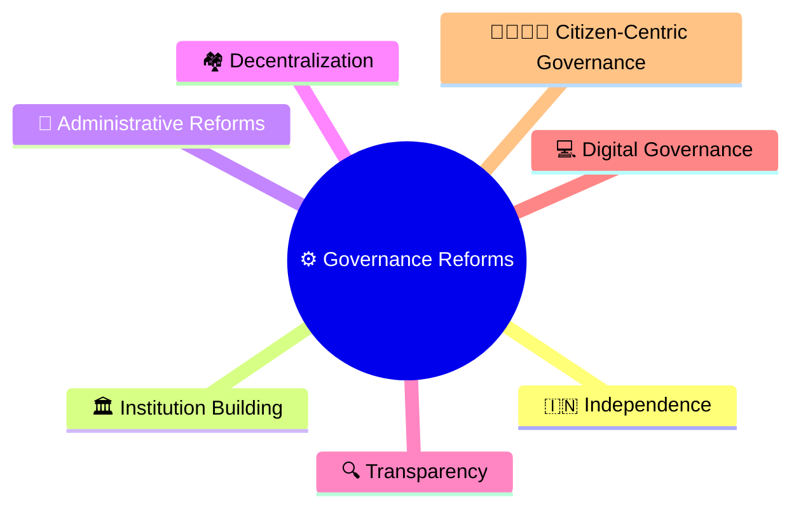
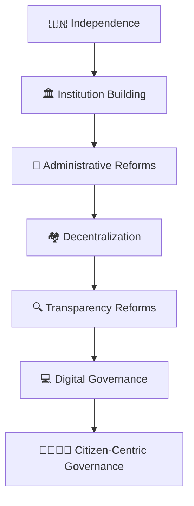
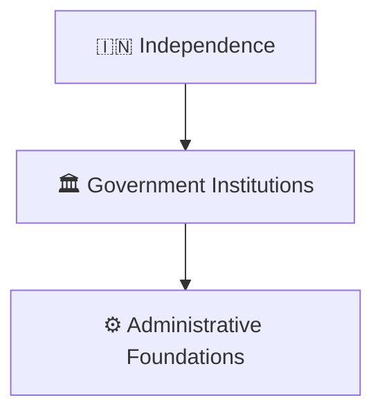
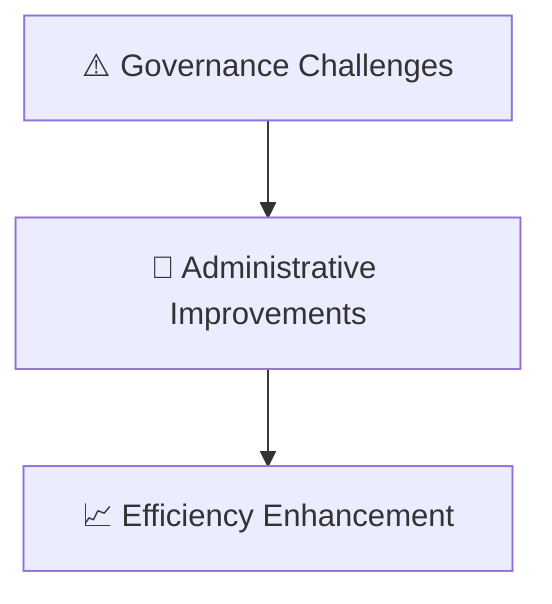
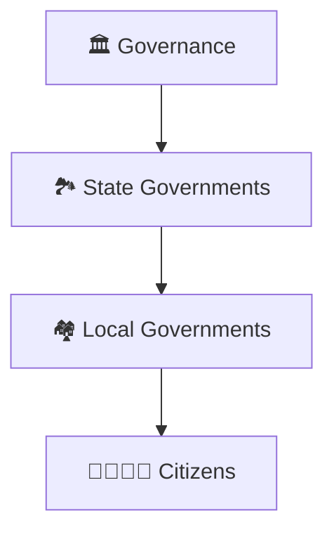
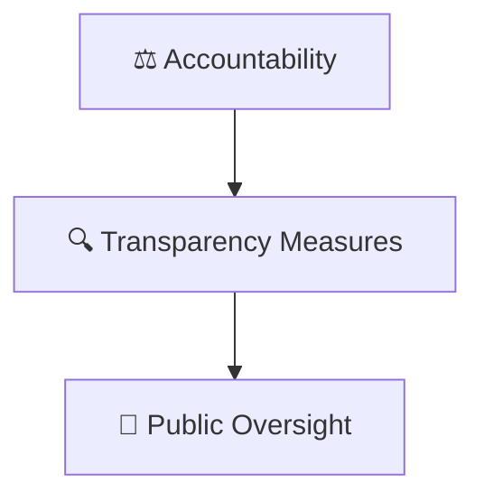
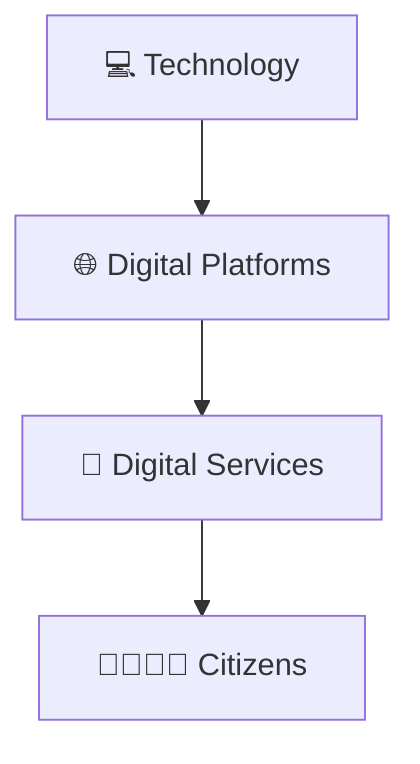
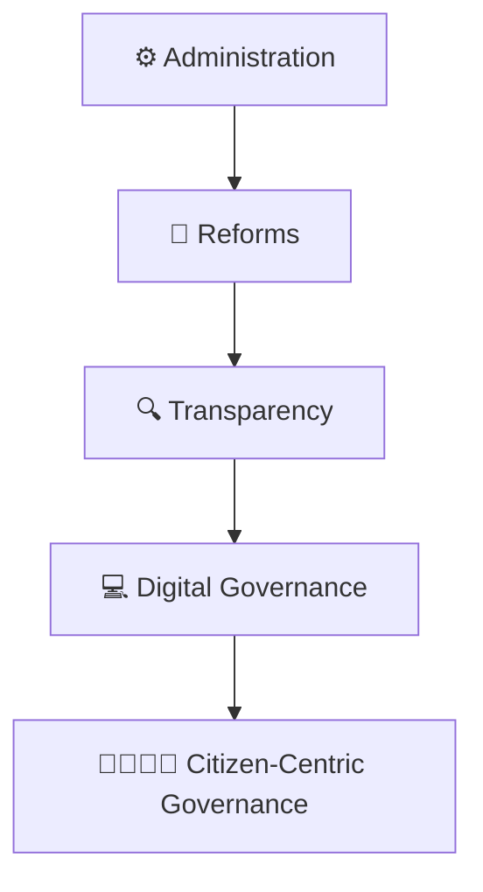

# Governance Reform Timeline

## Overview

This timeline explains the evolution of governance reforms in India from independence to contemporary India.

It provides a high-level understanding of how administrative systems, public service delivery, accountability mechanisms, decentralization, transparency initiatives, and digital governance evolved over time.

---

## Diagram Purpose

Understanding governance reforms helps explain:

- How governance became more citizen-focused
- How accountability mechanisms evolved
- How public service delivery improved
- How decentralization strengthened local governance
- How technology transformed administration

---

## Governance Reform Timeline

---

## Phase 1: Institution Building

### Significance

- Establishment of governance systems
- Administrative continuity
- Nation-building support

---

## Phase 2: Administrative Reforms

### Significance

- Better coordination
- Improved implementation
- Stronger governance capacity

---

## Phase 3: Decentralization

### Significance

- Greater local participation
- Improved responsiveness
- Stronger grassroots governance

---

## Phase 4: Transparency Reforms

### Significance

- Improved public trust
- Better accountability
- Stronger citizen participation

---

## Phase 5: Digital Governance

### Significance

- Faster service delivery
- Increased accessibility
- Administrative modernization

---

## Governance Evolution Framework

---

## Quick Revision

---

- governance-framework.md
- public-policy-lifecycle.md
- accountability-framework.md
- digital-governance-framework.md
- e-governance-workflow.md
- constitutional-development-timeline.md
