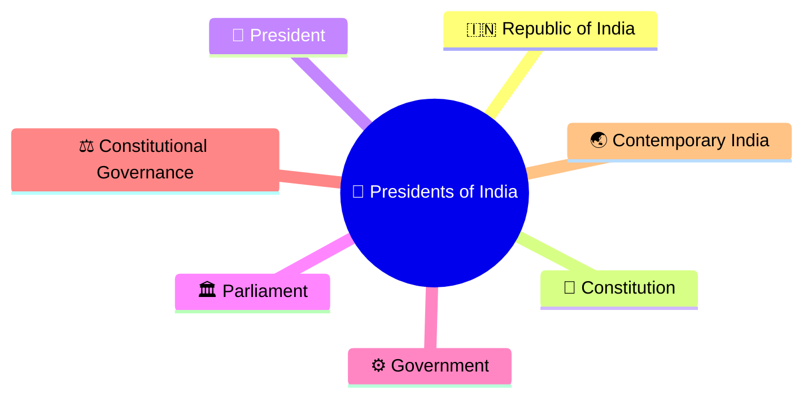
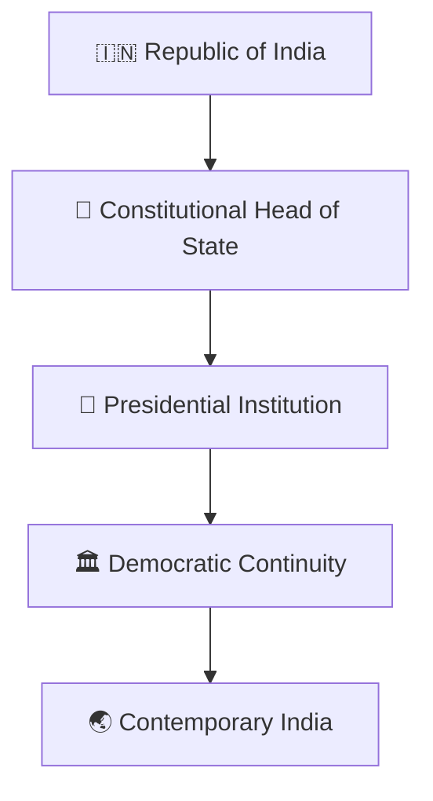
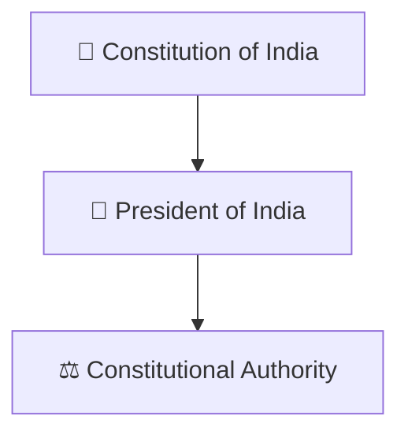
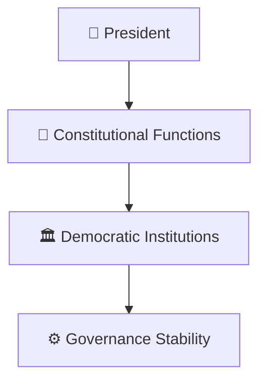
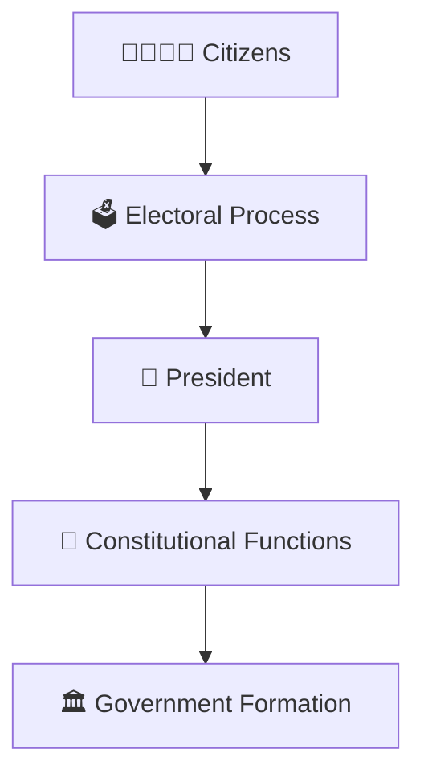
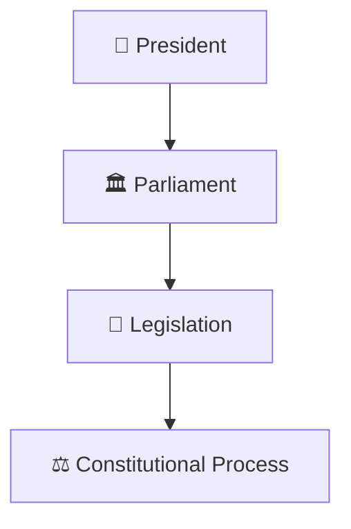
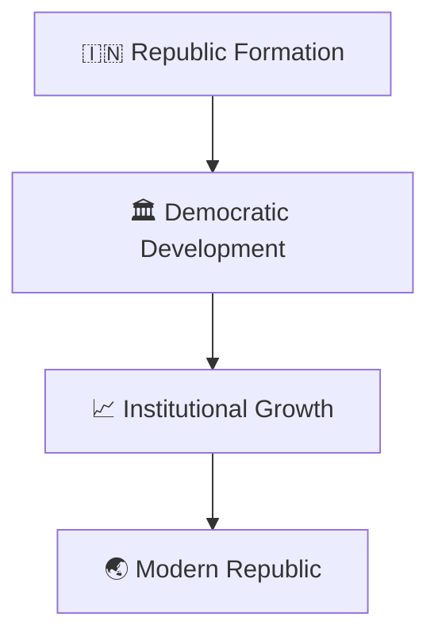
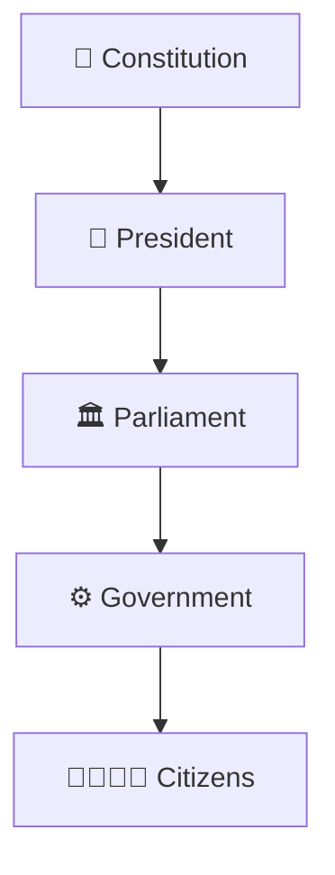

# Presidents Timeline

## Overview

This timeline explains the evolution of the office of the President of India from the establishment of the Republic to contemporary India.

It provides a high-level understanding of the constitutional role of the President and the continuity of India's democratic institutions.

---

## Diagram Purpose

Understanding the Presidents timeline helps explain:

- Evolution of the Republic of India
- Constitutional continuity
- Democratic stability
- Role of the Head of State
- Institutional development over time

---

## Presidents Timeline

---

## Constitutional Foundation

### Significance

- Head of State
- Constitutional guardian
- Symbol of national unity

---

## Institutional Continuity

### Significance

- Peaceful democratic transitions
- Constitutional governance
- Institutional continuity

---

## President and Government

### Significance

- Constitutional processes
- Democratic legitimacy
- Government continuity

---

## President and Parliament

### Significance

- Legislative procedures
- Constitutional responsibilities
- Institutional coordination

---

## Evolution of the Republic

---

## Constitutional Governance Framework

---

## Quick Revision

---

- prime-ministers-timeline.md
- constitutional-development-timeline.md
- nation-building-timeline.md
- parliament-and-law-making.md
- president-of-india.md
- constitutional-terminology.md
