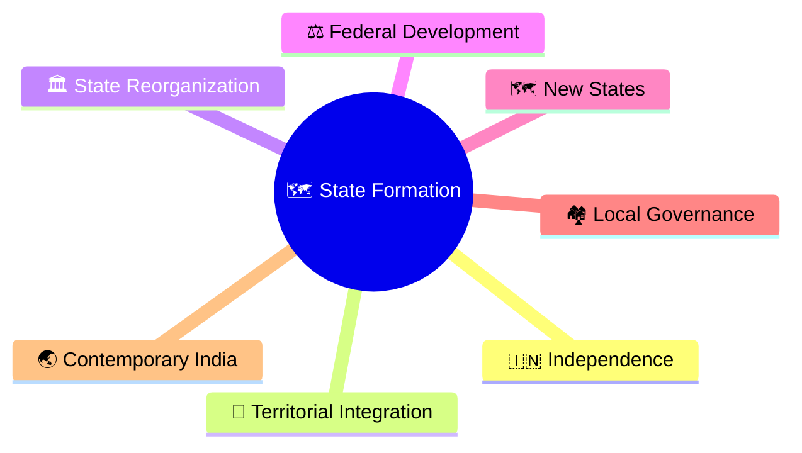
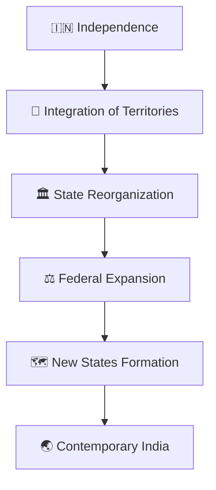
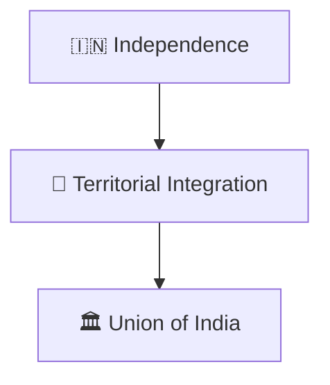
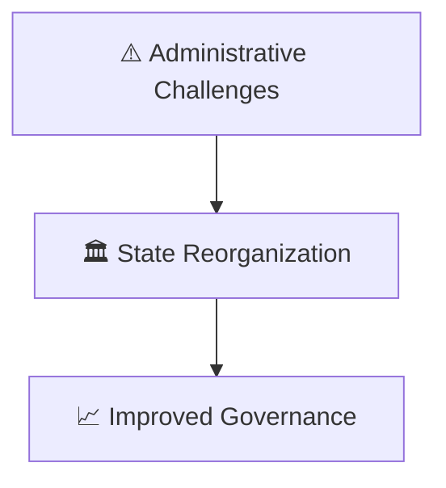
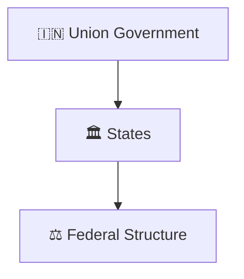
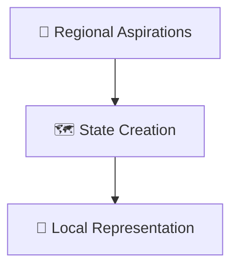
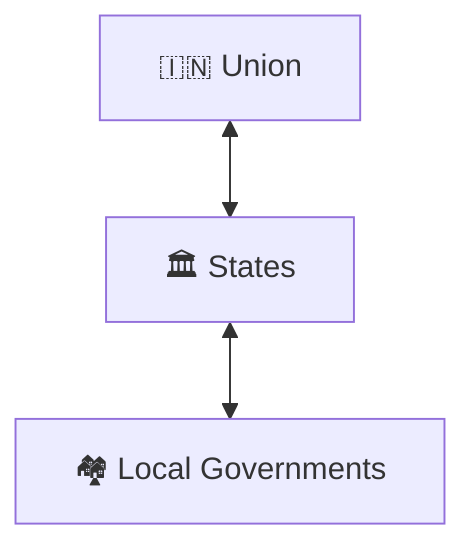
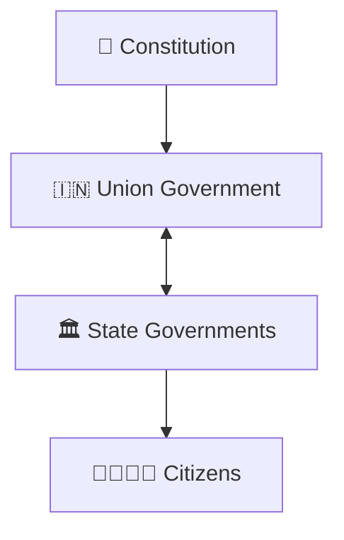

# State Formation Timeline

## Overview

This timeline explains how India's states evolved from independence to the present day.

It provides a high-level understanding of integration, reorganization, federal development, regional representation, and the evolution of India's state structure.

---

## Diagram Purpose

Understanding state formation helps explain:

- How modern India was organized
- How federalism evolved
- How states were created and reorganized
- How regional aspirations were accommodated
- How governance became closer to citizens

---

---

## State Formation Timeline

---

## Phase 1: National Integration

### Significance

- National unity
- Administrative consolidation
- Foundation of the Republic

---

## Phase 2: State Reorganization

### Significance

- Better administration
- Stronger representation
- Improved governance efficiency

---

## Phase 3: Federal Development

### Significance

- Shared governance
- Constitutional federalism
- Regional participation

---

## Phase 4: New State Formation

### Significance

- Greater local focus
- Administrative accessibility
- Regional development

---

## Phase 5: Contemporary Federal India

### Significance

- Multi-level governance
- Democratic representation
- Cooperative federalism

---

## Federal Structure Framework

---

## Quick Revision

---

- constitutional-development-timeline.md
- governance-reform-timeline.md
- centre-state-relations-framework.md
- cooperative-federalism-model.md
- election-timeline.md
- constitutional-governance-model.md
