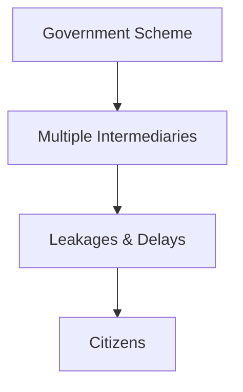
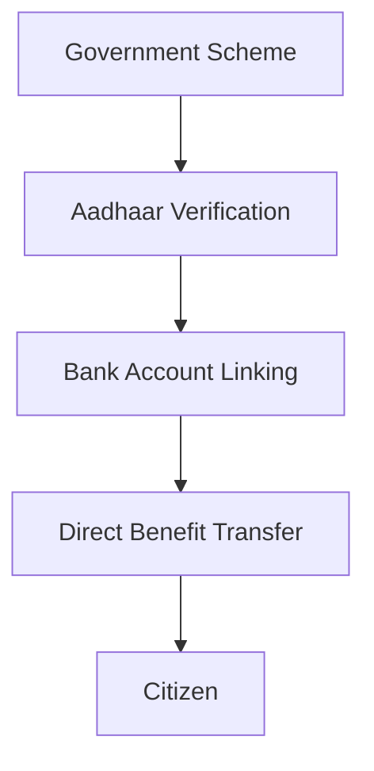
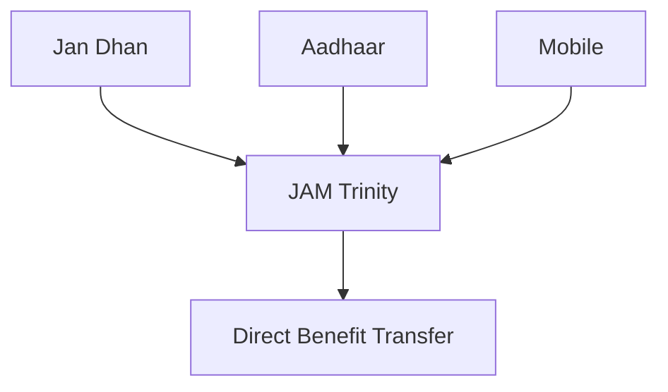
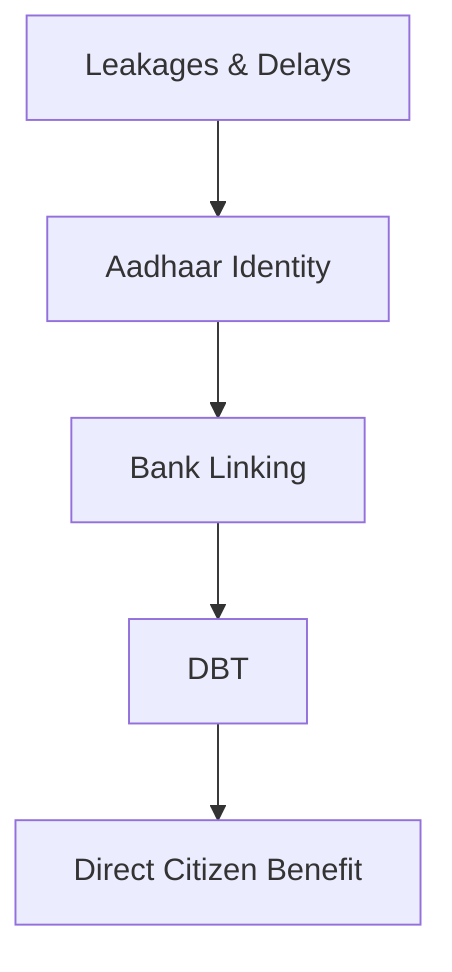

# Aadhaar and Direct Benefit Transfer (DBT)

## Why This Case Study Matters

Aadhaar and Direct Benefit Transfer (DBT) represent one of India's largest governance and public service delivery reforms. The initiative aimed to reduce leakages, eliminate duplicate beneficiaries, improve transparency, and transfer government benefits directly to citizens.

## Quick Facts

| Item              | Details                                             |
| ----------------- | --------------------------------------------------- |
| Initiative        | Aadhaar + Direct Benefit Transfer (DBT)             |
| Primary Objective | Direct transfer of benefits to beneficiaries        |
| Key Institutions  | UIDAI, Central Government, State Governments, Banks |
| Launch Period     | Aadhaar (2009), DBT expansion after 2013            |
| Coverage          | Welfare schemes, subsidies, pensions, scholarships  |
| Governance Theme  | Digital Governance                                  |

## Background

Before DBT, government benefits often passed through multiple administrative layers.

Common challenges included:

- Duplicate beneficiaries
- Fake records
- Delayed payments
- Leakages in welfare delivery
- Lack of beneficiary verification

Aadhaar introduced a unique identity layer, while DBT created a mechanism to transfer funds directly into bank accounts.

## Problem Statement

Key governance challenge:

How can benefits reach the intended citizen directly and transparently?

## Solution Framework

Core pillars:

- Digital Identity
- Financial Inclusion
- Direct Transfers
- Beneficiary Verification
- Transparency

## JAM Trinity

The reform is commonly associated with the JAM framework:

| Component | Purpose                      |
| --------- | ---------------------------- |
| Jan Dhan  | Bank Account Access          |
| Aadhaar   | Digital Identity             |
| Mobile    | Communication & Verification |

## Governance Transformation

## Benefits

### Governance Benefits

- Reduced duplication of beneficiaries
- Improved transparency
- Better auditability
- Faster fund transfers
- Improved data quality

### Citizen Benefits

- Direct receipt of benefits
- Reduced dependency on intermediaries
- Faster payments
- Greater visibility into scheme benefits

## Challenges and Criticism

### Inclusion Concerns

Potential issues include:

- Authentication failures
- Connectivity challenges
- Bank access limitations
- Errors in beneficiary databases

### Privacy Concerns

Frequently debated topics include:

- Data protection
- Privacy safeguards
- Consent mechanisms
- Information security

## Outcomes

Observed outcomes include:

- Expansion of digital governance
- Increased use of bank-linked welfare delivery
- Growth of digital public infrastructure
- Wider adoption of beneficiary verification systems

## Lessons for Governance

| Lesson                                           | Importance |
| ------------------------------------------------ | ---------- |
| Digital identity can improve service delivery    | High       |
| Technology must be supported by strong processes | High       |
| Inclusion remains critical                       | High       |
| Transparency improves trust                      | Medium     |
| Data protection is essential                     | High       |

## Key Concepts

1. What problem was Aadhaar and DBT designed to solve?
2. What is the JAM Trinity?
3. How does DBT reduce leakages?
4. What are the major criticisms of Aadhaar-linked welfare delivery?
5. What governance lessons emerged from Aadhaar and DBT?

## Quick Revision

