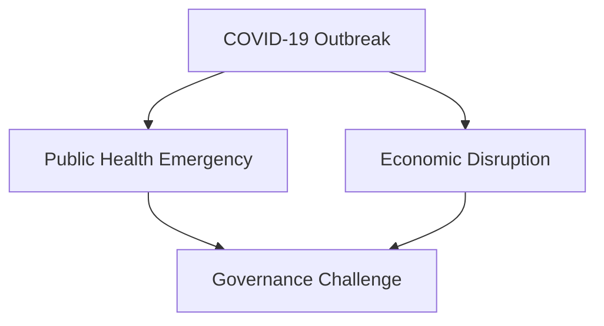
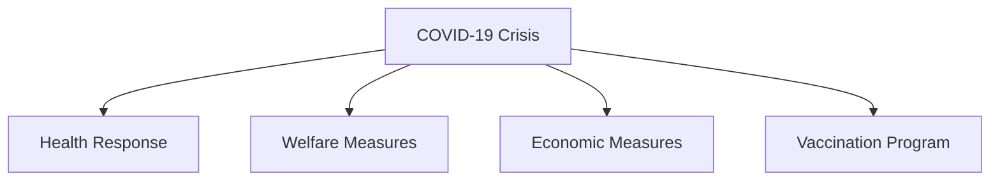
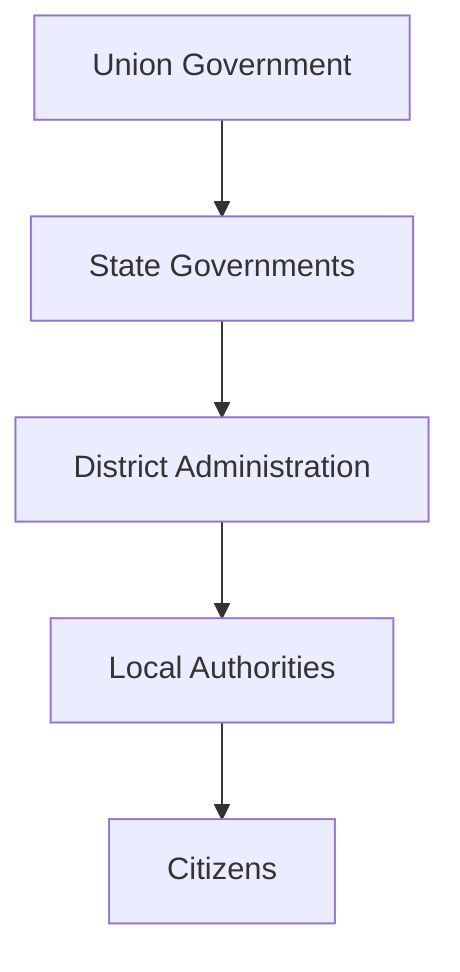
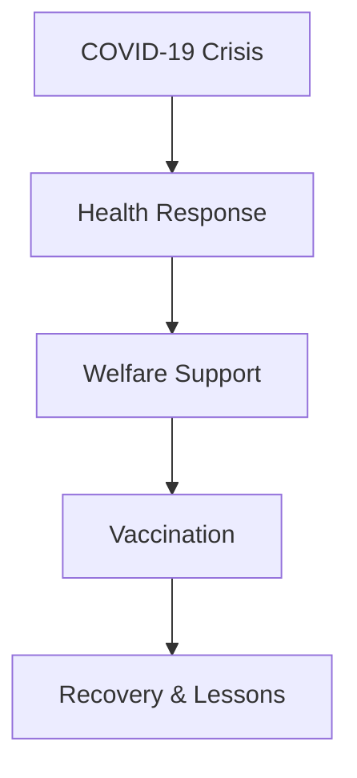

# COVID-19 Governance Response

## Why This Case Study Matters

The COVID-19 pandemic was one of the biggest governance challenges faced by independent India. It tested healthcare systems, disaster management capabilities, public administration, digital governance, economic policy, and coordination between the Union Government, State Governments, and local authorities.

## Quick Facts

| Item             | Details                                              |
| ---------------- | ---------------------------------------------------- |
| Event            | COVID-19 Pandemic Response                           |
| Period           | 2020–2022                                            |
| Governance Theme | Crisis Management                                    |
| Key Institutions | Union Government, State Governments, Health Agencies |
| Major Areas      | Healthcare, Vaccination, Welfare, Economy            |
| Scale            | Nationwide                                           |

## Background

COVID-19 emerged as a global pandemic and created unprecedented public health, economic, and social challenges.

Governments needed to simultaneously:

- Protect public health
- Expand healthcare capacity
- Manage economic disruption
- Support vulnerable populations
- Maintain essential services

## Problem Statement

## Governance Response Framework

## Multi-Level Governance Model

## Major Initiatives

### Public Health Measures

- Testing and surveillance
- Quarantine systems
- Hospital capacity expansion
- Emergency healthcare infrastructure

### Vaccination Program

- Nationwide vaccination campaign
- Digital registration systems
- Large-scale vaccine distribution
- Public awareness initiatives

### Welfare Measures

- Food support programs
- Direct benefit transfers
- Support for vulnerable groups
- Relief measures for affected populations

## Digital Governance Role

## Outcomes

Key outcomes included:

- Expansion of healthcare infrastructure
- Large-scale vaccination coverage
- Growth of digital public services
- Improved crisis-management experience
- Greater focus on health preparedness

## Challenges and Criticism

### Healthcare Challenges

- Capacity constraints
- Resource shortages during peak periods
- Regional disparities

### Governance Challenges

- Coordination complexity
- Economic disruption
- Migrant worker challenges
- Information management challenges

## Lessons for Governance

| Lesson                                 | Importance |
| -------------------------------------- | ---------- |
| Preparedness is critical               | High       |
| Healthcare investment matters          | High       |
| Digital governance improves scale      | High       |
| Centre-State coordination is essential | High       |
| Crisis communication matters           | High       |

## Key Concepts

1. Why was COVID-19 considered a major governance challenge?
2. What role did Centre-State coordination play during the pandemic?
3. How did digital governance support pandemic management?
4. What were the major welfare interventions during COVID-19?
5. What governance lessons emerged from the pandemic?

## Quick Revision

