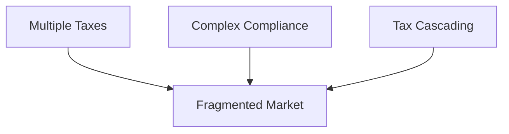
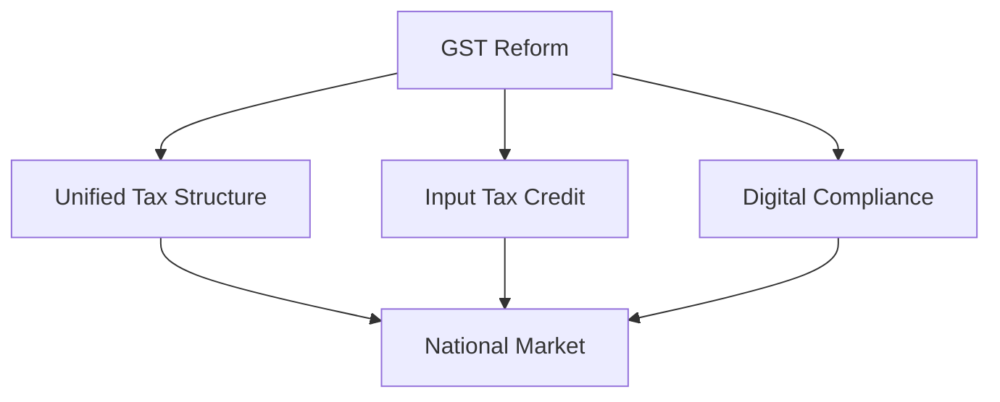
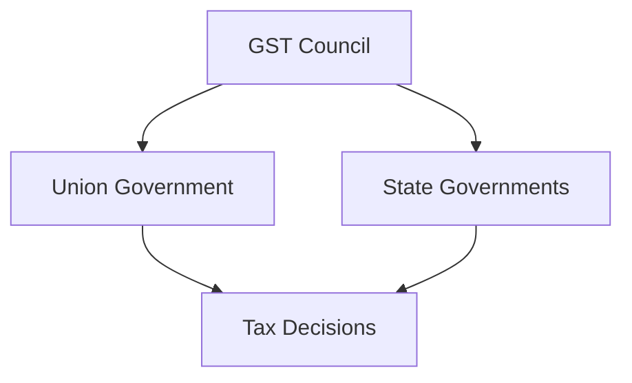
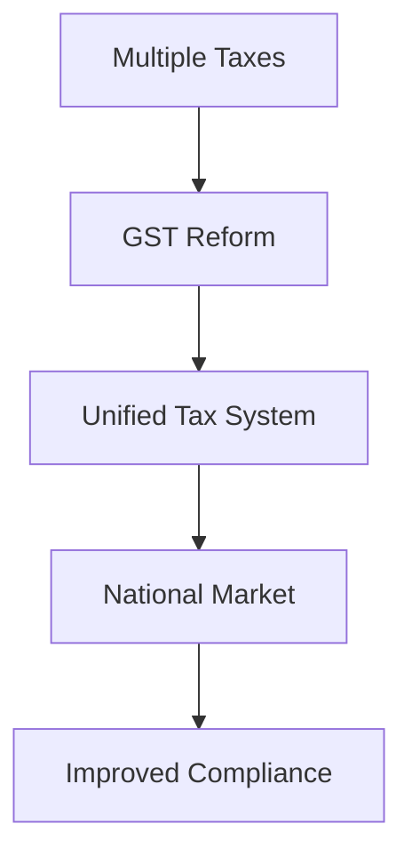

# GST Implementation

## Why This Case Study Matters

The Goods and Services Tax (GST) is one of the most significant tax reforms in independent India. It replaced multiple indirect taxes with a unified tax framework and aimed to create a common national market while simplifying taxation.

## Quick Facts

| Item             | Details                                            |
| ---------------- | -------------------------------------------------- |
| Reform           | Goods and Services Tax (GST)                       |
| Launch           | 1 July 2017                                        |
| Governance Theme | Tax Reform                                         |
| Key Objective    | One Nation, One Tax                                |
| Key Institutions | Parliament, GST Council, Union & State Governments |
| Coverage         | Indirect Taxation                                  |

## Background

Before GST, India had a complex indirect tax structure.

Major challenges included:

- Multiple taxes
- Cascading tax effects
- Complex compliance requirements
- State-level tax barriers
- Higher logistics costs

Businesses often had to comply with different tax systems across states.

## Problem Statement

## GST Solution Framework

## GST Council Framework

## Major Objectives

- Simplify indirect taxation
- Reduce tax cascading
- Improve compliance
- Create a common market
- Increase transparency

## Governance Transformation

## Outcomes

Major outcomes included:

- Unified indirect tax system
- Expansion of digital tax administration
- Improved tax transparency
- Better interstate trade integration
- Increased formalization in parts of the economy

## Challenges and Criticism

### Supporters Highlight

- Simplified tax structure
- Greater transparency
- National market integration
- Technology-driven compliance

### Critics Highlight

- Initial compliance burden
- Technical challenges during rollout
- Complexity of multiple tax slabs
- Impact on small businesses during transition

## Lessons for Governance

| Lesson                                          | Importance |
| ----------------------------------------------- | ---------- |
| Cooperative federalism can enable major reforms | High       |
| Technology improves administration              | High       |
| Large reforms require transition planning       | High       |
| Stakeholder coordination is essential           | High       |
| Tax simplification improves efficiency          | High       |

## Key Concepts

1. Why was GST introduced?
2. What problems existed before GST?
3. What is the role of the GST Council?
4. How does GST reduce tax cascading?
5. What challenges emerged during implementation?

## Quick Revision

