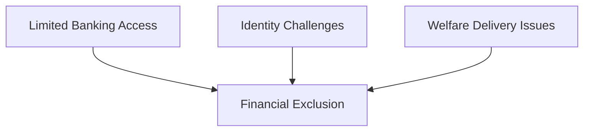
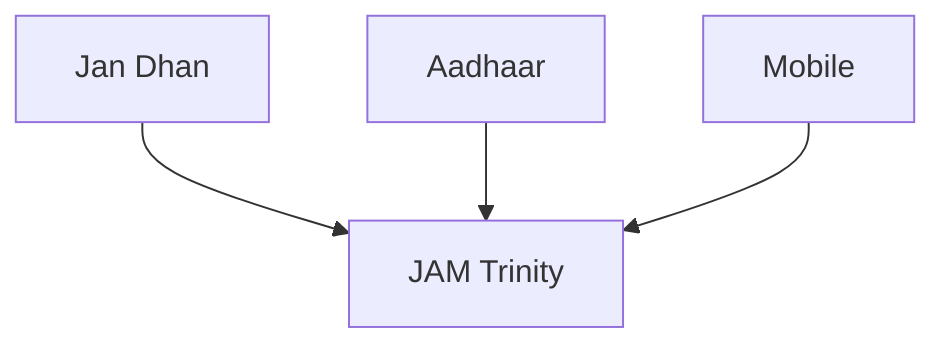
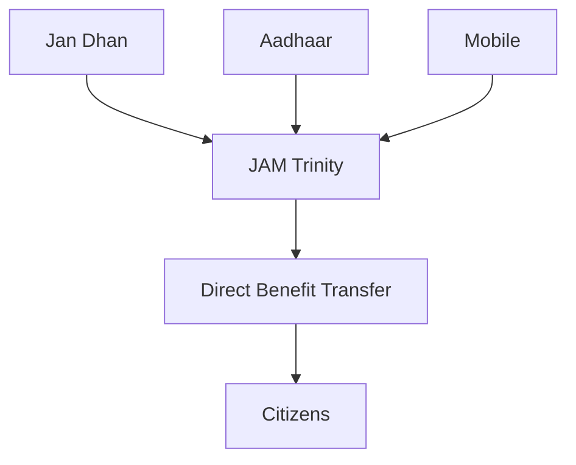
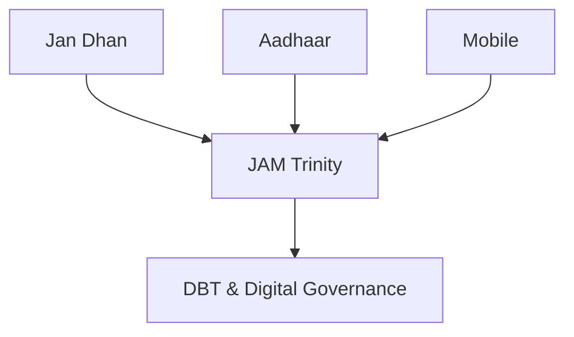

# JAM Trinity

## Why This Case Study Matters

The JAM Trinity (Jan Dhan, Aadhaar, Mobile) is one of India's most important digital governance initiatives. It created the foundation for large-scale financial inclusion, direct benefit transfers, digital public services, and modern welfare delivery.

## Quick Facts

| Item             | Details                                            |
| ---------------- | -------------------------------------------------- |
| Initiative       | JAM Trinity                                        |
| Components       | Jan Dhan, Aadhaar, Mobile                          |
| Governance Theme | Digital Governance                                 |
| Objective        | Financial Inclusion and Service Delivery           |
| Key Institutions | Government, Banks, UIDAI, Telecom Networks         |
| Impact Area      | Welfare Delivery and Digital Public Infrastructure |

## Background

Before JAM, many citizens faced challenges in accessing government services and financial systems.

Major challenges included:

- Limited banking access
- Identity verification issues
- Welfare delivery leakages
- Communication barriers
- Delayed benefit transfers

A unified digital governance framework was needed.

## Problem Statement

## JAM Framework

## Component Breakdown

### Jan Dhan

- Bank account access
- Financial inclusion
- Direct benefit receipt

### Aadhaar

- Digital identity
- Beneficiary verification
- Authentication support

### Mobile

- Communication channel
- Service notifications
- Digital access platform

## Governance Transformation

## Major Outcomes

- Expanded banking access
- Improved beneficiary verification
- Faster welfare delivery
- Support for DBT systems
- Foundation for digital public infrastructure

## Relationship with DBT

## Challenges and Criticism

### Governance Challenges

- Digital divide concerns
- Connectivity limitations
- Banking access disparities
- Data quality issues

### Policy Concerns

- Privacy debates
- Data protection concerns
- Inclusion challenges
- Authentication failures

## Lessons for Governance

| Lesson                                        | Importance |
| --------------------------------------------- | ---------- |
| Digital infrastructure can improve governance | High       |
| Inclusion must remain a priority              | High       |
| Technology requires strong implementation     | High       |
| Financial inclusion supports development      | High       |
| Digital identity enables service delivery     | High       |

## Key Concepts

1. What is the JAM Trinity?
2. Why was the JAM framework created?
3. How does JAM support DBT?
4. What governance benefits emerged from JAM?
5. What challenges are associated with digital governance systems?

## Quick Revision

