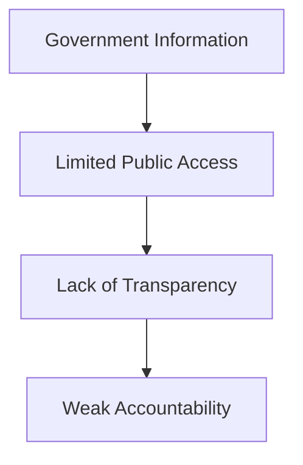
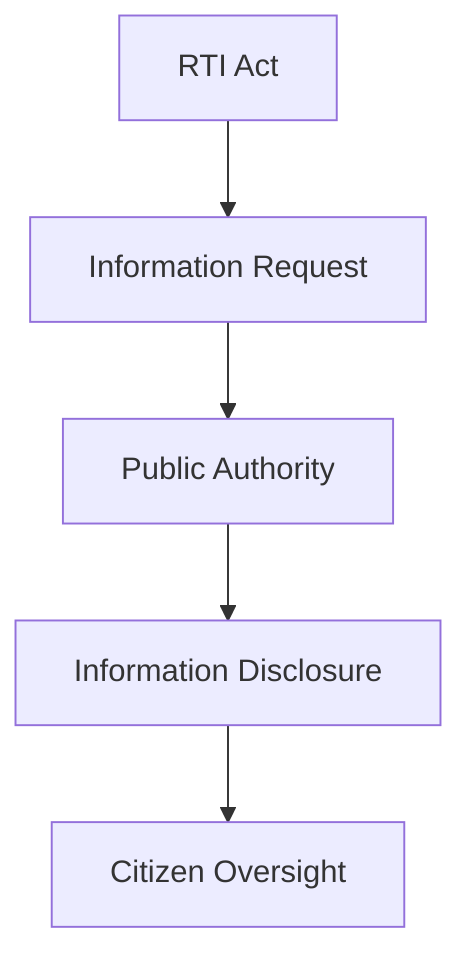
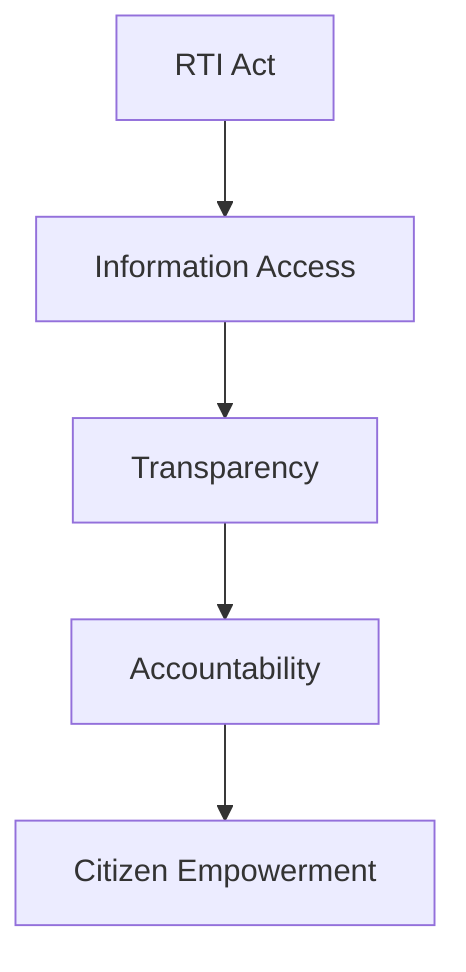

# Right to Information (RTI) Act Impact

## Why This Case Study Matters

The Right to Information (RTI) Act, 2005 is one of India's most important transparency and accountability reforms. It empowered citizens to seek information from public authorities and strengthened democratic oversight of government institutions.

## Quick Facts

| Item             | Details                                           |
| ---------------- | ------------------------------------------------- |
| Law              | Right to Information Act                          |
| Year             | 2005                                              |
| Governance Theme | Transparency & Accountability                     |
| Objective        | Citizen Access to Government Information          |
| Coverage         | Public Authorities                                |
| Impact Area      | Governance, Accountability, Citizen Participation |

## Background

Before RTI, obtaining government information was often difficult for ordinary citizens.

Major challenges included:

- Limited transparency
- Information asymmetry
- Weak public oversight
- Administrative secrecy
- Difficulty tracking public decisions

Citizens needed a legal mechanism to access official information.

## Problem Statement

## RTI Solution Framework

## How RTI Works

## Governance Benefits

### Transparency

- Increased public access to information
- Greater visibility of government actions
- Improved institutional openness

### Accountability

- Stronger public oversight
- Better monitoring of public expenditure
- Enhanced administrative responsibility

### Citizen Empowerment

- Increased participation in governance
- Better awareness of rights and services
- Improved engagement with institutions

## Governance Transformation

## Outcomes

Major outcomes included:

- Expansion of transparency practices
- Greater citizen engagement
- Increased scrutiny of public institutions
- Improved public awareness of governance processes
- Strengthening of democratic accountability mechanisms

## Challenges and Criticism

### Operational Challenges

- Delays in responses
- Administrative workload
- Backlog of cases
- Capacity constraints

### Policy Debates

- Balance between transparency and confidentiality
- Information management challenges
- Institutional capacity concerns

## Lessons for Governance

| Lesson                                                 | Importance |
| ------------------------------------------------------ | ---------- |
| Transparency improves trust                            | High       |
| Citizens play a vital accountability role              | High       |
| Access to information strengthens democracy            | High       |
| Institutions require effective implementation capacity | High       |
| Accountability mechanisms improve governance quality   | High       |

## Key Concepts

1. Why was the RTI Act introduced?
2. How does RTI improve accountability?
3. What governance benefits emerged from RTI?
4. What challenges exist in RTI implementation?
5. Why is transparency important in a democracy?

## Quick Revision

