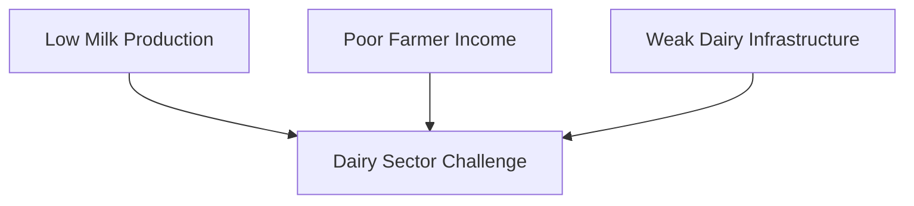
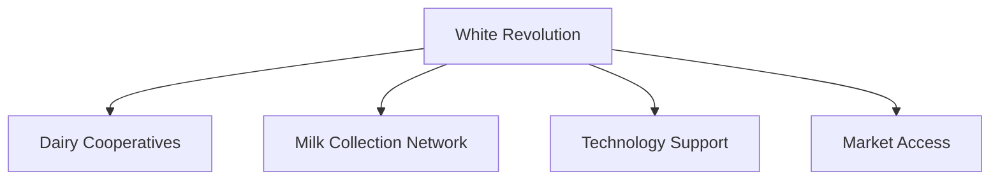
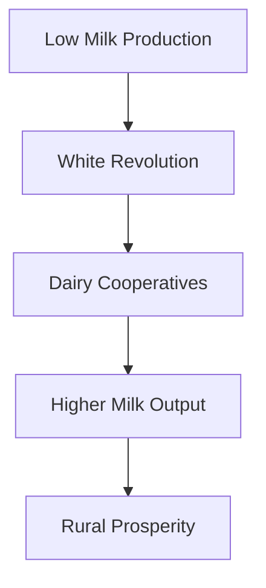

# White Revolution

## Why This Case Study Matters

The White Revolution transformed India from a milk-deficient country into one of the world's largest milk producers. It is a major governance and rural development success story that demonstrates how cooperatives, technology, institutions, and citizen participation can create large-scale economic and social change.

## Quick Facts

| Item             | Details                                 |
| ---------------- | --------------------------------------- |
| Initiative       | White Revolution                        |
| Major Program    | Operation Flood                         |
| Governance Theme | Rural Development                       |
| Objective        | Increase Milk Production                |
| Key Institution  | National Dairy Development Board (NDDB) |
| Impact Area      | Dairy Sector and Rural Economy          |

## Background

Before the White Revolution, India's dairy sector faced multiple challenges.

Major concerns included:

- Low milk production
- Poor rural incomes
- Limited dairy infrastructure
- Weak market access
- Supply shortages in urban areas

Improving dairy productivity became an important national development objective.

## Problem Statement

## Solution Framework

## Cooperative Model

## Key Components

### Dairy Cooperatives

- Farmer participation
- Collective bargaining power
- Better market access
- Local ownership model

### Infrastructure Development

- Milk collection centers
- Cold-chain facilities
- Transportation networks
- Processing plants

### Technology and Support

- Veterinary services
- Breed improvement
- Feed management
- Productivity enhancement

## Governance Transformation

## Outcomes

Major outcomes included:

- Significant growth in milk production
- Expansion of dairy cooperatives
- Increased farmer incomes
- Strengthening of rural economies
- Improved food and nutrition availability

## Challenges and Criticism

### Positive Outcomes

- Rural employment generation
- Strong cooperative ecosystem
- Increased dairy productivity
- Greater market access

### Concerns

- Regional disparities
- Cooperative management issues in some areas
- Infrastructure gaps
- Sustainability challenges

## Lessons for Governance

| Lesson                                     | Importance |
| ------------------------------------------ | ---------- |
| Cooperatives can drive development         | High       |
| Institutions matter for long-term success  | High       |
| Rural development requires market access   | High       |
| Technology improves productivity           | High       |
| Citizen participation strengthens outcomes | High       |

## Key Concepts

1. What was the objective of the White Revolution?
2. What was Operation Flood?
3. How did dairy cooperatives contribute to success?
4. What were the major outcomes of the White Revolution?
5. What governance lessons emerged from this initiative?

## Quick Revision

