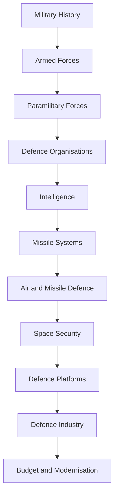
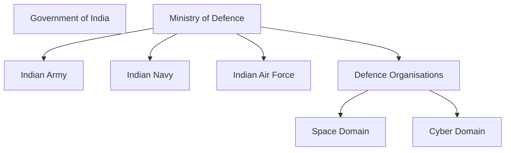

# Defence and National Security

## Why It Matters

Defence and national security are essential for protecting India's sovereignty, territorial integrity, citizens, strategic interests and global influence.

India maintains one of the world's largest military establishments and operates across multiple domains including land, sea, air, space, cyber and strategic deterrence.

This section provides a structured understanding of India's defence ecosystem, military history, organizations, capabilities and modernization efforts.

---

## Quick Facts

| Item | Details |
|----------|----------|
| Domain | Defence and National Security |
| Coverage | Military, Strategic, Space, Cyber and Security Affairs |
| Primary Ministry | Ministry of Defence |
| Importance | National Security and Strategic Stability |
| Learning Focus | Forces, Organisations, Capabilities and Reforms |

---

## Repository Structure

```text
18-defence-and-national-security/
├── README.md
├── military-history/
├── armed-forces/
├── paramilitary-forces/
├── defence-organisations-and-agencies/
├── intelligence/
├── missile-systems/
├── air-and-missile-defence/
├── space-security/
├── defence-platforms/
├── defence-industry/
└── defence-budget-and-modernisation/
```

---

## Learning Roadmap



---

## Major Sections

### Military History

Covers:

- Ancient military history
- Medieval military history
- Modern military history
- Wars and operations
- Strategic lessons

### Armed Forces

Covers:

- Indian Army
- Indian Navy
- Indian Air Force

### Paramilitary Forces

Covers:

- Border-security forces
- Internal-security forces
- Counter-terrorism organizations
- Maritime-security forces

### Defence Organisations and Agencies

Covers:

- Ministry of Defence
- CDS and DMA
- Integrated Defence Staff
- DRDO
- Defence Space Agency
- Defence Cyber Agency

### Intelligence

Covers:

- Intelligence agencies
- Intelligence coordination
- Strategic intelligence
- National security planning
- Future intelligence domains

### Missile Systems

Covers:

- Ballistic missiles
- Cruise missiles
- Strategic deterrence
- Sea-based deterrence
- Hypersonic programmes

### Air and Missile Defence

Covers:

- Air-defence systems
- Ballistic missile defence
- Layered defence concepts
- Integrated air defence
- Strategic protection systems

### Space Security

Covers:

- Military satellites
- NavIC and military navigation
- Space situational awareness
- Defence Space Agency
- Anti-satellite capability

### Defence Platforms

*Covers content related to defence platforms* 

### Defence Industry

Covers:

- Defence manufacturing ecosystem
- DPSUs
- DRDO
- Indigenous defence production
- Defence industrial development

### Defence Budget and Modernisation

Covers:

- Defence spending
- Procurement systems
- Defence industry
- Atmanirbhar Bharat initiatives

---

## Defence Architecture



---

## Current Progress

| Section | Status |
|----------|----------|
| Military History | Completed |
| Armed Forces | Completed |
| Paramilitary Forces | Completed |
| Defence Organisations and Agencies | Completed |
| Intelligence | In Progress |
| Missile Systems | Completed |
| Air and Missile Defence | Completed |
| Space Security | Completed |
| Defence Platforms | Completed |
| Defence Industry | Completed |
| Defence Budget and Modernisation | Completed |

---

## Quick Revision

- India's defence structure is built around the Army, Navy and Air Force.
- Paramilitary forces support border and internal security.
- CDS, DMA and IDS improve military integration.
- Intelligence supports national-security decision-making.
- Missile systems provide strategic deterrence.
- Air and missile defence protects critical assets.
- Space security supports communications, navigation and surveillance.
- DRDO and defence industry support indigenous capability.

---

## Key Concepts

### Why is defence important?

It protects sovereignty, territorial integrity and national interests.

### What are the major components of India's defence system?

Armed Forces, defence organisations, strategic capabilities and security forces.

### What is military jointness?

The ability of the Army, Navy and Air Force to operate together effectively.

### Why is modernization important?

To address evolving threats and future warfare requirements.

### Which organisation develops defence technologies?

DRDO.