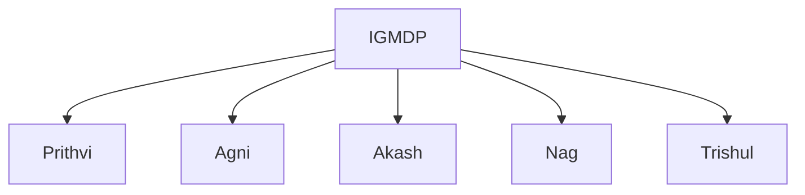
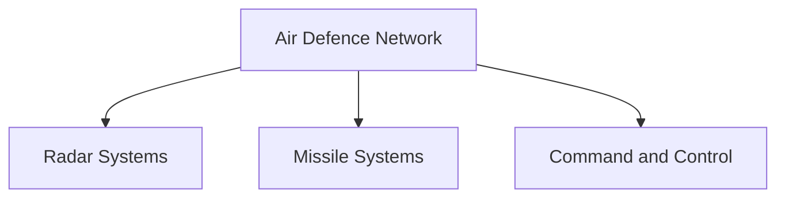

# Akash Missile System

## Why It Matters

The Akash Missile System is one of India's most important indigenous air-defence systems.

It provides protection against hostile aircraft, helicopters, drones and other aerial threats, helping strengthen India's layered air-defence architecture.

Akash demonstrates India's growing capability to design and produce advanced defence systems domestically.

---

## Quick Facts

| Item | Details |
|----------|----------|
| Name | Akash |
| Type | Surface-to-Air Missile (SAM) |
| Developed By | DRDO |
| Programme | IGMDP |
| Primary Role | Air Defence |
| Users | Indian Army and Indian Air Force |
| Importance | Indigenous Air-Defence System |

---

## What Is Akash?

Akash is an indigenous surface-to-air missile system designed to detect, track and engage aerial threats before they can reach their targets.

It forms an important part of India's integrated air-defence network.

---

## Development Journey

Akash was developed under the Integrated Guided Missile Development Programme (IGMDP).

---

## Why Akash Is Important

- Protects against aerial threats
- Strengthens air-defence capability
- Supports battlefield protection
- Enhances defence self-reliance
- Supports strategic infrastructure security
- Contributes to layered air defence

---

## How Air Defence Works

---

## Major Components

### Radar Systems

Responsible for:

- Detection
- Tracking
- Target identification

### Command and Control

Responsible for:

- Threat assessment
- Engagement decisions
- Battle management

### Missile Launchers

Responsible for:

- Missile deployment
- Target engagement
- Air-defence operations

---

## Akash Variants

### Akash

The original operational version.

### Akash-1S

Features:

- Improved seeker technology
- Better target engagement capability
- Enhanced operational performance

### Akash-NG

Features:

- Modern guidance systems
- Improved mobility
- Better interception capability
- Enhanced air-defence effectiveness

---

## Role in the Indian Army

The Army uses Akash for:

- Battlefield air defence
- Protection of military formations
- Defence of strategic assets
- Mobile force protection

---

## Role in the Indian Air Force

The Air Force uses Akash for:

- Air-base protection
- Strategic infrastructure security
- Airspace defence
- National air-defence missions

---

## Layered Air Defence

Akash operates as part of a larger layered air-defence architecture.

---

## Threats Countered

- Fighter aircraft
- Helicopters
- Drones and UAVs
- Cruise missile-type threats
- Low-altitude aerial targets

---

## Strategic Importance

Akash helps India:

- Improve national air defence
- Protect critical infrastructure
- Strengthen military preparedness
- Enhance indigenous defence capability
- Support strategic deterrence

---

## Challenges

- Evolving aerial threats
- Stealth technologies
- Electronic warfare environments
- Drone swarms
- Continuous modernization requirements

---

## Future Roadmap

- Expansion of Akash-NG capability
- Advanced radar integration
- Improved interception technologies
- Network-centric warfare integration
- Enhanced air-defence architecture

---

## Quick Revision

- Akash is an indigenous surface-to-air missile system.
- It was developed under the IGMDP.
- It is used by the Indian Army and Indian Air Force.
- Akash protects against aerial threats.
- Akash-NG is the next-generation version.
- It forms part of India's layered air-defence network.

---

## Key Concepts

### What is Akash?

An indigenous surface-to-air missile system.

### Why is Akash important?

It strengthens India's air-defence capability.

### Which services operate Akash?

The Indian Army and Indian Air Force.

### What is Akash-NG?

The next-generation version of the Akash missile system.

### What is the primary role of Akash?

To defend against aerial threats and protect strategic assets.