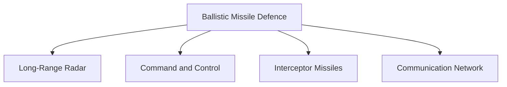
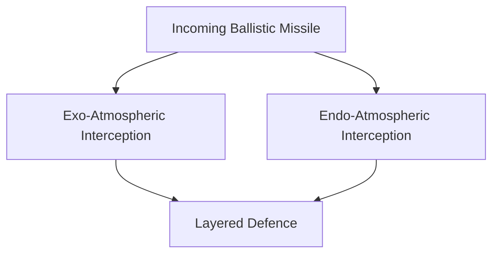
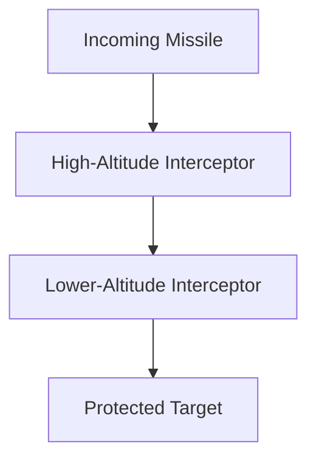

# Ballistic Missile Defence (BMD)

## Why It Matters

Ballistic Missile Defence (BMD) is designed to detect, track and intercept incoming ballistic missiles before they can reach their targets.

As missile technology becomes more advanced, missile-defence systems are increasingly important for protecting cities, military installations, strategic infrastructure and national command structures.

For India, BMD strengthens national security by adding a defensive layer against missile attacks.

---

## Quick Facts

| Item | Details |
|----------|----------|
| Name | Ballistic Missile Defence (BMD) |
| Type | Missile Defence System |
| Developed By | DRDO |
| Primary Role | Intercept Incoming Ballistic Missiles |
| Strategic Importance | National Missile Defence |
| Domain | Air and Missile Defence |

---

## What Is Ballistic Missile Defence?

Ballistic Missile Defence refers to systems designed to detect, track and destroy hostile ballistic missiles during different phases of flight.

Unlike offensive missile systems, BMD focuses on defence and protection.

---

## Why BMD Is Important

- Protects strategic assets
- Strengthens national security
- Enhances deterrence credibility
- Reduces vulnerability to missile attacks
- Supports strategic stability
- Improves defensive capability

---

## Missile Defence Concept

---

## Components of a BMD System

---

## How Ballistic Missiles Fly

BMD systems attempt to intercept hostile missiles before they reach their targets.

---

## Indian BMD Programme

India has developed a multi-layered missile-defence architecture designed to provide protection against ballistic missile threats.

The programme focuses on:

- Early detection
- Long-range tracking
- Target discrimination
- Missile interception
- Network-centric defence

---

## Defence Layers

India's BMD architecture follows a layered-interception approach.

This approach provides multiple opportunities to intercept a hostile missile.

---

## Interceptor Missiles

### Prithvi Air Defence (PAD)

Designed for:

- High-altitude interception
- Strategic missile defence
- Early interception capability

### Advanced Air Defence (AAD)

Designed for:

- Lower-altitude interception
- Terminal-phase engagement
- Layered defence capability

---

## Layered Defence Concept

Layered defence increases the probability of successfully intercepting hostile missiles.

---

## Relationship with Strategic Deterrence

BMD complements deterrence by:

- Improving survivability
- Protecting strategic assets
- Strengthening defence posture
- Supporting national resilience

BMD does not replace deterrence but adds an additional defensive layer.

---

## Challenges

- High-speed missile threats
- Multiple target attacks
- Decoys and countermeasures
- Hypersonic weapons
- Technological complexity
- High development costs

---

## Future Roadmap

- Advanced interceptor technologies
- Improved radar networks
- Enhanced tracking capability
- Better command-and-control systems
- Integration with future defence networks
- Greater protection against emerging missile threats

---

## Strategic Importance for India

BMD helps India:

- Protect critical infrastructure
- Protect national command and control assets
- Defend strategic locations
- Strengthen national security
- Improve missile-defence capability
- Enhance strategic stability

---

## Quick Revision

- BMD protects against incoming ballistic missiles.
- It relies on detection, tracking and interception.
- India is developing a layered missile-defence system.
- BMD uses exo-atmospheric and endo-atmospheric interception layers.
- PAD and AAD are key interceptor components.
- BMD strengthens defensive capability.
- It complements India's deterrence strategy.

---

## Key Concepts

### What is Ballistic Missile Defence?

A system designed to detect and intercept incoming ballistic missiles.

### Why is BMD important?

It protects strategic assets and strengthens national security.

### What are PAD and AAD?

Interceptor systems used within India's missile-defence architecture.

### What is layered defence?

Using multiple interception opportunities to improve defence effectiveness.

### Does BMD replace deterrence?

No. It complements deterrence by providing an additional defensive layer.