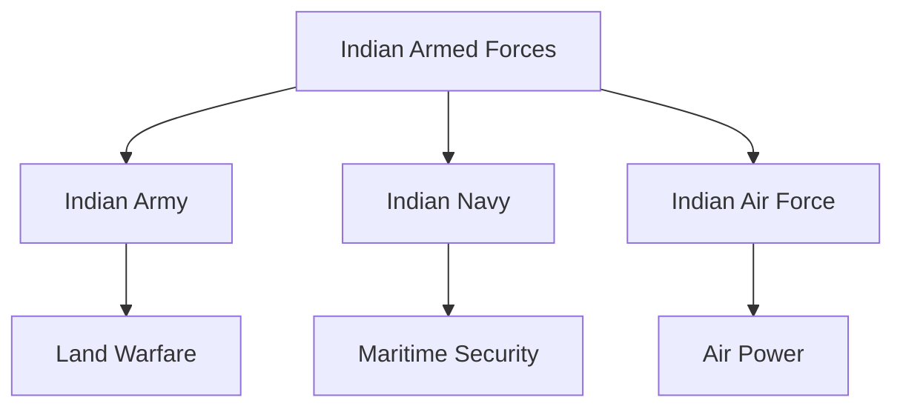

# Armed Forces

## Why It Matters

The Armed Forces are responsible for defending India's sovereignty, territorial integrity, maritime interests, airspace, and national security.

India maintains one of the world's largest military establishments, consisting of the Indian Army, Indian Navy, and Indian Air Force, supported by integrated command structures and joint military organizations.

Understanding the Armed Forces is essential for learning military organization, command structures, force modernization, joint operations, and national defence.

---

## Learning Objectives

After completing this section, you should understand:

- Structure of the Indian Armed Forces
- Roles of the Army, Navy, and Air Force
- Military rank structures
- Command and control mechanisms
- Integrated theatre commands
- Military training institutions

---

## Repository Structure

```text
armed-forces
├── README.md
├── indian-army.md
├── indian-navy.md
├── indian-air-force.md
├── command-and-control-structure.md
├── integrated-theatre-commands.md
├── military-training-academies.md
├── army-rank-structure.md
├── navy-rank-structure.md
└── air-force-rank-structure.md
```

---

## Armed Forces Overview



---

## Learning Path


---

## Topic Overview

### Indian Army

Responsible for land warfare, border defence, counter-insurgency operations, and territorial security.

### Indian Navy

Protects maritime interests, sea lines of communication, and India's maritime domain.

### Indian Air Force

Provides air power, air defence, strategic reach, and support to joint military operations.

### Command and Control Structure

Explains military leadership, command hierarchy, and operational decision-making.

### Integrated Theatre Commands

Covers ongoing military reforms aimed at improving jointness and operational effectiveness.

### Military Training Academies

Introduces institutions responsible for officer training and military leadership development.

---

## Key Concepts

- Joint Operations
- Integrated Commands
- Theatre Commands
- Force Modernization
- Strategic Deterrence
- Military Readiness
- National Security

---

## Quick Revision

- India has three military services: Army, Navy, and Air Force.
- The President is the Supreme Commander of the Armed Forces.
- CDS supports military integration and jointness.
- Theatre command reforms aim to improve operational effectiveness.
- Joint operations are increasingly important in modern warfare.

---

## Key Concepts

### Easy

1. What are the three branches of the Indian Armed Forces?
2. Who is the Supreme Commander of the Armed Forces?
3. What is the role of the Indian Navy?
4. What is a theatre command?

### Intermediate

1. Explain the command structure of the Armed Forces.
2. Why are integrated theatre commands important?
3. How do the three services support each other?
4. What is the role of military training academies?

### Advanced

1. Analyse the importance of jointness in modern warfare.
2. Evaluate India's military modernization efforts.
3. Discuss the challenges of integrated theatre command implementation.