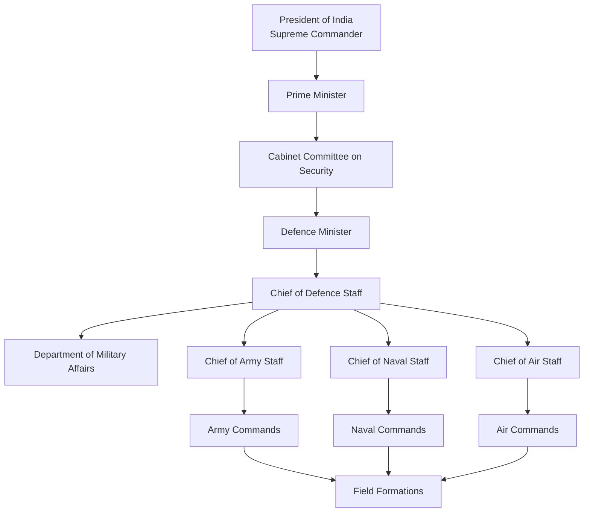
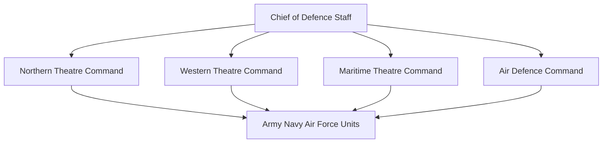
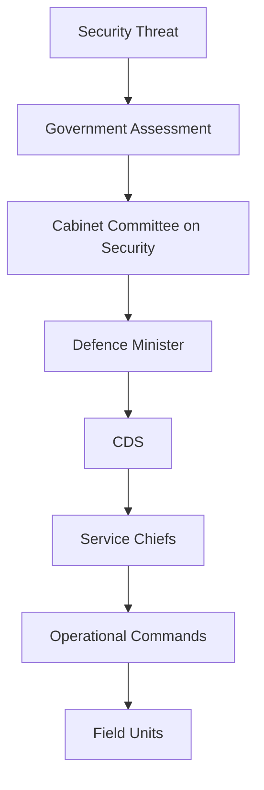

# Defence Command and Control Structure of India

## Why This Matters

India's defence command and control system defines how military decisions are made during peace, crises and war.

Understanding this structure is important for:

- National security studies
- Defence and military strategy
- UPSC and competitive exams
- Understanding civilian control over the military

---

## Constitutional Principle

India follows the principle of:

**Civilian Control of the Military**

The armed forces operate under the authority of the elected government.

---

## Core Principle of Indian Defence Management

India follows a democratic military structure where:

- Elected civilian leadership makes national security decisions
- Armed forces execute government decisions
- Military remains politically neutral
- Strategic decisions remain under civilian authority

This model is followed by most major democracies.

---

## National Defence Command Structure

---

## Key Decision-Making Authorities

| Authority | Role |
|-----------|------|
| President of India | Supreme Commander of Armed Forces |
| Prime Minister | Overall national security leadership |
| Cabinet Committee on Security (CCS) | Highest security decision-making body |
| Defence Minister | Political head of Ministry of Defence |
| Chief of Defence Staff (CDS) | Principal military adviser |
| Service Chiefs | Lead Army, Navy and Air Force |

---

## Chain of Authority

| Level | Authority |
|----------|----------|
| Political Leadership | President and Prime Minister |
| National Security Leadership | Cabinet Committee on Security |
| Defence Administration | Defence Minister |
| Military Coordination | Chief of Defence Staff |
| Service Leadership | Army, Navy and Air Force Chiefs |
| Operational Leadership | Commands and Field Formations |

---

## President of India

### Position

Supreme Commander of the Armed Forces.

### Responsibilities

- Formal military authority
- Appoints Service Chiefs
- Declares war or peace on government advice
- Approves major military appointments

---

## Prime Minister

### Role

The Prime Minister is the most influential authority in national security matters.

### Responsibilities

- Chairs Cabinet Committee on Security
- Approves major military actions
- Oversees strategic policy
- Coordinates national security decisions

---

## Cabinet Committee on Security (CCS)

### Highest Security Decision Body

Major decisions involving:

- War
- Nuclear policy
- Defence procurement
- National security crises
- Strategic operations

are taken through the CCS.

### Typical Members

- Prime Minister
- Defence Minister
- Home Minister
- Finance Minister
- External Affairs Minister

---

## Ministry of Defence

The Ministry of Defence manages:

- Defence policy
- Military administration
- Procurement
- Budget allocation
- Defence reforms

Political leadership remains separate from military leadership.

---

## Chief of Defence Staff (CDS)

### Role

The CDS acts as:

- Principal military adviser
- Joint planning authority
- Coordinator among services

### Responsibilities

- Promote joint operations
- Improve interoperability
- Support theatre command reforms
- Prioritize defence modernization

---

## Service Chiefs

### Army

Chief of Army Staff (COAS)

Responsible for:

- Land warfare
- Border defence
- Army readiness

### Navy

Chief of Naval Staff (CNS)

Responsible for:

- Maritime security
- Naval operations
- Sea control and deterrence

### Air Force

Chief of Air Staff (CAS)

Responsible for:

- Air defence
- Air operations
- Strategic air power

---

## Theatre Command Structure (Future Model)

### Objective

- Unified command structure
- Faster military response
- Better resource utilization
- Improved joint operations
- Integrated warfighting capability

---

## During a Military Crisis

---

## Important Topics and Answers

### Who is the Supreme Commander of the Indian Armed Forces?
President of India.

### Who is the principal military adviser to the Government of India?
Chief of Defence Staff.

### What is the highest security decision-making body in India?
Cabinet Committee on Security (CCS).

### Who heads the Ministry of Defence politically?
Defence Minister.

### Who commands the Army, Navy and Air Force?
Their respective Service Chiefs.

### Why are Theatre Commands being introduced?
To improve joint operations and military effectiveness.

### Quick Revision

- President = Supreme Commander
- Prime Minister = National security leadership
- CCS = Highest security decision-making body
- Defence Minister = Political head of defence
- CDS = Principal military adviser
- Service Chiefs = Lead Army, Navy and Air Force
- Theatre Commands = Future integrated warfighting structure
- Civilian control of military = Core constitutional principle