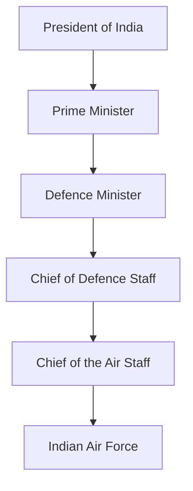
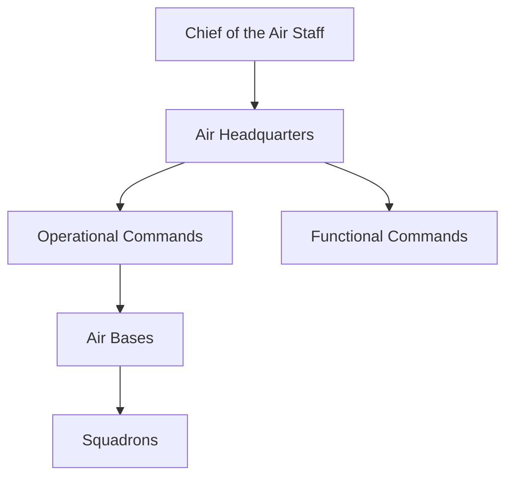

# Indian Air Force (IAF)

## Why This Matters

The Indian Air Force (IAF) is India's air warfare branch responsible for protecting Indian airspace, supporting land and naval operations, strategic airlift, humanitarian missions, disaster relief, and national security.

---

## Quick Facts

| Item | Details |
|----------|----------|
| Established | 8 October 1932 |
| Headquarters | New Delhi |
| Service Branch | Indian Armed Forces |
| Administrative Ministry | Ministry of Defence |
| Current Head | Chief of the Air Staff |
| Highest Rank | Marshal of the Indian Air Force |
| Motto | Touch the Sky with Glory |
| Motto (Sanskrit) | Nabhah Sprisham Deeptam |
| Air Force Day | 8 October |

---

## Position in National Defence Structure

---

## Main Responsibilities

### Air Defence

- Protect Indian airspace
- Detect and intercept hostile aircraft
- Maintain air superiority

### Offensive Air Operations

- Precision strikes
- Strategic bombing missions
- Battlefield air support

### Strategic Airlift

- Troop movement
- Equipment transportation
- Emergency deployment

### Humanitarian Assistance

- Disaster relief
- Medical evacuation
- Rescue operations

### Support to Army and Navy

- Close air support
- Reconnaissance missions
- Joint military operations

---

## Organisation Structure

---

## Major Air Commands

| Command | Headquarters |
|----------|----------|
| Western Air Command | New Delhi |
| Eastern Air Command | Shillong |
| Central Air Command | Prayagraj |
| South Western Air Command | Gandhinagar |
| Southern Air Command | Thiruvananthapuram |
| Training Command | Bengaluru |
| Maintenance Command | Nagpur |

---

## Major Aircraft Categories

| Category | Examples |
|----------|----------|
| Fighter Aircraft | Rafale, Su-30MKI, Tejas, Mirage 2000 |
| Transport Aircraft | C-17, C-130J, AN-32 |
| Helicopters | Apache, Chinook, Mi-17 |
| Trainer Aircraft | Hawk, Pilatus PC-7 |
| Surveillance Aircraft | Netra AEW&C, AWACS |

---

## Important Operations

| Operation | Significance |
|----------|----------|
| 1965 War | Air operations against Pakistan |
| 1971 War | Air superiority during Bangladesh Liberation War |
| Kargil War 1999 | Operation Safed Sagar |
| Balakot Air Strike 2019 | Counter-terror strike mission |
| Disaster Relief Missions | Humanitarian assistance and rescue |

---

## Modernization Initiatives

- Rafale induction
- Tejas fighter programme
- Indigenous radar systems
- Network-centric warfare capabilities
- Air defence modernization
- Drone and unmanned systems integration

---

## Why the Indian Air Force Is Important

- Protects Indian airspace
- Provides rapid military response capability
- Supports Army and Navy operations
- Enables strategic deterrence
- Assists during natural disasters
- Enhances India's regional security posture

---

## Important Topics and Answers

### When was the Indian Air Force established?
8 October 1932.

### Who leads the Indian Air Force?
Chief of the Air Staff.

### What is the highest rank in the Indian Air Force?
Marshal of the Indian Air Force.

### What is the motto of the Indian Air Force?
Touch the Sky with Glory.

### What was the Indian Air Force role during Kargil War?
Operation Safed Sagar.

### Which indigenous fighter aircraft is operated by the IAF?
HAL Tejas.

### Quick Revision

- Established = 1932
- Air Force Day = 8 October
- Head = Chief of the Air Staff
- Motto = Touch the Sky with Glory
- Highest Rank = Marshal of the Indian Air Force
- Major fighter aircraft = Rafale, Su-30MKI, Tejas
- Kargil operation = Operation Safed Sagar
- Role = Air defence, strike missions, strategic airlift