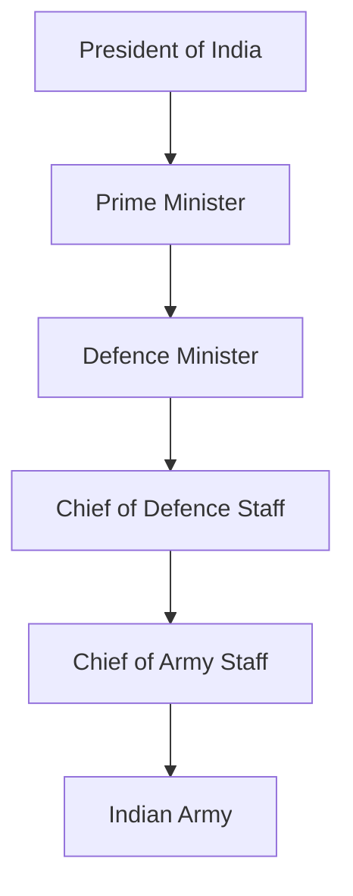
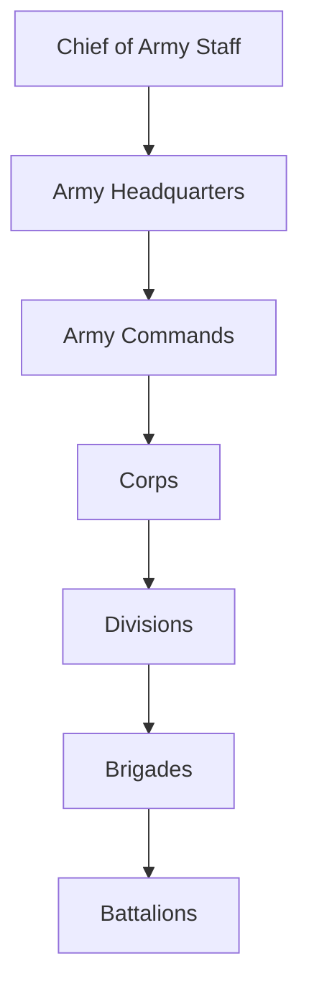
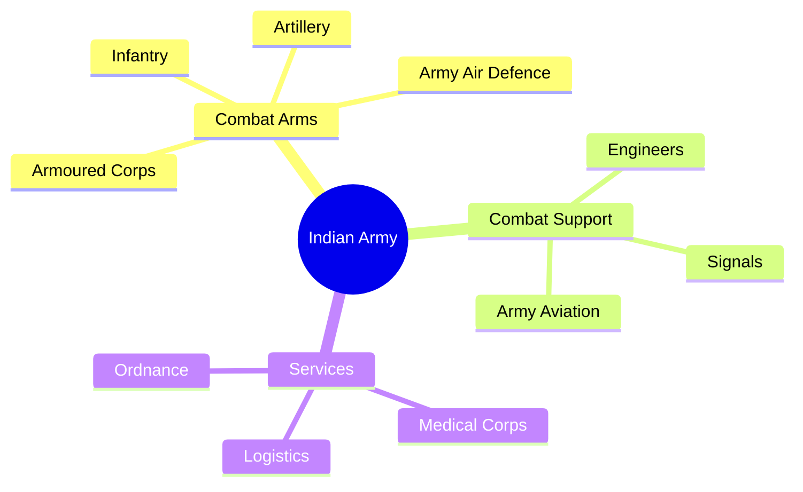

# Indian Army (IA)

## Why This Matters

The Indian Army is the land warfare branch of the Indian Armed Forces. It protects India's territorial integrity, safeguards national sovereignty, conducts military operations on land, supports internal security when required, and assists civil authorities during natural disasters and emergencies.

---

## Quick Facts

| Item | Details |
|----------|----------|
| Founded | 1 April 1895 |
| Headquarters | New Delhi |
| Branch | Indian Armed Forces |
| Administrative Ministry | Ministry of Defence |
| Supreme Commander | President of India |
| Current Head | Chief of the Army Staff (COAS) |
| Highest Rank | Field Marshal |
| Motto | Service Before Self |
| Army Day | 15 January |
| Primary Domain | Land Warfare |

---

## Position in National Defence Structure

---

## Main Responsibilities

### Territorial Defence

Protect India's borders and sovereignty against external aggression.

### Counter-Insurgency Operations

Support national security in regions affected by insurgency and terrorism.

### High-Altitude Warfare

Maintain operational readiness in challenging mountain environments including the Himalayas.

### Humanitarian Assistance and Disaster Relief

Provide support during floods, earthquakes, landslides, cyclones, and other emergencies.

### United Nations Peacekeeping

Contribute troops and expertise to international peacekeeping missions.

---

## Army Commands

| Command | Headquarters |
|----------|----------|
| Northern Command | Udhampur |
| Western Command | Chandimandir |
| Eastern Command | Kolkata |
| Southern Command | Pune |
| South Western Command | Jaipur |
| Central Command | Lucknow |
| Army Training Command (ARTRAC) | Shimla |

---

## Organisation Structure

---

## Major Arms and Branches

### Infantry

Primary ground combat force.

### Armoured Corps

Operates tanks and armoured fighting vehicles.

### Artillery

Provides long-range firepower support.

### Army Aviation Corps

Operates helicopters and aerial support platforms.

### Corps of Engineers

Responsible for military engineering tasks.

### Corps of Signals

Maintains battlefield communication networks.

### Army Medical Corps

Provides medical support and healthcare services.

---

## Key Operational Environments

- Desert Warfare
- Mountain Warfare
- High-Altitude Warfare
- Jungle Warfare
- Urban Warfare

---

## Important Wars and Operations

| Operation | Significance |
|----------|----------|
| Indo-Pak War 1947-48 | Defence of Jammu and Kashmir |
| Indo-Pak War 1965 | Major conventional conflict |
| Indo-Pak War 1971 | Bangladesh Liberation War |
| Operation Meghdoot | Siachen Glacier control |
| Kargil War 1999 | Operation Vijay |
| Counter-Insurgency Operations | Internal security support |
| UN Peacekeeping Missions | International peace operations |

---

## Modernisation Initiatives

- Network-centric warfare capabilities
- Indigenous defence equipment adoption
- Future soldier programmes
- Enhanced surveillance systems
- Integration with theatre command concepts

---

## Challenges

- Two-front security environment
- Technology-driven warfare
- High-altitude operational demands
- Rapid force modernisation requirements
- Cyber and information warfare threats

---

## Future Roadmap

- Greater jointness among services
- Increased indigenous defence production
- AI-enabled battlefield systems
- Advanced ISR capabilities
- Integrated theatre command implementation

---

## Why the Indian Army Is Important

- Protects territorial integrity
- Guards land borders
- Conducts military operations
- Supports internal security when required
- Assists during disasters and emergencies
- Contributes to UN peacekeeping missions

---

## Important Topics and Answers

### When was the Indian Army established?
1 April 1895.

### Who leads the Indian Army?
Chief of Army Staff (COAS).

### What is the highest rank in the Indian Army?
Field Marshal.

### Which command is responsible for Jammu and Kashmir and Ladakh?
Northern Command.

### What is the motto of the Indian Army?
Service Before Self.

### Who are the Field Marshals of India?
Sam Manekshaw and K. M. Cariappa.

### Quick Revision

- Established = 1895
- Army Day = 15 January
- Head = Chief of Army Staff
- Motto = Service Before Self
- Highest Rank = Field Marshal
- Commands = 7
- Headquarters = New Delhi
- Primary Role = Land Warfare