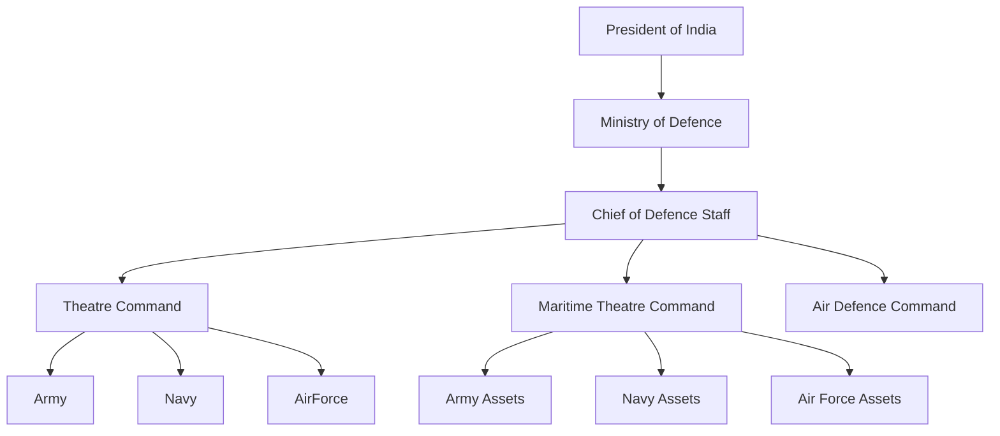
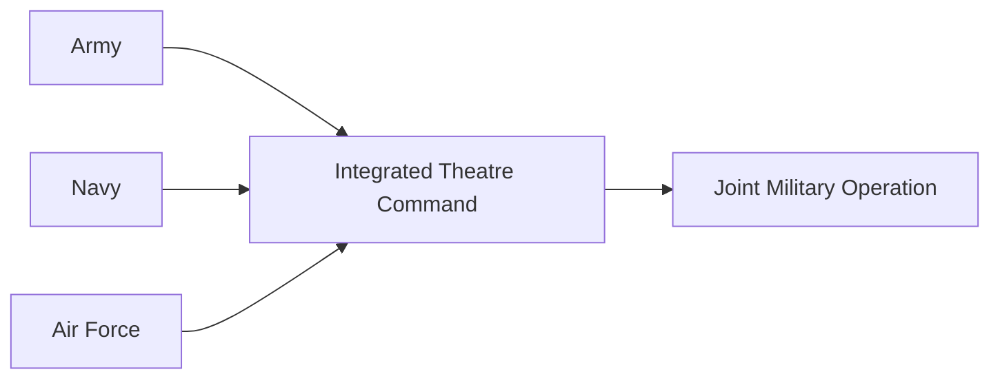

# Integrated Theatre Commands

## Why It Matters

Integrated Theatre Commands are proposed unified military commands that bring together Army, Navy, and Air Force assets under a single operational commander. The objective is faster decision-making, improved joint operations, better resource utilization, and enhanced combat effectiveness.

---

## Quick Facts

| Item | Details |
|----------|----------|
| Purpose | Joint Military Operations |
| Controlled By | Indian Armed Forces |
| Guided By | Chief of Defence Staff (CDS) |
| Objective | Integration of Army, Navy and Air Force |
| Status | Under Implementation |
| Model Inspiration | Major Military Powers Including USA and China |

---

## Position Within Defence Ecosystem

---

## Why India Is Moving Towards Theatre Commands

### Current Structure

Army, Navy, and Air Force maintain separate operational commands.

### Challenge

During joint operations, coordination between services can be slower and more complex.

### Solution

A unified command structure where all services operate under a single theatre commander.

---

## Theatre Command Concept

---

## Proposed Theatre Commands

| Command | Primary Responsibility |
|----------|----------|
| Northern Theatre Command | China Border and Northern Front |
| Western Theatre Command | Pakistan Front |
| Maritime Theatre Command | Indian Ocean Region |
| Air Defence Command | National Air Defence |
|

---

## Expected Benefits

### Faster Decision-Making

Single operational commander reduces coordination delays.

### Better Joint Operations

Army, Navy, and Air Force can operate as a unified force.

### Efficient Resource Utilization

Reduces duplication of assets and infrastructure.

### Improved Combat Readiness

Enhances preparedness for multi-domain warfare.

### Integrated National Security

Provides a coordinated response during crises and conflicts.

---

## International Examples

| Country | Theatre Command System |
|----------|----------|
| United States | Geographic Combatant Commands |
| China | Five Theatre Commands |
| Russia | Joint Strategic Commands |
|

---

## Challenges

- Inter-service coordination and restructuring
- Command and control transition
- Resource allocation among services
- Operational doctrine integration
- Training and cultural adaptation

---

## Future Roadmap

- Establish unified command structures
- Expand joint operational planning
- Improve interoperability across services
- Strengthen network-centric warfare capabilities
- Fully integrate future military operations

---

## Quick Revision

| Topic | Key Point |
|----------|----------|
| Purpose | Joint Operations |
| Led By | Chief of Defence Staff |
| Main Goal | Integration of Three Services |
| Benefits | Faster Decisions and Better Coordination |
| Status | Under Implementation |

---

## Key Concepts

### What is an Integrated Theatre Command?

A unified military command that combines Army, Navy, and Air Force assets under one operational commander.

### Why are Theatre Commands important?

They improve coordination, reduce duplication, and increase combat effectiveness.

### Who is leading theatre command reforms in India?

The Chief of Defence Staff and the Ministry of Defence.

### What is the Maritime Theatre Command?

A proposed command responsible for protecting India's maritime interests and the Indian Ocean Region.

### What is the Air Defence Command?

A proposed command responsible for integrating national air defence capabilities.
