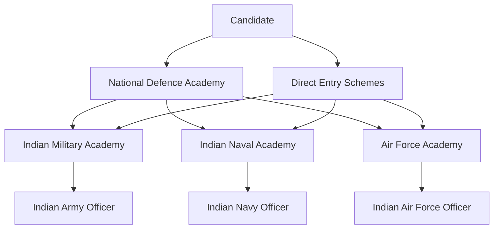

# Military Training Academies of India

## Why It Matters

Military training academies produce the officers and leaders of the Indian Armed Forces. They transform civilian candidates into military professionals capable of leading troops during peace, war, disaster relief, and national security operations.

---

## Military Training Ecosystem

---

## Major Military Training Academies

| Academy | Location | Service | Purpose |
|----------|----------|----------|----------|
| National Defence Academy (NDA) | Khadakwasla, Pune | Tri-Service | Joint training for Army, Navy and Air Force cadets |
| Indian Military Academy (IMA) | Dehradun | Army | Commissioning academy for Army officers |
| Officers Training Academy (OTA) | Chennai | Army | Short Service Commission officers |
| Officers Training Academy (OTA) | Gaya | Army | Training for technical entry officers |
| Indian Naval Academy (INA) | Ezhimala, Kerala | Navy | Officer training for Indian Navy |
| Air Force Academy (AFA) | Dundigal, Hyderabad | Air Force | Flying and ground duty officer training |
| Rashtriya Indian Military College (RIMC) | Dehradun | Pre-Officer | Prepares students for NDA entry |
| Sainik Schools | Across India | Pre-Officer | Military-oriented school education |

---

## National Defence Academy (NDA)

### Overview

- World's first tri-service military academy
- Trains Army, Navy and Air Force cadets together
- Located at Khadakwasla, Maharashtra
- Cadets undergo academic and military training before joining service-specific academies

### Training Duration

- 3 years at NDA
- Followed by specialized training in respective service academies

### Significance

- Builds joint-service culture
- Develops leadership and discipline
- Creates future military leadership pipeline

---

## Indian Military Academy (IMA)

### Overview

- Premier Army officer training institution
- Located in Dehradun, Uttarakhand
- Trains Permanent Commission officers

### Motto

> Veerta Aur Vivek (Valour and Wisdom)

### Output

- Officers commissioned as Lieutenants in the Indian Army

---

## Officers Training Academy (OTA)

### Chennai

- Trains Short Service Commission officers
- Men and women officers
- Important source of Army leadership

### Gaya

- Focuses mainly on Technical Entry Scheme candidates

---

## Indian Naval Academy (INA)

### Overview

- Located at Ezhimala, Kerala
- Largest naval academy in Asia
- Trains officers for executive, technical and other naval branches

### Key Focus Areas

- Maritime warfare
- Navigation
- Seamanship
- Naval leadership
- Technical operations

---

## Air Force Academy (AFA)

### Overview

- Located at Dundigal, Hyderabad
- Main training institution for Air Force officers

### Branches Trained

- Flying Branch
- Ground Duty Technical Branch
- Ground Duty Non-Technical Branch

### Key Focus Areas

- Flight training
- Air operations
- Aerospace systems
- Air warfare leadership

---

## Other Important Defence Institutions

| Institution | Purpose |
|------------|---------|
| Defence Services Staff College (DSSC) | Mid-career officer training |
| College of Defence Management (CDM) | Strategic and management education |
| National Defence College (NDC) | Senior strategic leadership training |
| Army War College | Army operational studies |
| Naval War College | Maritime warfare studies |
| Air Force War College | Air power and operational studies |
| Centre for United Nations Peacekeeping | UN peacekeeping training |

---

## Officer Training Journey

---

## Quick Revision

- NDA is the world's first tri-service military academy.
- IMA trains Permanent Commission Army officers.
- OTA mainly trains Short Service Commission officers.
- INA is located at Ezhimala, Kerala.
- AFA is located at Dundigal, Hyderabad.
- RIMC and Sainik Schools form the early military leadership pipeline.
- NDC is India's premier strategic leadership institution.

---

## Important Questions & Answers

### Which academy trains cadets of all three services together?
National Defence Academy (NDA).

### Which academy commissions Army officers?
Indian Military Academy (IMA).

### Which academy trains Navy officers?
Indian Naval Academy (INA).

### Which academy trains Air Force officers?
Air Force Academy (AFA).

### Which is Asia's largest naval academy?
Indian Naval Academy at Ezhimala.