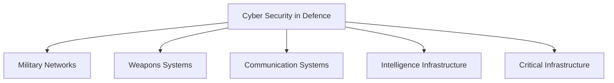
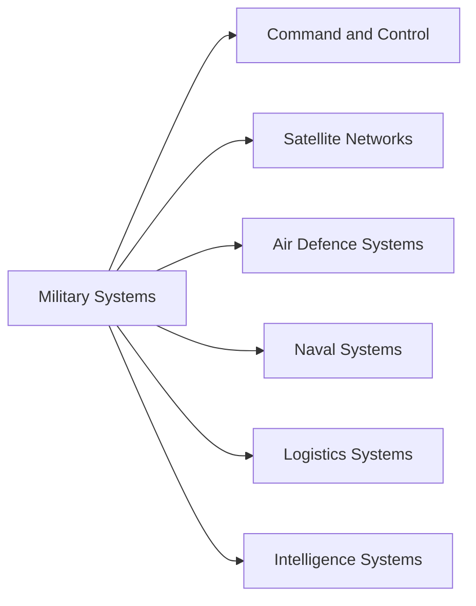

# Cyber Security in Defence

## Why It Matters

Modern armed forces depend heavily on digital networks, communication systems, satellites, sensors, command-and-control platforms, logistics systems, and critical infrastructure.

Cyber attacks against these systems can disrupt military operations without a single shot being fired.

Cyber security in defence focuses on protecting military networks, weapons systems, intelligence infrastructure, and critical national security assets from cyber threats.

Studying this topic helps understand:

- Military cyber defence
- Protection of critical infrastructure
- Defence Cyber Agency
- Cyber warfare preparedness
- Modern national security challenges

---

## Quick Facts

| Item | Details |
|--------|---------|
| Domain | Cyber Security |
| Purpose | Protect military and defence systems |
| Key Threats | Malware, ransomware, espionage, cyber attacks |
| Lead Organisation | Defence Cyber Agency |
| Importance | National security and military readiness |

---

## Cyber Security Ecosystem

---

## Major Threats

### Cyber Espionage

Attempts to steal sensitive military, strategic, or intelligence information.

### Malware Attacks

Malicious software designed to disrupt, damage, or gain unauthorized access to systems.

### Ransomware

Cyber attacks that encrypt systems and demand payment for restoration.

### Supply Chain Attacks

Compromise of software, hardware, or vendors supporting defence systems.

### Critical Infrastructure Attacks

Targeting power grids, communication networks, transportation systems, and defence facilities.

---

## Defence Cyber Agency

The Defence Cyber Agency (DCA) is a tri-service organization responsible for strengthening India's cyber defence capabilities.

### Responsibilities

- Protect defence networks
- Conduct cyber security operations
- Coordinate cyber incident response
- Improve cyber warfare readiness
- Support military cyber capabilities

---

## Military Systems Requiring Protection

---

## Key Defence Measures

### Network Security

Protection of military communication and information networks.

### Encryption

Secures sensitive military communications and data.

### Threat Intelligence

Identification and monitoring of emerging cyber threats.

### Incident Response

Rapid detection, containment, and recovery from cyber incidents.

### Cyber Training

Training personnel to identify and respond to cyber threats.

---

## Challenges

- Rapidly evolving cyber threats
- State-sponsored cyber attacks
- Dependence on digital infrastructure
- Supply-chain vulnerabilities
- Shortage of cyber security specialists

---

## Future Roadmap

- Strengthening Defence Cyber Agency capabilities
- Indigenous cyber security technologies
- AI-assisted threat detection
- Improved cyber resilience
- Greater integration of cyber defence into military planning

---

## Quick Revision

- Cyber security protects military and defence systems.
- Defence Cyber Agency is India's primary military cyber organization.
- Major threats include espionage, malware, ransomware, and infrastructure attacks.
- Cyber security is essential for modern warfare readiness.
- Military networks, satellites, and command systems are key targets.

---

## Key Concepts

### Easy

1. What is cyber security in defence?
2. What is the role of the Defence Cyber Agency?
3. What are cyber threats?
4. Why are military networks important?

### Intermediate

1. How does cyber security support military operations?
2. What are supply-chain cyber attacks?
3. Why is encryption important in defence?
4. What challenges does military cyber security face?

### Advanced

1. Analyse the role of cyber security in modern warfare.
2. Evaluate India's cyber defence preparedness.
3. Explain how cyber attacks can affect national security.
