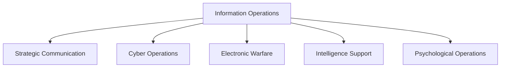

# Information Operations

## Why It Matters

Information Operations (Info Ops) involve the coordinated use of information, influence, cyber capabilities, electronic warfare, intelligence, and communication strategies to achieve military and national security objectives.

Modern conflicts are fought not only on land, sea, air, space, and cyberspace but also in the information domain.

Studying information operations helps understand:

- Information warfare
- Strategic communication
- Influence operations
- Military decision superiority
- National security in the digital age

---

## Quick Facts

| Item | Details |
| -------- | -------- |
| Domain | Information Operations |
| Objective | Influence decisions and protect information advantage |
| Components | Information, Intelligence, Cyber, Electronic Warfare |
| Users | Armed Forces, Intelligence Agencies, Governments |
| Importance | Modern multi-domain warfare |

---

## Information Operations Ecosystem

---

## Core Objectives

### Information Superiority

Ensure friendly forces have better information while denying adversaries the same advantage.

### Influence Decision Making

Shape perceptions, behaviour, and decision-making processes.

### Protect Friendly Information

Defend military networks, communication channels, and sensitive information.

### Counter Adversary Narratives

Detect and respond to misinformation, propaganda, and influence campaigns.

---

## Major Components

### Strategic Communication

Coordinated messaging to support national and military objectives.

### Cyber Operations

Use of cyber capabilities to protect or influence information systems.

### Electronic Warfare

Control and exploitation of the electromagnetic spectrum.

### Intelligence Support

Collection and analysis of information to support operational decisions.

### Psychological Operations

Activities designed to influence perceptions and behaviour.

---

## Information Operations in Modern Warfare

---

## Challenges

- Disinformation campaigns
- Deepfake technologies
- Social media manipulation
- Information overload
- Rapid information dissemination
- Attribution difficulties

---

## India's Information Operations Environment

Key areas include:

- National security communication
- Counter-disinformation efforts
- Military information support activities
- Cyber-enabled influence operations
- Information security and resilience

---

## Future Roadmap

- AI-assisted information analysis
- Improved disinformation detection
- Better integration with cyber operations
- Enhanced strategic communication capabilities
- Stronger information resilience mechanisms

---

## Quick Revision

- Information Operations combine information, intelligence, cyber, and influence activities.
- Information superiority is a major military objective.
- Strategic communication and psychological operations are important components.
- Modern conflicts increasingly involve information-domain competition.
- Information Operations support decision advantage and national security.

---

## Key Concepts

### Easy

1. What are Information Operations?
2. Why is information superiority important?
3. What is strategic communication?
4. How do Information Operations support military objectives?

### Intermediate

1. How do cyber operations support Information Operations?
2. What role does intelligence play in Information Operations?
3. What challenges do disinformation campaigns create?
4. How do Information Operations differ from traditional military operations?

### Advanced

1. Analyse the role of Information Operations in modern warfare.
2. Evaluate the impact of digital platforms on national security.
3. Explain how Information Operations support multi-domain warfare.