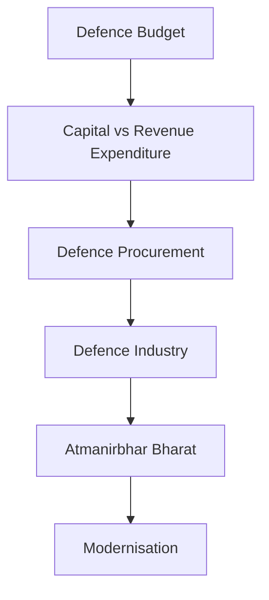
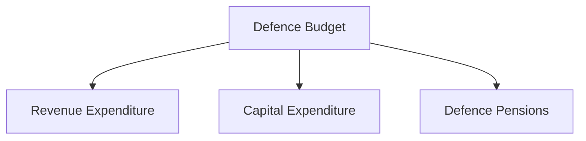
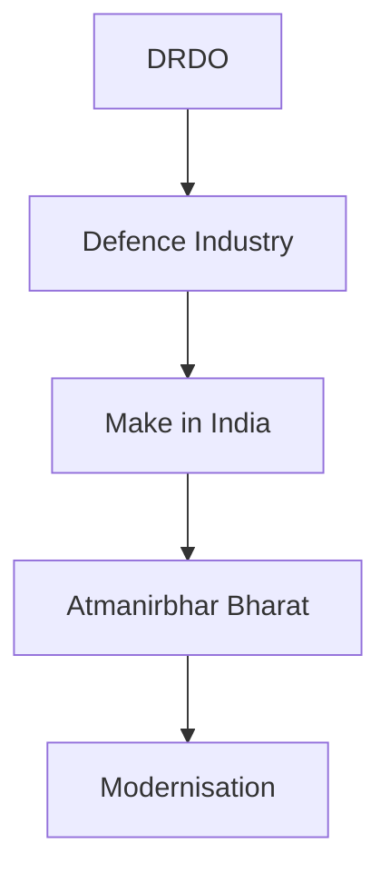

# Defence Budget and Modernisation

## Why It Matters

Defence modernization depends on sustained financial investment, efficient procurement systems, indigenous manufacturing and long-term capability development.

India's defence budget supports military readiness, modernization programmes, strategic deterrence, infrastructure development and future warfare capabilities.

Understanding how defence funding, procurement and industrial policies work together is essential for understanding India's military transformation.

---

## Quick Facts

| Item | Details |
|----------|----------|
| Domain | Defence Finance and Modernisation |
| Primary Ministry | Ministry of Defence |
| Key Focus | Budget, Procurement and Self-Reliance |
| Major Goal | Future Military Capability |
| Supporting Organisations | DRDO, DAC and Defence Industry |
| Importance | Military Readiness and Modernisation |

---

## Repository Structure

```text
 defence-budget-and-modernisation/
 ├── README.md
 ├── defence-budget-overview.md
 ├── capital-vs-revenue-expenditure.md
 ├── defence-procurement-process.md
 ├── atmanirbhar-bharat-defence.md
 ├── make-in-india-defence.md
 ├── defence-industrial-corridors.md
 ├── offset-policy.md
 └── major-modernisation-programmes.md
```

---

## Learning Roadmap



---

## Defence Budget Architecture



---

## Procurement and Modernisation Ecosystem


---

## Atmanirbhar Bharat Ecosystem



---

## Major Topics Covered

| Topic | Focus Area |
|----------|----------|
| Defence Budget Overview | Defence Finance |
| Capital vs Revenue Expenditure | Spending Structure |
| Defence Procurement Process | Acquisition System |
| Atmanirbhar Bharat Defence | Self-Reliance |
| Make in India Defence | Manufacturing |
| Defence Industrial Corridors | Industrial Ecosystem |
| Defence Offset Policy | Technology Transfer |
| Major Modernisation Programmes | Capability Development |

---

## Why Modernisation Matters

Modernisation helps India:

- Replace obsolete equipment
- Improve combat effectiveness
- Strengthen deterrence
- Enhance military readiness
- Support future warfare requirements
- Improve strategic autonomy

---

## Strategic Importance

This section explains how India:

- Funds national defence
- Procures military equipment
- Develops indigenous capability
- Supports defence industry growth
- Builds future military strength

---

## Quick Revision

- Defence budget funds readiness and modernization.
- Capital expenditure builds future capability.
- Revenue expenditure supports current operations.
- Procurement converts budget into military capability.
- Atmanirbhar Bharat promotes self-reliance.
- Make in India strengthens defence manufacturing.
- Defence Industrial Corridors support industrial growth.
- Modernisation prepares India for future warfare.

---

## Key Concepts

### Why is the defence budget important?

It determines military readiness and modernization capability.

### What is capital expenditure?

Spending on long-term military assets and infrastructure.

### Why is procurement important?

It converts operational requirements into military capability.

### What is Atmanirbhar Bharat in defence?

India's effort to achieve defence self-reliance.

### Why is modernization necessary?

To address evolving threats and future warfare challenges.
