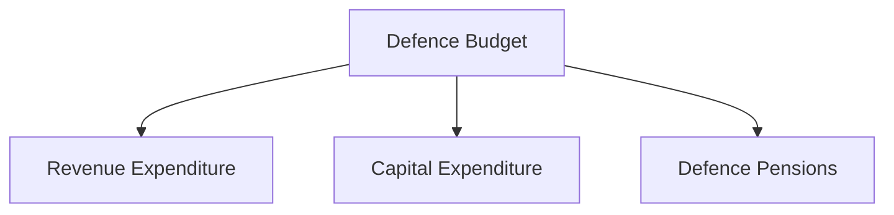
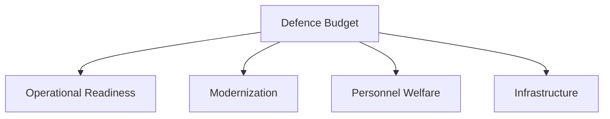

# Defence Budget Overview

## Why It Matters

The defence budget determines how India funds its military preparedness, modernization programmes, personnel requirements and strategic capabilities.

It directly influences national security, military readiness, technological advancement and long-term defence planning.

A well-structured defence budget helps balance current operational needs with future capability development.

---

## Quick Facts

| Item | Details |
|----------|----------|
| Domain | Defence Finance and Planning |
| Managed By | Ministry of Defence |
| Covers | Personnel, Operations and Modernization |
| Major Components | Revenue, Capital and Pensions |
| Importance | Military Readiness and Capability Development |

---

## What is the Defence Budget?

The defence budget is the annual allocation of financial resources for India's defence and security requirements.

It funds:

- Armed Forces operations
- Military modernization
- Equipment procurement
- Infrastructure development
- Personnel costs
- Strategic programmes

---

## Defence Budget Structure

---

## Budget Allocation Process

---

## Revenue Expenditure

Revenue expenditure supports day-to-day functioning of the Armed Forces.

Examples include:

- Salaries and allowances
- Fuel and transportation
- Equipment maintenance
- Training activities
- Operational logistics
- Ammunition consumption

Revenue expenditure helps maintain operational readiness.

---

## Capital Expenditure

Capital expenditure focuses on long-term capability creation.

Examples include:

- Fighter aircraft
- Warships and submarines
- Missile systems
- Air-defence systems
- Military infrastructure
- Advanced military technologies

Capital expenditure drives military modernization.

---

## Defence Pensions

Defence pensions support:

- Retired military personnel
- Family pension beneficiaries
- Veteran welfare commitments

Pension expenditure forms an important component of overall defence spending.

---

## Defence Budget Priorities

---

## Defence Budget Trends

Major long-term trends include:

- Higher modernization requirements
- Growing technology investments
- Increased indigenous procurement
- Greater focus on cyber and space domains
- Expansion of defence-industrial capabilities

---

## India and Global Defence Spending

Large military powers typically allocate significant resources toward:

- Force modernization
- Research and development
- Strategic deterrence
- Advanced technologies

India's defence budget reflects both current security requirements and future capability needs.

---

## Strategic Importance

The defence budget helps India:

- Maintain military readiness
- Modernize the Armed Forces
- Strengthen deterrence
- Support defence reforms
- Enhance national-security preparedness

---

## Challenges

- Rising personnel costs
- Expensive defence technologies
- Balancing modernization and readiness
- Competing budget priorities
- Long-term capability requirements

---

## Future Roadmap

- Greater capital expenditure focus
- Improved procurement efficiency
- Enhanced indigenous capability development
- Technology-driven modernization
- Better long-term defence planning

---

## Quick Revision

- Defence budget funds military readiness and modernization.
- Main components are revenue, capital and pensions.
- Revenue expenditure supports operations.
- Capital expenditure creates future capabilities.
- Budget allocation influences national-security preparedness.
- Modernization requires sustained long-term investment.

---

## Key Concepts

### What is the defence budget?

The annual allocation of resources for India's defence and security requirements.

### What are the major components of the defence budget?

Revenue expenditure, capital expenditure and defence pensions.

### Which component supports modernization?

Capital expenditure.

### Which component supports daily military operations?

Revenue expenditure.

### Why is the defence budget important?

It determines military readiness, modernization and long-term security capability.