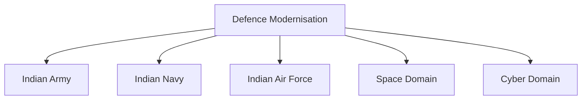
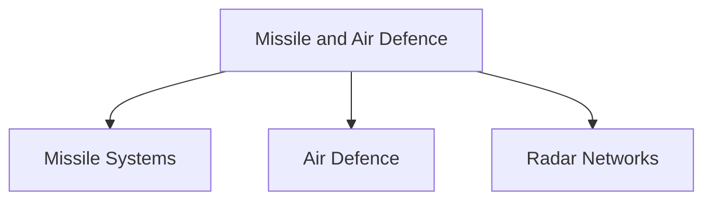
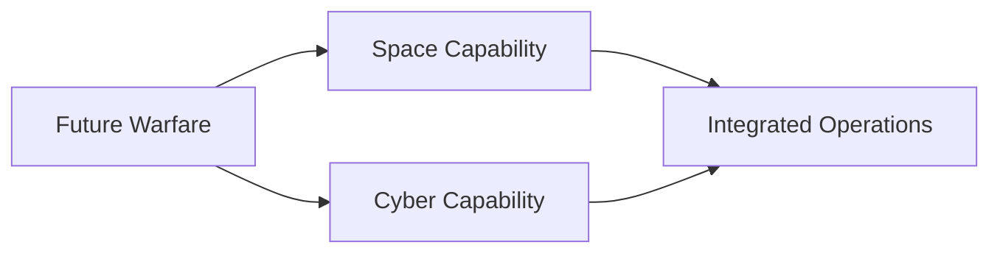

# Major Modernisation Programmes

## Why It Matters

Military modernization refers to the continuous process of upgrading India's defence capabilities to address evolving security challenges, technological advancements and future warfare requirements.

Modernization helps the Armed Forces maintain operational readiness, improve combat effectiveness and strengthen national security.

India's modernization efforts focus on indigenous capability development, technological advancement and long-term strategic preparedness.

---

## Quick Facts

| Item | Details |
|----------|----------|
| Domain | Defence Modernisation |
| Objective | Capability Enhancement |
| Lead Ministry | Ministry of Defence |
| Supporting Organisations | DRDO, Armed Forces and Defence Industry |
| Focus Areas | Land, Sea, Air, Space and Cyber |
| Importance | Future Military Readiness |

---

## What is Defence Modernisation?

Defence modernization involves:

- Replacing obsolete equipment
- Acquiring advanced technologies
- Enhancing operational capabilities
- Improving joint-force effectiveness
- Preparing for future warfare

It is a continuous process rather than a one-time activity.

---

## Modernisation Framework

---

## Indian Army Modernisation

Key focus areas include:

- Future infantry systems
- Modern artillery
- Advanced air-defence systems
- Battlefield surveillance
- Network-centric warfare
- Armoured-force upgrades

Examples:

- Modern artillery systems
- Improved soldier equipment
- Indigenous armoured platforms

---

## Indian Navy Modernisation

Key focus areas include:

- Aircraft carriers
- Submarines
- Destroyers and frigates
- Naval aviation
- Maritime surveillance
- Underwater warfare capability

Examples:

- Indigenous warship programmes
- Advanced submarine projects
- Maritime domain awareness systems

---

## Indian Air Force Modernisation

Key focus areas include:

- Fighter aircraft upgrades
- Force-multiplier platforms
- Air-defence networks
- Precision-strike capability
- Unmanned systems

Examples:

- Modern combat aircraft
- Integrated air-defence systems
- Advanced radar networks

---

## Missile and Air Defence Modernisation

Important areas include:

- Strategic missile capability
- Ballistic missile defence
- Integrated air-defence systems
- Advanced surveillance networks

---

## Space and Cyber Modernisation

Emerging domains include:

- Military satellites
- Space situational awareness
- Cyber defence
- Network security
- Information warfare capability

---

## Indigenous Modernisation Programmes

Modernization increasingly emphasizes:

- Atmanirbhar Bharat
- Make in India
- Indigenous procurement
- Defence innovation
- Domestic manufacturing

This reduces import dependence and strengthens strategic autonomy.

---

## Role of DRDO

DRDO supports modernization through:

- Missile development
- Radar systems
- Electronic warfare technologies
- Aerospace research
- Strategic technologies

DRDO remains central to India's long-term modernization efforts.

---

## Major Challenges

- Rapid technological change
- High acquisition costs
- Legacy equipment replacement
- Long procurement cycles
- Emerging warfare domains
- Global technology competition

---

## Strategic Importance

Modernisation helps India:

- Maintain military superiority
- Improve operational readiness
- Strengthen deterrence
- Support national security
- Prepare for future conflicts

---

## Future Roadmap

- Greater indigenous capability
- Artificial intelligence integration
- Autonomous systems
- Advanced missile technologies
- Enhanced cyber capability
- Stronger space-domain capability
- Integrated theatre-command support

---

## Quick Revision

- Modernisation upgrades military capability.
- Covers Army, Navy, Air Force, Space and Cyber domains.
- Focuses on technology, readiness and future warfare.
- DRDO plays a major role in modernization.
- Atmanirbhar Bharat supports indigenous capability development.
- Modernisation strengthens long-term national security.

---

## Key Concepts

### What is defence modernisation?

The process of upgrading military capabilities, technologies and operational effectiveness.

### Why is modernization important?

To address evolving threats and future warfare requirements.

### Which domains are being modernized?

Land, sea, air, space and cyber domains.

### Which organisation supports defence technology development?

DRDO.

### How does modernization support national security?

By improving military readiness, deterrence and long-term capability.
