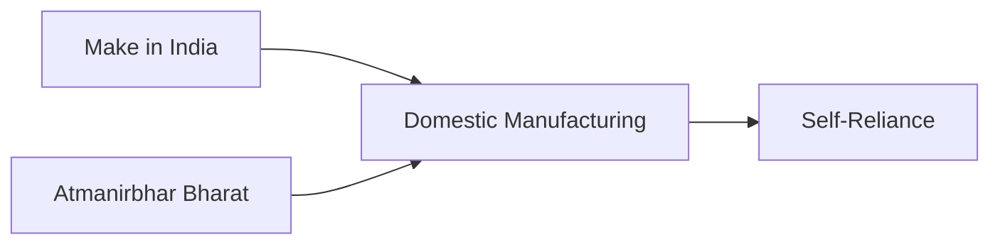
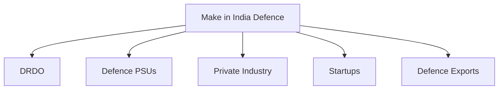

# Make in India Defence

## Why It Matters

Make in India Defence is India's initiative to strengthen domestic defence manufacturing and reduce dependence on imported military equipment.

The programme encourages indigenous production, technology development, private-sector participation and export growth. It complements Atmanirbhar Bharat and supports India's long-term objective of becoming a major defence-manufacturing nation.

---

## Quick Facts

| Item | Details |
|----------|----------|
| Initiative | Make in India |
| Defence Focus | Indigenous Manufacturing |
| Lead Ministry | Ministry of Defence |
| Objective | Domestic Defence Production |
| Key Areas | Manufacturing, Innovation and Exports |
| Importance | Defence Self-Reliance |

---

## What is Make in India Defence?

Make in India Defence seeks to increase domestic participation in defence production by encouraging:

- Indigenous manufacturing
- Technology development
- Private-sector investment
- Defence innovation
- Export-oriented production

The initiative aims to build a strong defence-industrial ecosystem.

---

## Relationship with Atmanirbhar Bharat

Both initiatives work together to strengthen India's defence capability and industrial base.

---

## Defence Manufacturing Ecosystem

---

## Role of Public Sector Organisations

Public-sector organizations contribute through:

- Defence manufacturing
- Strategic production programmes
- Research collaboration
- Large-scale industrial capability

Examples include defence public-sector undertakings and associated manufacturing organizations.

---

## Role of Private Industry

Private-sector participation supports:

- Advanced manufacturing
- Defence innovation
- Component production
- Technology partnerships
- Export development

Private industry has become increasingly important in India's defence ecosystem.

---

## Foreign Direct Investment (FDI)

FDI policies help:

- Attract investment
- Improve technology access
- Strengthen industrial capability
- Support manufacturing growth

The objective is to build a globally competitive defence sector while increasing domestic production.

---

## Defence Startups and Innovation

Startups contribute through:

- Artificial intelligence solutions
- Drone technologies
- Robotics
- Cyber-security products
- Advanced defence applications

Innovation is becoming an important pillar of defence modernization.

---

## Defence Exports

Increasing exports helps strengthen industrial capacity and international defence partnerships.

---

## Strategic Importance

Make in India Defence helps India:

- Reduce import dependence
- Strengthen defence self-reliance
- Expand industrial capability
- Generate employment
- Increase exports
- Improve strategic autonomy

---

## Challenges

- Technology gaps
- Global competition
- Long development cycles
- Supply-chain requirements
- Skilled-workforce needs
- Capital-intensive investments

---

## Future Roadmap

- Greater indigenous content
- Advanced defence manufacturing
- Stronger startup ecosystem
- Increased exports
- Better industry-academia collaboration
- Enhanced global competitiveness

---

## Quick Revision

- Make in India Defence promotes domestic defence manufacturing.
- Supports Atmanirbhar Bharat.
- Encourages private-sector participation.
- Strengthens defence exports.
- Supports innovation and technology development.
- Improves defence self-reliance.

---

## Key Concepts

### What is Make in India Defence?

An initiative to strengthen domestic defence manufacturing and industrial capability.

### Why is it important?

It reduces dependence on imports and strengthens national security.

### How does it support self-reliance?

By encouraging indigenous production, innovation and exports.

### What role does private industry play?

It contributes to manufacturing, technology development and defence innovation.

### How does it support modernization?

By creating the industrial foundation needed for long-term military capability development.
