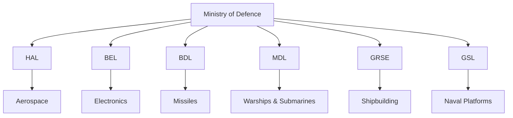
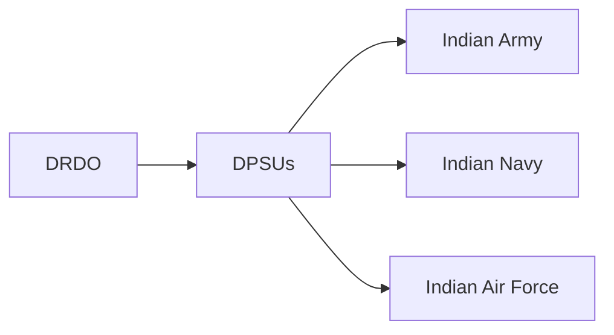

# Defence Public Sector Undertakings (DPSUs)

## Why It Matters

Defence Public Sector Undertakings (DPSUs) are government-owned companies responsible for manufacturing military equipment, defence electronics, aircraft, warships, missiles, ammunition, and strategic systems required by India's armed forces.

They form the backbone of India's indigenous defence manufacturing capability and play a major role in achieving defence self-reliance.

---

## Quick Facts

| Item | Details |
|----------|----------|
| Controlled By | Ministry of Defence |
| Ownership | Government of India |
| Purpose | Defence Manufacturing and Support |
| Customers | Army, Navy, Air Force, Coast Guard |
| Role | Production of Defence Equipment |
| Strategic Goal | Atmanirbhar Bharat |

---

## DPSU Ecosystem

---

## Major DPSUs

| DPSU | Primary Responsibility |
|----------|----------|
| Hindustan Aeronautics Limited (HAL) | Aircraft and Helicopters |
| Bharat Electronics Limited (BEL) | Defence Electronics and Radars |
| Bharat Dynamics Limited (BDL) | Missile Production |
| Mazagon Dock Shipbuilders Limited (MDL) | Submarines and Destroyers |
| Garden Reach Shipbuilders & Engineers (GRSE) | Naval Shipbuilding |
| Goa Shipyard Limited (GSL) | Patrol Vessels and Naval Ships |
|
---

## How DPSUs Support the Armed Forces

DPSUs convert research and designs into operational military equipment.

---

## Key Areas of Production

### Aerospace

Produced primarily by HAL:

- Fighter aircraft
- Trainer aircraft
- Helicopters
- Aircraft upgrades

### Electronics

Produced primarily by BEL:

- Radars
- Communication systems
- Electronic warfare systems
- Command and control systems

### Missiles

Produced primarily by BDL:

- Surface-to-air missiles
- Anti-tank missiles
- Strategic weapon systems

### Naval Platforms

Produced by MDL, GRSE and GSL:

- Destroyers
- Frigates
- Corvettes
- Submarines
- Patrol vessels

---

## Importance of DPSUs

- Strengthen national security
- Reduce import dependency
- Support military modernization
- Build strategic capabilities
- Generate skilled employment
- Support defence exports

---

## Role in Atmanirbhar Bharat

DPSUs contribute by:

- Increasing indigenous manufacturing
- Supporting DRDO programmes
- Developing domestic supply chains
- Expanding defence exports
- Strengthening strategic autonomy

---

## Challenges

- Technology dependence in some sectors
- Global competition
- Long procurement cycles
- Rapid technological changes
- Need for stronger private-sector collaboration

---

## Future Roadmap

- Greater indigenous content
- Advanced aerospace programmes
- Next-generation naval platforms
- AI-enabled defence systems
- Increased exports
- Stronger public-private partnerships

---

## Quick Revision

- DPSUs are government-owned defence manufacturers.
- Operate under the Ministry of Defence.
- HAL leads aerospace production.
- BEL leads defence electronics.
- BDL leads missile manufacturing.
- MDL, GRSE and GSL support naval shipbuilding.
- DPSUs are central to Atmanirbhar Bharat.

---

## Key Concepts

### What are DPSUs?

Government-owned companies that manufacture defence equipment and strategic systems.

### Why are DPSUs important?

They provide indigenous military production capability.

### Which DPSU manufactures aircraft?

Hindustan Aeronautics Limited (HAL).

### Which DPSU manufactures missiles?

Bharat Dynamics Limited (BDL).

### What is the overall objective of DPSUs?

To strengthen India's defence self-reliance and military preparedness.
