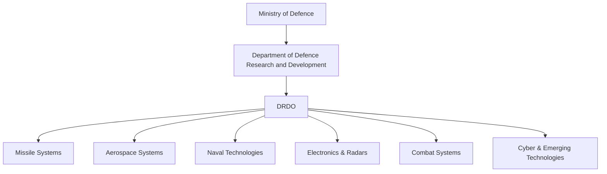
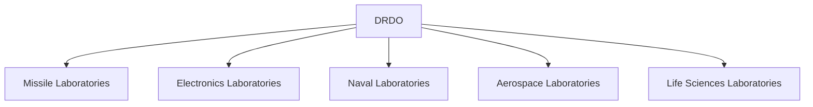

# Defence Research and Development Organisation (DRDO)

## Why It Matters

The Defence Research and Development Organisation (DRDO) is India's premier military research organization. It is responsible for developing indigenous defence technologies, weapons, missiles, aircraft systems, radars, electronic warfare platforms, and strategic military capabilities.

DRDO is the technological backbone of India's defence modernization and self-reliance efforts.

---

## Quick Facts

| Item | Details |
|----------|----------|
| Full Name | Defence Research and Development Organisation |
| Established | 1958 |
| Headquarters | New Delhi |
| Ministry | Ministry of Defence |
| Parent Department | Department of Defence Research and Development |
| Primary Role | Defence Research and Technology Development |
| Motto | Strength's Origin is in Knowledge |
|
---

## Organisation Structure

---

## Why DRDO Was Created

After independence, India relied heavily on foreign military technology.

DRDO was established to:

- Build indigenous defence technology
- Reduce dependence on imports
- Support the armed forces
- Develop strategic military capabilities
- Strengthen national security

---

## Major Responsibilities

- Defence research and development
- Missile development
- Military electronics
- Aerospace technologies
- Radar systems
- Electronic warfare systems
- Strategic weapons development
- Defence innovation and future technologies

---

## How DRDO Works

DRDO designs and develops technologies, while production agencies manufacture systems for operational use.

---

## Major Successes

| Programme | Category |
|----------|----------|
| Agni Series | Ballistic Missiles |
| Prithvi Series | Surface-to-Surface Missiles |
| Akash | Surface-to-Air Missile |
| Astra | Air-to-Air Missile |
| Nag | Anti-Tank Missile |
| BrahMos (Joint Venture) | Supersonic Cruise Missile |
| Arjun | Main Battle Tank |
| Tejas Support Technologies | Aerospace Systems |
| AEW&C Systems | Airborne Early Warning |

---

## Major Technology Domains

### Missile Systems

- Agni
- Prithvi
- Akash
- Astra
- Nag
- QRSAM

### Aerospace

- Aircraft technologies
- UAV systems
- Flight control systems
- Advanced avionics

### Electronics

- Radars
- Communication systems
- Electronic warfare systems
- Surveillance systems

### Naval Systems

- Sonars
- Underwater sensors
- Torpedo technologies
- Naval combat systems

---

## DRDO Laboratory Network

DRDO operates numerous laboratories across India specializing in different defence technologies.

---

## Role in Atmanirbhar Bharat

DRDO supports self-reliance through:

- Indigenous weapon development
- Technology transfer to industry
- Support for defence startups
- Collaboration with academia
- Strategic technology development

---

## Challenges

- Long development timelines
- Rapid technological evolution
- Dependence on some imported components
- Complex testing requirements
- Global technology competition

---

## Future Roadmap

- Hypersonic technologies
- Directed energy weapons
- Artificial intelligence systems
- Autonomous military platforms
- Advanced missile systems
- Space and cyber defence technologies

---

## Quick Revision

- Established in 1958.
- India's premier defence R&D organization.
- Functions under the Ministry of Defence.
- Develops missiles, radars, military electronics and strategic systems.
- Supports Army, Navy and Air Force.
- Core driver of Atmanirbhar Bharat in defence.

---

## Key Concepts

### What is DRDO?

India's primary defence research and technology development organization.

### Which ministry controls DRDO?

The Ministry of Defence.

### Does DRDO manufacture weapons?

Usually DRDO develops and designs systems while production agencies manufacture them.

### Why is DRDO important?

It enables indigenous defence technology development and strategic self-reliance.

### What is DRDO best known for?

Missile programmes, defence electronics, radars, strategic systems, and military research.