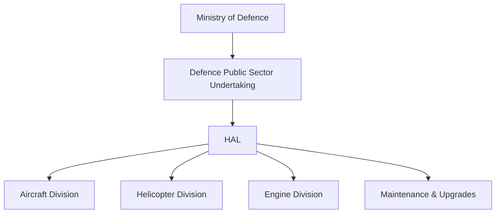
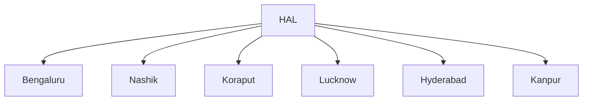

# Hindustan Aeronautics Limited (HAL)

## Why It Matters

Hindustan Aeronautics Limited (HAL) is India's largest aerospace and defence manufacturing company. It designs, develops, manufactures, upgrades, and maintains military aircraft, helicopters, engines, and aerospace systems for the Indian Armed Forces.

HAL is the backbone of India's military aviation ecosystem and plays a critical role in defence self-reliance.

---

## Quick Facts

| Item | Details |
|----------|----------|
| Full Name | Hindustan Aeronautics Limited |
| Established | 1940 |
| Headquarters | Bengaluru, Karnataka |
| Ministry | Ministry of Defence |
| Type | Defence Public Sector Undertaking |
| Sector | Aerospace and Defence Manufacturing |
| Primary Customers | Indian Air Force, Indian Army, Indian Navy |
|
---

## Organisation Structure

---

## Why HAL Was Created

HAL was established to build an indigenous aerospace manufacturing capability.

Its objectives include:

- Manufacturing military aircraft
- Supporting defence aviation
- Reducing dependence on imports
- Developing aerospace technologies
- Supporting long-term defence readiness

---

## Major Responsibilities

- Aircraft manufacturing
- Helicopter manufacturing
- Aircraft upgrades
- Aircraft maintenance and overhaul
- Engine production
- Aerospace research collaboration
- Support for indigenous aviation programmes

---

## HAL in India's Defence Ecosystem

DRDO develops technologies and platforms, while HAL manufactures, integrates, upgrades, and supports many aviation systems.

---

## Major Aircraft Programmes

| Platform | Category |
|----------|----------|
| Tejas | Light Combat Aircraft |
| HTT-40 | Basic Trainer Aircraft |
| HJT-36 Yashas | Intermediate Trainer Aircraft |
| Dornier Do-228 | Transport Aircraft |
| Light Utility Helicopter | Utility Helicopter |
| Light Combat Helicopter Prachand | Attack Helicopter |
| Advanced Light Helicopter Dhruv | Multi-Role Helicopter |
|
---

## Major Helicopter Programmes

### Advanced Light Helicopter (Dhruv)

- Multi-role helicopter
- Used by Army, Navy, Air Force and Coast Guard

### Light Combat Helicopter (Prachand)

- Indigenous attack helicopter
- Designed for high-altitude warfare

### Light Utility Helicopter (LUH)

- Replacement for older utility helicopters
- Suitable for mountainous regions

---

## Aircraft Upgrade Programmes

HAL also upgrades:

- Su-30MKI
- Jaguar
- Mirage support systems
- Various transport aircraft
- Helicopter fleets

These upgrades extend operational life and improve combat capability.

---

## Manufacturing Facilities

HAL operates manufacturing and support facilities across India.

---

## Contribution to Atmanirbhar Bharat

HAL contributes through:

- Indigenous aircraft production
- Indigenous helicopter production
- Technology absorption
- Aerospace manufacturing ecosystem development
- Support for private defence suppliers

---

## Challenges

- Complex aerospace technologies
- Long development cycles
- Engine technology dependence
- Global competition
- Rapid technological changes

---

## Future Roadmap

- Advanced Medium Combat Aircraft support
- Tejas Mk-2 production
- Expanded helicopter manufacturing
- Unmanned aerial systems support
- Next-generation aerospace technologies

---

## Quick Revision

- Established in 1940.
- India's largest aerospace and defence manufacturer.
- Manufactures aircraft, helicopters and aerospace systems.
- Produces Tejas, Dhruv, Prachand and other indigenous platforms.
- Supports all three armed services.
- Key pillar of defence self-reliance.

---

## Key Concepts

### What is HAL?

India's premier aerospace and defence manufacturing company.

### Which ministry controls HAL?

The Ministry of Defence.

### What is HAL famous for?

Tejas fighter aircraft, Dhruv helicopter and Prachand attack helicopter.

### Does HAL perform research?

HAL primarily focuses on design, manufacturing, integration, maintenance and production, while DRDO leads major defence research programmes.

### Why is HAL important?

HAL provides indigenous military aviation capability and reduces dependence on foreign suppliers.