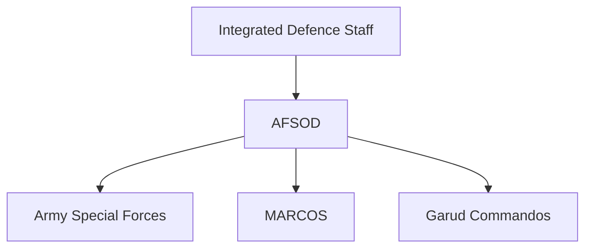
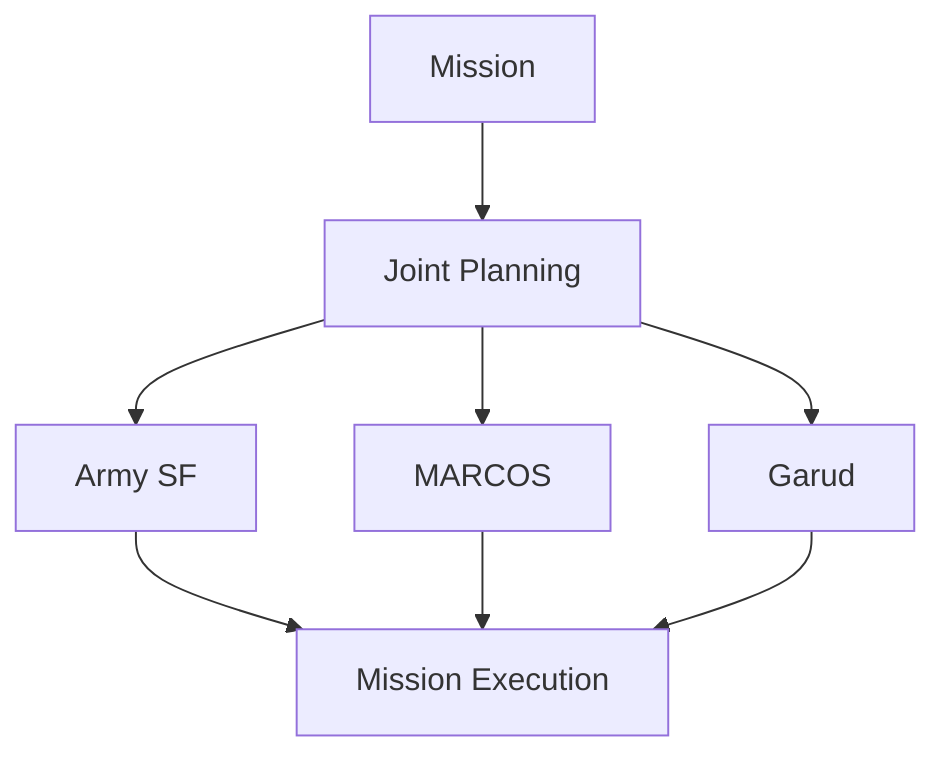
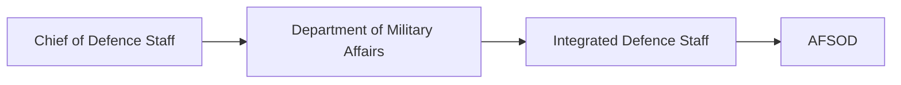

# Armed Forces Special Operations Division (AFSOD)

## Why It Matters

The Armed Forces Special Operations Division (AFSOD) is India's first integrated tri-service special operations organization.

It brings together highly trained personnel from the Indian Army, Indian Navy and Indian Air Force to conduct specialized missions that require joint planning, rapid response and strategic coordination.

AFSOD represents an important step toward greater military jointness and integrated warfare capability.

---

## Quick Facts

| Item | Details |
|----------|----------|
| Name | Armed Forces Special Operations Division (AFSOD) |
| Type | Tri-Service Special Operations Formation |
| Parent Organisation | Integrated Defence Staff |
| Established | 2019 |
| Services Involved | Army, Navy and Air Force |
| Role | Joint Special Operations |
| Importance | Military Jointness and Integration |

---

## What Is AFSOD?

AFSOD is a joint special-operations organization created to conduct missions that require personnel, expertise and capabilities from multiple military services.

The division improves coordination between the Armed Forces and enhances India's ability to conduct complex special operations.

---

## Evolution of Joint Operations

---

## Organisation Structure

---

## Components

### Army Special Forces

Provide:

- Direct action capability
- Strategic reconnaissance
- Counter-terrorism expertise
- Special warfare capability

### MARCOS

Provide:

- Maritime special operations
- Coastal and offshore missions
- Special reconnaissance

### Garud Commandos

Provide:

- Air-base protection expertise
- Air operations support
- Specialized tactical capabilities

---

## Primary Responsibilities

- Joint special operations
- Counter-terrorism missions
- Strategic reconnaissance
- High-value target operations
- Rapid-response missions
- National-security contingencies

---

## Joint Operations Concept

---

## Why Jointness Matters

Jointness improves:

- Operational efficiency
- Resource utilization
- Mission effectiveness
- Inter-service coordination
- Strategic flexibility

AFSOD is one of the major outcomes of India's push toward integrated military structures.

---

## Strategic Importance

AFSOD helps India:

- Improve rapid-response capability
- Conduct complex special operations
- Enhance military integration
- Strengthen counter-terrorism capability
- Improve preparedness for future conflicts

---

## Relationship with Defence Reforms

AFSOD is closely linked to broader defence reforms focused on jointness and theatre-level integration.

---

## Challenges

- Inter-service coordination requirements
- Complex mission planning
- Evolving security threats
- Technology integration
- Future theatre-command transition

---

## Future Roadmap

- Greater joint-operational capability
- Enhanced intelligence integration
- Advanced special-operations equipment
- Improved interoperability
- Alignment with future theatre commands

---

## Quick Revision

- AFSOD was established in 2019.
- It is India's first tri-service special-operations formation.
- Includes Army Special Forces, MARCOS and Garud Commandos.
- Operates under the Integrated Defence Staff.
- Supports joint special operations.
- Promotes military jointness and integration.

---

## Key Concepts

### What is AFSOD?

India's integrated tri-service special-operations organization.

### Why was AFSOD created?

To improve joint special-operations capability and military integration.

### Which forces contribute to AFSOD?

Army Special Forces, MARCOS and Garud Commandos.

### Why is AFSOD important?

It strengthens India's ability to conduct complex joint operations.

### How is AFSOD connected to defence reforms?

It is part of India's broader effort to improve military jointness and integration.