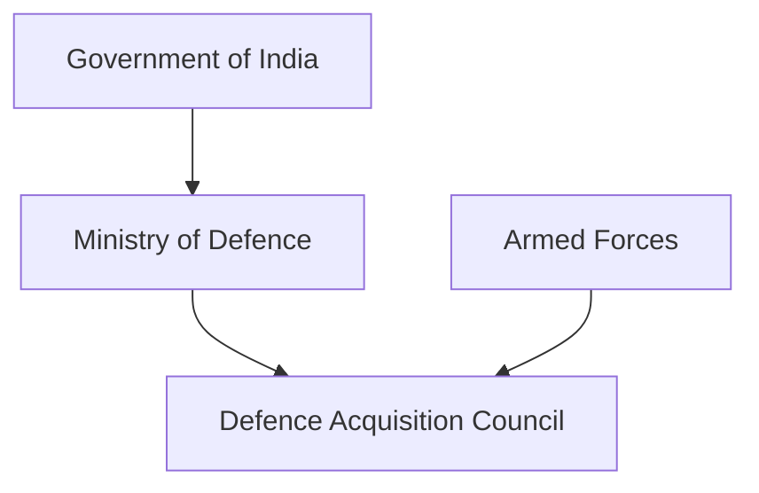
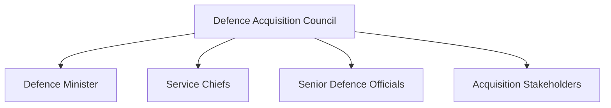
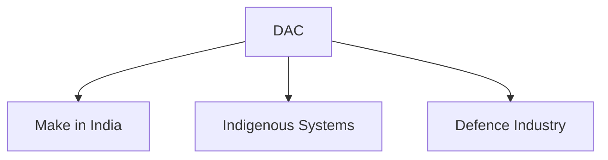

# Defence Acquisition Council (DAC)

## Why It Matters

The Defence Acquisition Council (DAC) is India's highest decision-making body for defence procurement.

It plays a central role in modernizing the Armed Forces by approving major defence acquisitions, promoting indigenous defence manufacturing and ensuring that military capabilities keep pace with evolving security challenges.

The DAC is one of the most important institutions in India's defence-modernization framework.

---

## Quick Facts

| Item | Details |
|----------|----------|
| Name | Defence Acquisition Council (DAC) |
| Established | 2001 |
| Chairperson | Defence Minister |
| Domain | Defence Procurement |
| Role | Highest Defence Acquisition Body |
| Objective | Modernization of Armed Forces |
| Importance | Capability Development |

---

## What Is the DAC?

The Defence Acquisition Council is the apex body responsible for making major decisions related to defence procurement and acquisition.

It evaluates military requirements, approves acquisition proposals and supports long-term capability development.

---

## Why Was the DAC Created?

The DAC was established to:

- Improve defence procurement processes
- Accelerate military modernization
- Enhance transparency in acquisitions
- Strengthen long-term capability planning
- Support national-security objectives

---

## Position in Defence Structure

---

## Composition of DAC

The Defence Minister serves as the Chairperson of the DAC.

---

## Primary Responsibilities

- Defence procurement approvals
- Capability-development decisions
- Acquisition planning
- Modernization initiatives
- Indigenous procurement promotion
- Strategic acquisition oversight

---

## Defence Procurement Process

---

## Role in Military Modernization

DAC supports modernization through:

- New equipment acquisition
- Technology upgrades
- Capability enhancement
- Future-force planning
- Strategic procurement decisions

---

## Support for Indigenous Defence Manufacturing

The council increasingly emphasizes indigenous procurement and defence self-reliance.

---

## Relationship with Defence Reforms

DAC contributes to:

- Atmanirbhar Bharat initiatives
- Defence-industrial development
- Technology modernization
- Long-term capability planning

---

## Strategic Importance

DAC helps India:

- Modernize the Armed Forces
- Improve operational readiness
- Support indigenous defence production
- Strengthen national security
- Enhance future military capability

---

## Challenges

- Rapid technological change
- Long procurement timelines
- Balancing cost and capability
- Complex acquisition requirements
- Future warfare demands

---

## Future Roadmap

- Faster procurement processes
- Greater indigenous content
- Advanced technology acquisition
- Improved acquisition planning
- Stronger defence-industrial integration

---

## Quick Revision

- DAC is the highest defence-acquisition body in India.
- Established in 2001.
- Chaired by the Defence Minister.
- Approves major defence procurements.
- Supports Armed Forces modernization.
- Promotes indigenous defence manufacturing.

---

## Key Concepts

### What is the Defence Acquisition Council?

India's apex body for defence procurement decisions.

### Who chairs the DAC?

The Defence Minister.

### Why is DAC important?

It guides military modernization and capability development.

### What role does DAC play in defence procurement?

It approves major acquisition proposals and modernization initiatives.

### How does DAC support self-reliance?

By encouraging indigenous procurement and domestic defence manufacturing.