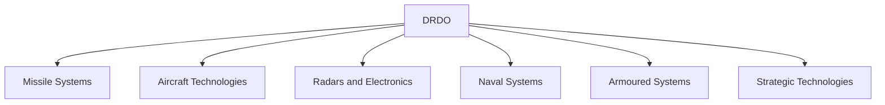
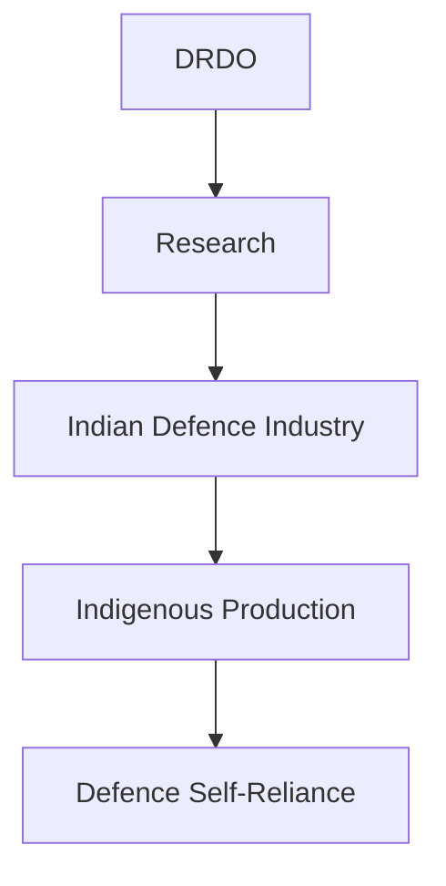

# Defence Research and Development Organisation (DRDO)

## Why It Matters

The Defence Research and Development Organisation (DRDO) is India's premier defence research agency responsible for developing indigenous military technologies and strategic capabilities.

DRDO has played a major role in strengthening India's self-reliance in defence through the development of missiles, radars, electronic warfare systems, aircraft technologies, naval systems, armoured platforms and strategic technologies.

It is one of the most important institutions supporting India's defence modernization and technological advancement.

---

## Quick Facts

| Item | Details |
|----------|----------|
| Name | Defence Research and Development Organisation (DRDO) |
| Established | 1958 |
| Ministry | Ministry of Defence |
| Headquarters | New Delhi |
| Domain | Defence Research and Development |
| Motto | Strength's Origin is in Science |
| Importance | Indigenous Defence Technology |

---

## Historical Background

DRDO was established in 1958 through the merger of existing defence technical organizations.

Over the decades, it evolved into India's primary defence research institution and became a key pillar of indigenous defence capability development.

---

## What Is DRDO?

DRDO is India's leading defence-research organization responsible for designing, developing and testing technologies required by the Armed Forces.

Its work spans multiple domains including:

- Missiles
- Aircraft systems
- Radars
- Electronic warfare
- Naval systems
- Armoured platforms
- Strategic technologies

---

## Organisation Structure

---

## Research and Development Cycle

---

## Major Laboratories

DRDO operates numerous laboratories specializing in:

- Missiles and strategic systems
- Aeronautics
- Electronics and radar systems
- Naval technologies
- Life sciences
- Materials and metallurgy
- Artificial intelligence and emerging technologies

---

## Missile Programmes

DRDO has contributed significantly to:

- Prithvi Missile Series
- Agni Missile Series
- Akash Air Defence System
- Ballistic Missile Defence Programme
- Advanced missile technologies

These programmes form a major part of India's strategic deterrence capability.

---

## Aircraft Programmes

DRDO supports development of:

- Combat-aircraft technologies
- Unmanned systems
- Avionics
- Flight-control systems
- Aeronautical research

These efforts contribute to India's aerospace capabilities.

---

## Radar and Electronic Systems

Key focus areas include:

- Surveillance radars
- Battlefield sensors
- Electronic warfare systems
- Communication technologies
- Air-defence systems

These technologies improve situational awareness and operational effectiveness.

---

## Naval Technologies

DRDO develops technologies for:

- Naval weapons
- Underwater systems
- Sonars
- Naval sensors
- Maritime surveillance systems

These capabilities support the Indian Navy.

---

## Armoured and Land Systems

DRDO contributes to:

- Armoured fighting vehicles
- Protection systems
- Artillery technologies
- Battlefield mobility solutions
- Soldier-support equipment

---

## Strategic and Emerging Technologies

Important areas include:

- Artificial intelligence
- Directed-energy technologies
- Hypersonic research
- Cyber technologies
- Space-related defence applications

These areas are increasingly important for future warfare.

---

## Role in Atmanirbhar Bharat

DRDO plays a central role in India's defence self-reliance initiatives.

---

## Major Achievements

- Development of strategic missile systems
- Indigenous air-defence technologies
- Radar and surveillance systems
- Naval defence technologies
- Electronic warfare systems
- Support for strategic deterrence programmes

---

## Strategic Importance

DRDO helps India:

- Reduce dependence on imports
- Strengthen defence self-reliance
- Develop strategic technologies
- Modernize the Armed Forces
- Support long-term national security

---

## Challenges

- Rapid technological evolution
- Complex research requirements
- Global technology competition
- Long development cycles
- Future warfare demands

---

## Future Roadmap

- Advanced missile technologies
- Artificial intelligence integration
- Autonomous systems
- Hypersonic capabilities
- Space and cyber technologies
- Greater industry collaboration

---

## Quick Revision

- DRDO was established in 1958.
- India's premier defence-research organization.
- Operates under the Ministry of Defence.
- Develops missiles, radars, aircraft and strategic technologies.
- Supports Atmanirbhar Bharat in defence.
- Plays a key role in military modernization.

---

## Key Concepts

### What is DRDO?

India's primary defence research and development organization.

### Why is DRDO important?

It develops indigenous military technologies and supports defence self-reliance.

### Which ministry controls DRDO?

The Ministry of Defence.

### What are DRDO's major areas of work?

Missiles, aircraft, radars, naval systems, armoured systems and strategic technologies.

### How does DRDO support national security?

By developing technologies that strengthen India's military capabilities and strategic independence.