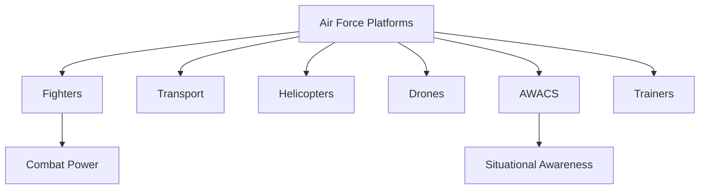

# Air Force Platforms

## Why It Matters

Air power is a critical component of modern warfare. Air Force platforms provide air superiority, strategic reach, surveillance, reconnaissance, air defence, logistics support, and precision strike capabilities.

The Indian Air Force operates a diverse mix of fighters, transport aircraft, helicopters, drones, trainers, and airborne surveillance systems to support national security objectives.

Understanding these platforms helps explain how air power contributes to deterrence, combat operations, and joint military missions.

---

## Learning Objectives

After completing this section, you should understand:

- Major categories of Air Force platforms
- Roles of fighter aircraft and transport fleets
- Importance of airborne surveillance systems
- Military drone capabilities
- Air mobility and logistics support
- Modern air warfare concepts

---

## Repository Structure

```text
air-force-platforms
├── README.md
├── fighter-aircraft.md
├── transport-aircraft.md
├── helicopters.md
├── drones.md
├── airborne-warning-systems.md
└── trainers.md
```

---

## Learning Path


---

## Platform Categories

### Fighter Aircraft

Primary combat platforms used for air superiority, interception, air defence, and strike missions.

### Transport Aircraft

Provide strategic and tactical airlift capabilities for troops, equipment, and humanitarian operations.

### Helicopters

Support transport, logistics, rescue, reconnaissance, and combat missions.

### Drones

Used for surveillance, intelligence gathering, targeting, and increasingly for offensive operations.

### Airborne Warning Systems

Provide airborne surveillance, command-and-control support, and battlefield awareness.

### Trainers

Used for pilot training and operational skill development.

---

## Air Power Ecosystem



---

## Importance in Modern Warfare

- Air superiority operations
- Strategic deterrence
- Rapid force deployment
- Intelligence, Surveillance and Reconnaissance (ISR)
- Precision strike missions
- Humanitarian assistance and disaster relief

---

## Quick Revision

- Fighters provide combat capability.
- Transport aircraft provide strategic mobility.
- Helicopters support multiple mission types.
- Drones improve surveillance and targeting.
- AWACS improves battlefield awareness.
- Trainers develop future pilots.

---

## Key Concepts

### Easy

1. What are the major categories of Air Force platforms?
2. What is the role of fighter aircraft?
3. Why are transport aircraft important?
4. What are AWACS systems?

### Intermediate

1. How do drones support modern air operations?
2. Explain the importance of airborne warning systems.
3. What role do helicopters play in military operations?
4. How does air mobility support national security?

### Advanced

1. Analyse the importance of air power in modern warfare.
2. Evaluate the role of ISR platforms in military operations.
3. Explain how different Air Force platforms support joint operations.