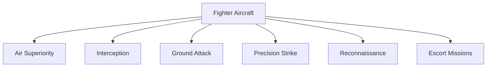

# Fighter Aircraft

## Why It Matters

Fighter aircraft are the cornerstone of a nation's air defence and offensive capabilities. They ensure control of the skies, protect national airspace, support ground operations, and provide strategic deterrence. For India, maintaining a versatile and modern fighter fleet is essential to counter evolving security challenges and assert regional air superiority.

---

## Quick Facts

| Item | Details |
|----------|----------|
| Primary Operator | Indian Air Force |
| Main Role | Air Combat and Strike Operations |
| Strategic Purpose | Air Superiority, Precision Strike, and National Defence |
| Key Capability | Speed, Maneuverability, Multi-role Flexibility |
| Modern Requirement | Network-Centric Warfare and Stealth |
| Future Focus | Indigenous Development and Advanced Technologies |

---

## What Is a Fighter Aircraft?

A fighter aircraft is a military plane designed primarily for air-to-air combat, interception, and precision strikes. Modern fighters also perform multirole tasks including ground attack, reconnaissance, and electronic warfare, adapting to complex battlefield environments.

---

## Fighter Aircraft Mission Types



---

## Major Fighter Aircraft of the Indian Air Force

| Aircraft       | Origin          | Generation | Primary Role          | Status        |
|----------------|-----------------|------------|-----------------------|---------------|
| Su-30MKI       | India/Russia    | 4++        | Multirole Fighter     | Active        |
| Rafale         | France          | 4.5+       | Multirole Fighter     | Active        |
| Tejas Mk1/Mk1A | India           | 4          | Light Combat Aircraft | Active/Induction |
| Mirage 2000    | France          | 4          | Multirole Fighter     | Active        |
| MiG-29         | Russia          | 4          | Air Superiority       | Active        |
| Jaguar         | UK/France       | 3.5        | Strike Aircraft       | Active        |

---

## Fighter Aircraft Classification

| Classification          | Description                        | Indian Examples                |
|------------------------|----------------------------------|-------------------------------|
| Air Superiority Fighters | Designed to dominate enemy aircraft in air-to-air combat | MiG-29, Su-30MKI               |
| Multirole Fighters      | Capable of air-to-air and air-to-ground missions | Rafale, Mirage 2000, Su-30MKI  |
| Strike Aircraft         | Specialized in deep strike and ground attack missions | Jaguar                        |
| Light Combat Aircraft   | Lightweight, agile fighters for tactical roles | Tejas Mk1/Mk1A                |

---

## Su-30MKI

### Key Features
- Twin-engine, twin-seat multirole fighter
- Advanced thrust-vectoring engines for superior maneuverability
- Long-range and heavy weapons payload capability
- Integrated avionics with Indian and Russian systems
- Capable of air superiority, interception, and ground attack

### Operational Role
Acts as the backbone of the IAF’s fighter fleet, excelling in air dominance and precision strike roles over extended ranges.

### Why It Matters
Its versatility and advanced capabilities provide India with a strategic edge in regional air combat scenarios.

---

## Rafale

### Key Features
- Multirole 4.5 generation fighter with stealth features
- Advanced AESA radar and electronic warfare suite
- Capable of beyond-visual-range (BVR) combat and precision strikes
- Network-centric warfare enabled with data link connectivity
- Wide weapon compatibility including nuclear delivery

### Operational Role
Enhances IAF’s multirole strike and air superiority capabilities with state-of-the-art avionics and sensor fusion.

### Why It Matters
Significantly boosts India’s air combat effectiveness and strategic deterrence.

---

## Tejas Mk1/Mk1A

### Key Features
- Indigenous lightweight fighter with modern avionics
- Fly-by-wire control system and composite airframe
- Capable of precision strikes and air defence
- Mk1A variant includes improved radar, electronic warfare, and weapons integration
- Designed for ease of maintenance and cost-effectiveness

### Operational Role
Serves as a frontline light combat aircraft for tactical air defence and ground support missions.

### Why It Matters
Represents India’s growing self-reliance in aerospace and reduces dependence on imports.

---

## Mirage 2000

### Key Features
- Proven multirole fighter with precision strike capability
- Highly reliable with a strong operational track record
- Advanced avionics and weapon systems upgrades
- Capable of nuclear and conventional missions

### Operational Role
Provides multirole strike and air defence capability with high mission readiness.

### Why It Matters
A dependable platform that complements newer fighters and extends operational flexibility.

---

## MiG-29

### Key Features
- Agile air superiority fighter with excellent dogfighting capabilities
- Twin-engine design with high thrust-to-weight ratio
- Equipped with advanced radar and missile systems
- Primarily used for interception and air defence

### Operational Role
Acts as a quick reaction interceptor and air defence asset in the IAF.

### Why It Matters
Maintains airspace security and rapid response capability against hostile incursions.

---

## Jaguar

### Key Features
- Twin-engine deep strike and ground attack aircraft
- Long-range strike capability with precision-guided munitions
- Robust airframe suited for low-level penetration missions
- Integrated navigation and targeting systems

### Operational Role
Specialized in interdiction, close air support, and deep strike missions.

### Why It Matters
Provides critical strike capability to neutralize enemy infrastructure and support ground forces.

---

## Air Combat Ecosystem

```mermaid
flowchart LR
    Radar[Radars & Sensors]
    IACCS[IACCS (Integrated Air Command & Control System)]
    AWACS[AWACS]
    Fighter[Fighter Aircraft]
    Weapons[Weapons Systems]
    Target[Hostile Aircraft/Targets]

    Radar --> IACCS
    IACCS --> AWACS
    AWACS --> Fighter
    Fighter --> Weapons
    Weapons --> Target
```

---

## Challenges

- High operating and maintenance costs for advanced fighters
- Rapid technological advancements requiring continuous upgrades
- Fleet modernization amidst ageing platforms
- Pilot training and retention to handle complex systems
- Electronic warfare threats and countermeasures
- Integration of indigenous and imported systems

---

## Future Roadmap

- Tejas Mk-2: Enhanced range, payload, and avionics for multirole capability
- Advanced Medium Combat Aircraft (AMCA): Fifth-generation stealth fighter under development
- TEDBF (Twin Engine Deck Based Fighter): Indigenous naval fighter for aircraft carriers
- Greater network integration and AI-enabled systems
- Next-generation weapons including hypersonic missiles and directed energy weapons

---

## Quick Revision

- Fighter aircraft secure airspace and enable offensive operations.
- Su-30MKI is the IAF’s multirole backbone.
- Rafale adds advanced sensor fusion and precision strike.
- Tejas Mk1/Mk1A is India’s indigenous light combat aircraft.
- Mirage 2000, MiG-29, and Jaguar support multirole and strike missions.
- Future focus includes AMCA, TEDBF, and fleet modernization.

---

## Key Fighter Aircraft Programmes

### Tejas Mk1A
- Improved radar and electronic warfare suite
- Enhanced weapons compatibility
- Reduced maintenance turnaround time
- Increased operational availability

### Tejas Mk2
- More powerful engine and larger airframe
- Extended range and payload capacity
- Advanced avionics and sensor fusion
- Designed for multirole operations

### Advanced Medium Combat Aircraft (AMCA)
- Fifth-generation stealth multirole fighter
- Internal weapons bays and advanced sensors
- AI-enabled systems and sensor fusion
- Indigenous design with reduced radar cross-section

### Twin Engine Deck Based Fighter (TEDBF)
- Carrier-based twin-engine fighter for Indian Navy
- Stealth features and multirole capability
- Designed for naval operations including carrier takeoff/landing
- Complements IAF’s fighter fleet with naval strike power

---

## India's Fighter Fleet Challenges

- Squadron shortages limiting operational readiness
- Ageing aircraft requiring upgrades or replacement
- Heavy dependence on imported platforms and components
- Complex maintenance and logistics chains
- Rising capabilities of regional adversaries, notably China and Pakistan

---

## Interview Questions

### Easy
1. What is the primary role of fighter aircraft?
2. Name two fighter aircraft currently operated by the Indian Air Force.
3. What does "multirole fighter" mean?
4. Why is the Tejas aircraft important for India?

### Intermediate
1. Explain the difference between air superiority fighters and strike aircraft.
2. What are the key features of the Su-30MKI that make it a backbone of the IAF?
3. Describe the significance of network-centric warfare in modern air combat.
4. What challenges does the Indian Air Force face in maintaining its fighter fleet?

### Advanced
1. Discuss the strategic importance of the AMCA programme for India’s future air power.
2. How does the integration of AWACS and IACCS enhance fighter aircraft effectiveness?
3. Analyze the impact of emerging electronic warfare threats on fighter operations.
4. Compare and contrast the operational roles of Rafale and MiG-29 in the IAF.