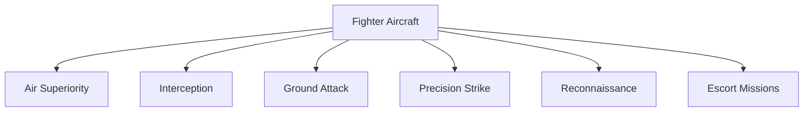
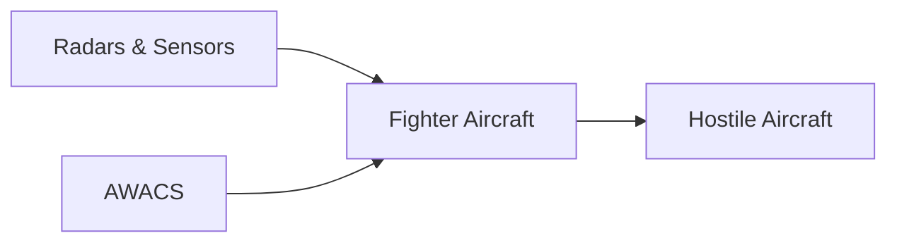

# Fighter Aircraft

## Why It Matters

Fighter aircraft are the primary offensive and defensive weapons of an air force. They protect national airspace, intercept hostile aircraft, conduct precision strikes, support ground forces, and provide strategic deterrence.

The Indian Air Force (IAF) relies on a mix of indigenous and imported fighter aircraft to maintain air superiority and combat readiness.

---

## Quick Facts

| Item | Details |
|----------|----------|
| Primary Operator | Indian Air Force |
| Main Role | Air Combat and Strike Operations |
| Strategic Purpose | Air Superiority and National Defence |
| Key Capability | Speed, Maneuverability and Firepower |
| Modern Requirement | Network-Centric Warfare |
| Future Focus | Indigenous Fighter Development |

---

## What Is a Fighter Aircraft?

A fighter aircraft is a military aircraft designed primarily for air-to-air combat, air defence, interception, and precision strike missions.

---

## Fighter Aircraft Mission Types

---

## Major Fighter Aircraft of the Indian Air Force

| Aircraft | Origin | Category |
|----------|----------|----------|
| Su-30MKI | India/Russia | Multirole Fighter |
| Rafale | France | Multirole Fighter |
| Tejas | India | Light Combat Aircraft |
| Mirage 2000 | France | Multirole Fighter |
| MiG-29 | Russia | Air Superiority Fighter |
| Jaguar | United Kingdom/France | Deep Strike Aircraft |

---

## Su-30MKI

### Key Features

- Mainstay of the Indian Air Force
- Long-range operations
- Heavy weapons payload
- Multirole capability
- Air superiority missions

### Importance

The Su-30MKI forms the backbone of India's fighter fleet.

---

## Rafale

### Key Features

- Advanced sensors and avionics
- Precision strike capability
- Beyond-visual-range combat capability
- Network-centric warfare support

### Importance

Rafale significantly improves India's air combat capability.

---

## Tejas Light Combat Aircraft

### Key Features

- Indigenous fighter aircraft
- Developed in India
- Modern avionics
- Lightweight and agile design

### Importance

Tejas represents India's growing aerospace and defence capability.

---

## Mirage 2000

### Key Features

- Precision strike capability
- Proven operational record
- Modernized systems

### Importance

Widely regarded as one of the most reliable platforms in the IAF.

---

## MiG-29

### Key Features

- Air defence role
- High maneuverability
- Interception capability

### Importance

Provides rapid-response air defence capability.

---

## Jaguar

### Key Features

- Deep strike missions
- Ground attack capability
- Long operational history

### Importance

Primarily used for strike operations.

---

## How Fighter Aircraft Support National Security

---

## Weapons Used by Fighter Aircraft

- Air-to-Air Missiles
- Air-to-Ground Missiles
- Precision Guided Bombs
- Anti-Ship Missiles
- Guided Munitions
- Internal Cannon Systems

---

## Challenges

- High operating costs
- Rapid technological changes
- Advanced electronic warfare threats
- Fleet modernization requirements
- Pilot training demands

---

## Future Roadmap

- Tejas Mk-2
- Advanced Medium Combat Aircraft (AMCA)
- More indigenous systems
- Greater network integration
- Next-generation weapons and sensors

---

## Quick Revision

- Fighter aircraft are the core combat platforms of the IAF.
- Su-30MKI is the backbone of the fighter fleet.
- Rafale provides advanced multirole capability.
- Tejas is India's indigenous fighter aircraft.
- Mirage 2000, MiG-29 and Jaguar continue to support combat operations.
- Future focus is on Tejas Mk-2 and AMCA.

---

## Key Concepts

### What is a fighter aircraft?

A military aircraft designed primarily for combat operations.

### Which fighter forms the backbone of the IAF?

The Su-30MKI.

### What is India's indigenous fighter aircraft?

The Tejas Light Combat Aircraft.

### Why is Rafale important?

It provides advanced air combat and precision strike capability.

### What is AMCA?

India's future Advanced Medium Combat Aircraft programme.