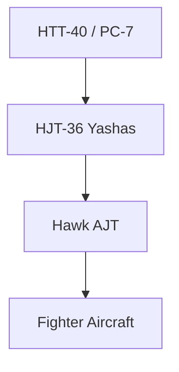

# Trainer Aircraft

## Why It Matters

Trainer aircraft are used to prepare military pilots before they operate frontline combat aircraft. Every fighter pilot, transport pilot, and helicopter pilot begins their journey through a structured training system.

Without trainer aircraft, air forces cannot safely develop skilled pilots capable of operating advanced military platforms.

---

## Quick Facts

| Item | Details |
|----------|----------|
| Primary Operator | Indian Air Force |
| Main Purpose | Pilot Training |
| Training Stages | Basic, Intermediate and Advanced |
| Strategic Importance | Development of Combat-Ready Pilots |
| Indigenous Programme | HTT-40 |
| Final Goal | Operational Conversion to Combat Aircraft |

---

## Pilot Training Pipeline

---

## Why Trainer Aircraft Are Important

- Develop flying skills
- Build combat readiness
- Train pilots safely
- Reduce operational risks
- Prepare pilots for advanced aircraft
- Standardize air-force training

---

## Types of Trainer Aircraft

### Basic Trainers

Used during the initial stage of pilot training.

Focus areas:

- Aircraft handling
- Navigation basics
- Flying procedures
- Fundamental aviation skills

### Intermediate Trainers

Used after basic training.

Focus areas:

- Instrument flying
- Formation flying
- Operational procedures

### Advanced Trainers

Used before transition to combat aircraft.

Focus areas:

- Weapons training
- Tactical operations
- Combat manoeuvres
- Mission planning

---

## Major Trainer Aircraft Used by India

| Aircraft | Origin | Training Role |
|----------|----------|----------|
| HTT-40 | India | Basic Trainer |
| Pilatus PC-7 Mk II | Switzerland | Basic Trainer |
| Hawk AJT | United Kingdom | Advanced Jet Trainer |
| HJT-36 Yashas | India | Intermediate Trainer |

---

## HTT-40

### Key Features

- Indigenous trainer aircraft
- Developed by HAL
- Supports pilot training requirements
- Modern training systems

### Importance

Represents India's effort to strengthen indigenous aviation training capability.

---

## Pilatus PC-7 Mk II

### Key Features

- Basic training platform
- Reliable and proven design
- Widely used in pilot training

### Importance

Provides foundational flying experience to new pilots.

---

## Hawk Advanced Jet Trainer

### Key Features

- Advanced jet trainer
- High-performance training platform
- Combat-oriented training environment

### Importance

Prepares pilots for modern fighter aircraft such as Su-30MKI, Rafale and Tejas.

---

## HJT-36 Yashas

### Key Features

- Indigenous intermediate trainer
- Bridges the gap between basic and advanced training
- Supports future pilot training requirements

### Importance

Strengthens India's self-reliance in military aviation training.

---

## Training Progression

---

## Challenges

- Growing pilot requirements
- Modernization of training systems
- Cost of advanced flight training
- Need for indigenous solutions
- Integration of simulation technologies

---

## Future Roadmap

- Expansion of indigenous trainer programmes
- Greater use of simulators
- Advanced digital training systems
- Improved pilot training efficiency
- Stronger self-reliance in aviation training

---

## Quick Revision

- Trainer aircraft prepare pilots for operational service.
- Training occurs in basic, intermediate and advanced stages.
- HTT-40 is India's indigenous basic trainer.
- Hawk AJT is the primary advanced jet trainer.
- HJT-36 Yashas supports intermediate training.
- Trainer aircraft are essential for developing combat-ready pilots.

---

## Key Concepts

### Why are trainer aircraft important?

They prepare pilots for safe and effective military operations.

### What are the three stages of pilot training?

Basic, Intermediate and Advanced training.

### What is HTT-40?

India's indigenous basic trainer aircraft.

### What is Hawk AJT used for?

Advanced jet training before pilots move to frontline combat aircraft.

### Why is indigenous trainer development important?

It reduces dependence on foreign training platforms and strengthens self-reliance.
