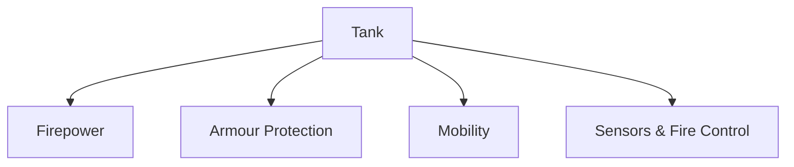
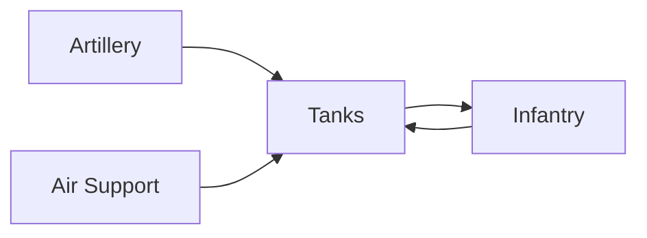

# Tanks

## Why It Matters

Tanks are among the most powerful land-combat platforms in modern warfare. They combine firepower, armour protection and mobility, allowing armies to conduct offensive operations, break enemy defences and dominate the battlefield.

For India, tanks play a critical role in defending borders, maintaining deterrence and supporting mechanized warfare operations.

---

## Quick Facts

| Item | Details |
|----------|----------|
| Primary Operator | Indian Army |
| Main Purpose | Armoured Warfare |
| Key Strengths | Firepower, Protection, Mobility |
| Battlefield Role | Offensive and Defensive Operations |
| Main Category | Main Battle Tank (MBT) |
| Strategic Importance | Land Combat Dominance |

---

## What Is a Tank?

A tank is a heavily armoured combat vehicle equipped with a large-calibre gun, advanced targeting systems and strong battlefield mobility.

---

## Core Components of a Tank

---

## Why Tanks Are Important

- Break enemy defensive positions
- Support infantry operations
- Provide battlefield shock effect
- Defend strategic sectors
- Conduct rapid offensive manoeuvres
- Strengthen deterrence capability

---

## Major Tanks Used by India

| Tank | Origin | Category |
|----------|----------|----------|
| Arjun Mk-1A | India | Main Battle Tank |
| T-90 Bhishma | Russia/India | Main Battle Tank |
| T-72 Ajeya | Soviet Origin | Main Battle Tank |

---

## Arjun Main Battle Tank

### Key Features

- Indigenous tank programme
- Advanced fire-control systems
- Strong armour protection
- High battlefield survivability

### Importance

Represents India's indigenous armoured warfare capability.

---

## T-90 Bhishma

### Key Features

- Modern combat tank
- Advanced weapon systems
- Night-fighting capability
- High operational mobility

### Importance

Forms the backbone of India's armoured strike formations.

---

## T-72 Ajeya

### Key Features

- Proven combat platform
- Large fleet strength
- Modernized variants in service

### Importance

Continues to support frontline armoured units.

---

## Tanks in Combined-Arms Warfare

Modern warfare relies on tanks operating alongside infantry, artillery and air support.

---

## Operational Roles

### Offensive Operations

- Breakthrough attacks
- Deep penetration missions
- Rapid advances

### Defensive Operations

- Hold strategic sectors
- Counter enemy armour
- Strengthen defensive positions

### Border Security

- Rapid deployment capability
- Strategic deterrence
- Crisis response operations

---

## Challenges

- Anti-tank guided missiles (ATGMs)
- Drone-based threats
- High maintenance requirements
- Difficult terrain
- Evolving battlefield technologies

---

## Future Roadmap

- Future Ready Combat Vehicle (FRCV)
- Improved active protection systems
- Better battlefield networking
- Advanced sensors and targeting systems
- Greater indigenous manufacturing
- Integration with unmanned systems

---

## Quick Revision

- Tanks combine firepower, armour and mobility.
- T-90 Bhishma is India's primary frontline tank.
- Arjun Mk-1A is India's indigenous tank.
- T-72 Ajeya remains an important platform.
- Tanks are central to mechanized warfare.
- Future focus includes FRCV and advanced protection systems.

---

## Key Concepts

### What is a tank?

A heavily armoured combat vehicle designed for frontline warfare.

### What are the three core strengths of a tank?

Firepower, armour protection and mobility.

### Which tank forms the backbone of India's armoured forces?

The T-90 Bhishma.

### What is Arjun Mk-1A?

India's indigenous main battle tank.

### What is FRCV?

The Future Ready Combat Vehicle programme intended to support future armoured warfare requirements.