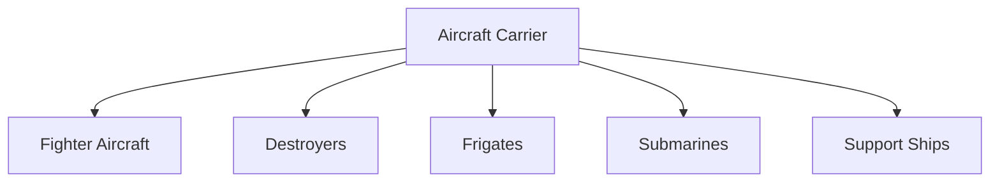

# Aircraft Carriers

## Why It Matters

Aircraft carriers are among the most powerful military platforms in the world. They function as mobile airbases at sea, allowing a country to project military power far beyond its coastline.

For India, aircraft carriers are critical for protecting maritime interests, securing sea lanes, supporting naval operations and maintaining a strong presence across the Indian Ocean Region.

---

## Quick Facts

| Item | Details |
|----------|----------|
| Primary Operator | Indian Navy |
| Main Purpose | Sea-Based Air Power |
| Key Capability | Mobile Airbase |
| Strategic Role | Power Projection |
| Operational Area | Indian Ocean Region and Beyond |
| Strategic Importance | Maritime Dominance |

---

## What Is an Aircraft Carrier?

An aircraft carrier is a warship designed to carry, launch, recover and support military aircraft while operating at sea.

It acts as a floating airbase capable of conducting air operations without relying on land-based infrastructure.

---

## Aircraft Carrier Battle Group

---

## Why Aircraft Carriers Are Important

- Project power far from home waters
- Protect maritime trade routes
- Support naval air operations
- Strengthen deterrence capability
- Enhance regional influence
- Support humanitarian assistance missions

---

## India's Aircraft Carriers

| Carrier | Status | Type |
|----------|----------|----------|
| INS Vikramaditya | Active Service | Aircraft Carrier |
| INS Vikrant | Active Service | Indigenous Aircraft Carrier |

---

## INS Vikramaditya

### Key Features

- Carrier-based fighter operations
- Long-range naval deployment capability
- Supports fleet air defence
- Integral part of carrier battle groups

### Importance

Served as India's primary aircraft carrier before the commissioning of INS Vikrant.

---

## INS Vikrant

### Key Features

- India's first indigenous aircraft carrier
- Designed and built in India
- Modern carrier aviation capability
- Supports long-term naval self-reliance

### Importance

Represents a major milestone in India's defence manufacturing and shipbuilding capability.

---

## Carrier-Based Aircraft

Aircraft carriers support:

- Fighter aircraft
- Naval helicopters
- Search and rescue missions
- Maritime surveillance operations

### Major Aircraft

| Aircraft | Role |
|----------|----------|
| MiG-29K | Carrier-Based Fighter |
| MH-60R | Naval Helicopter |
| Kamov Helicopters | Naval Operations |

---

## Aircraft Carrier Operations

---

## Strategic Importance for India

Aircraft carriers help India:

- Maintain presence in the Indian Ocean Region
- Protect maritime trade routes
- Respond to regional crises
- Support friendly nations
- Conduct evacuation and disaster-relief operations
- Strengthen maritime deterrence

---

## Challenges

- High acquisition and operating costs
- Complex maintenance requirements
- Dependence on escort warships
- Growing anti-ship missile threats
- Requirement for advanced naval aviation capability

---

## Future Roadmap

- Strengthening carrier battle groups
- Expansion of indigenous shipbuilding capability
- Improved carrier aviation systems
- Enhanced maritime surveillance integration
- Evaluation of future carrier requirements

---

## Quick Revision

- Aircraft carriers are floating airbases.
- They provide sea-based air power.
- INS Vikramaditya and INS Vikrant are India's aircraft carriers.
- INS Vikrant is India's first indigenous aircraft carrier.
- Carriers operate with destroyers, frigates and submarines.
- Aircraft carriers are central to maritime power projection.

---

## Key Concepts

### What is an aircraft carrier?

A warship that carries and operates military aircraft at sea.

### Why are aircraft carriers important?

They provide long-range sea-based air power and strategic reach.

### Which aircraft carriers does India currently operate?

INS Vikramaditya and INS Vikrant.

### Why is INS Vikrant significant?

It is India's first indigenously built aircraft carrier.

### What is a carrier battle group?

A formation of warships and support vessels organized around an aircraft carrier.