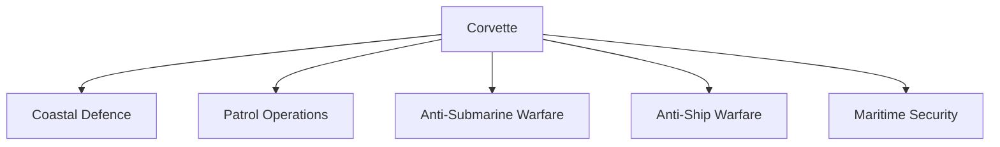

# Corvettes

## Why It Matters

Corvettes are small, fast and highly maneuverable warships designed for coastal defence, patrol missions, anti-submarine warfare and maritime security operations.

For India, corvettes play a critical role in protecting coastal waters, securing maritime approaches, safeguarding strategic assets and responding rapidly to regional threats.

---

## Quick Facts

| Item | Details |
|----------|----------|
| Primary Operator | Indian Navy |
| Main Purpose | Coastal and Littoral Warfare |
| Key Capability | Speed and Flexibility |
| Strategic Role | Maritime Security |
| Operational Area | Coastal Waters and Near-Sea Operations |
| Strategic Importance | First Line of Maritime Defence |

---

## What Is a Corvette?

A corvette is a relatively small but heavily armed warship designed for operations close to shore as well as limited blue-water missions.

Corvettes combine mobility, firepower and versatility while operating at a lower cost than larger warships.

---

## Roles of Corvettes

---

## Why Corvettes Are Important

- Protect coastal regions
- Conduct maritime patrols
- Hunt submarines
- Counter surface threats
- Secure sea lanes
- Support naval task forces
- Respond rapidly to regional incidents

---

## Major Corvette Classes of India

| Class | Type | Primary Role |
|----------|----------|----------|
| Kamorta Class | ASW Corvette | Anti-Submarine Warfare |
| Kora Class | Guided Missile Corvette | Surface Warfare |
| Khukri Class | Corvette | Patrol and Escort |
| Veer Class | Missile Corvette | Fast Attack Operations |
| Abhay Class | ASW Corvette | Coastal Defence |

---

## Kamorta Class

### Key Features

- Indigenous warship design
- Specialized anti-submarine warfare platform
- Advanced sonar systems
- Helicopter operations capability

### Importance

The Kamorta Class is one of India's most advanced anti-submarine warfare platforms.

---

## Kora Class

### Key Features

- Guided missile capability
- Surface warfare focus
- Long operational endurance
- Multi-role capability

### Importance

Provides strong anti-ship warfare capability in coastal and regional waters.

---

## Khukri Class

### Key Features

- Patrol and escort missions
- Maritime security operations
- Fleet support capability

### Importance

Served as an important component of India's coastal defence architecture.

---

## Veer Class

### Key Features

- High-speed operations
- Missile strike capability
- Rapid-response platform

### Importance

Designed to conduct fast attack missions against hostile naval targets.

---

## Corvettes in Coastal Defence

---

## Anti-Submarine Warfare Role

Corvettes help detect and engage submarines using:

- Hull-mounted sonar
- Towed sonar systems
- Torpedoes
- Naval helicopters
- Underwater surveillance systems

---

## Maritime Security Operations

Corvettes support:

- Coastal patrols
- Anti-piracy operations
- Exclusive Economic Zone (EEZ) protection
- Maritime law enforcement support
- Strategic asset protection

---

## Strategic Importance for India

Corvettes help India:

- Secure coastal waters
- Protect offshore infrastructure
- Monitor maritime activity
- Support naval operations
- Maintain regional maritime presence

---

## Challenges

- Limited endurance compared to larger warships
- Growing submarine threats
- Increasing missile threats
- Rapid technological evolution
- Expanding maritime security requirements

---

## Future Roadmap

- More indigenous corvette construction
- Advanced sonar systems
- Enhanced missile capability
- Better network-centric warfare integration
- Stronger anti-submarine warfare capability
- Improved maritime surveillance systems

---

## Quick Revision

- Corvettes are small, fast and versatile warships.
- They are optimized for coastal and littoral warfare.
- Kamorta Class specializes in anti-submarine warfare.
- Kora Class provides guided missile capability.
- Veer Class focuses on fast attack operations.
- Corvettes are important for coastal defence and maritime security.

---

## Key Concepts

### What is a corvette?

A small warship designed for coastal defence and multi-role naval operations.

### Why are corvettes important?

They provide rapid-response capability and protect coastal waters.

### Which Indian corvette class specializes in anti-submarine warfare?

The Kamorta Class.

### What is the role of missile corvettes?

To conduct rapid strike missions against surface targets.

### Why are corvettes important for India?

They strengthen coastal defence and maritime security across India's vast coastline.