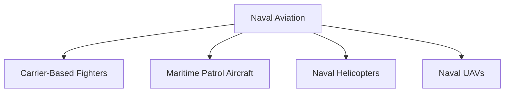
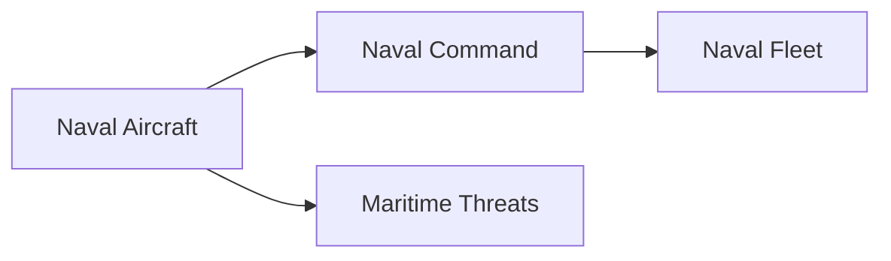
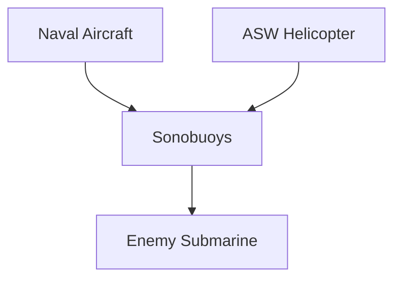

# Naval Aviation

## Why It Matters

Naval Aviation extends the reach of the Indian Navy beyond the horizon by combining air power with maritime operations. It enables surveillance, reconnaissance, anti-submarine warfare, search and rescue operations, fleet defence and maritime strike missions.

For India, naval aviation is essential for securing the Indian Ocean Region, protecting sea lanes, supporting aircraft carrier operations and maintaining maritime domain awareness.

---

## Quick Facts

| Item | Details |
|----------|----------|
| Primary Operator | Indian Navy |
| Main Purpose | Maritime Air Operations |
| Key Capability | Air Power at Sea |
| Strategic Role | Maritime Surveillance and Fleet Support |
| Operational Area | Indian Ocean Region and Beyond |
| Strategic Importance | Maritime Domain Awareness |

---

## What Is Naval Aviation?

Naval Aviation refers to aircraft, helicopters, drones and aviation units operated by a navy to support maritime operations.

It combines air power and naval power to provide surveillance, strike capability, anti-submarine warfare and fleet protection.

---

## Components of Naval Aviation

---

## Why Naval Aviation Is Important

- Extends naval operational reach
- Detects threats beyond the horizon
- Supports aircraft carriers
- Conducts anti-submarine warfare
- Protects naval fleets
- Improves maritime surveillance

---

## Major Naval Aviation Platforms

| Platform | Type | Primary Role |
|----------|----------|----------|
| MiG-29K | Carrier-Based Fighter | Fleet Air Defence |
| P-8I Poseidon | Maritime Patrol Aircraft | Surveillance and ASW |
| MH-60R Seahawk | Naval Helicopter | Anti-Submarine Warfare |
| Kamov Ka-28 | Naval Helicopter | Anti-Submarine Warfare |
| Kamov Ka-31 | AEW Helicopter | Airborne Early Warning |
| Dornier Do-228 | Maritime Patrol Aircraft | Coastal Surveillance |

---

## MiG-29K

### Key Features

- Carrier-based fighter aircraft
- Air defence capability
- Maritime strike capability
- Operates from aircraft carriers

### Importance

Forms the primary fighter component of India's carrier aviation capability.

---

## P-8I Poseidon

### Key Features

- Long-range maritime patrol aircraft
- Advanced surveillance systems
- Anti-submarine warfare capability
- Anti-surface warfare capability

### Importance

One of the most important maritime surveillance platforms operated by India.

---

## MH-60R Seahawk

### Key Features

- Advanced naval helicopter
- Anti-submarine warfare capability
- Anti-surface warfare capability
- Fleet support operations

### Importance

Strengthens India's submarine-hunting capability.

---

## Kamov Helicopters

### Ka-28

Used primarily for:

- Anti-submarine warfare
- Fleet protection
- Maritime patrol

### Ka-31

Used primarily for:

- Airborne early warning
- Fleet air-defence support
- Long-range surveillance

---

## Dornier Do-228

### Key Features

- Maritime reconnaissance aircraft
- Coastal surveillance missions
- Search and rescue operations
- EEZ monitoring

### Importance

Provides regular maritime patrol capability close to India's coastline.

---

## Maritime Surveillance Network

---

## Anti-Submarine Warfare (ASW)

Naval aviation plays a major role in detecting and tracking submarines before they can threaten naval assets.

---

## Aircraft Carriers and Naval Aviation

Aircraft carriers act as floating airbases that allow naval aircraft to operate far from Indian shores.

Together they provide:

- Air superiority
- Fleet defence
- Maritime strike capability
- Long-range surveillance

---

## Strategic Importance for India

Naval aviation helps India:

- Monitor the Indian Ocean Region
- Protect sea lines of communication
- Counter submarine threats
- Support carrier battle groups
- Enhance maritime deterrence

---

## Challenges

- Expanding maritime surveillance requirements
- Growing submarine threats
- High operational costs
- Technology modernization requirements
- Need for greater indigenous capability

---

## Future Roadmap

- Expansion of naval UAV operations
- New carrier-based fighter aircraft
- Improved maritime surveillance systems
- Advanced anti-submarine warfare capability
- Greater indigenous aviation development
- Enhanced network-centric warfare integration

---

## Quick Revision

- Naval aviation combines air power and naval power.
- MiG-29K is India's primary carrier-based fighter.
- P-8I Poseidon is India's premier maritime patrol aircraft.
- MH-60R Seahawk supports anti-submarine warfare.
- Ka-31 provides airborne early warning capability.
- Naval aviation is critical for surveillance and fleet protection.

---

## Key Concepts

### What is naval aviation?

The aviation arm of a navy that operates aircraft and helicopters for maritime missions.

### Why is naval aviation important?

It extends the operational reach of naval forces far beyond the horizon.

### What is the primary maritime patrol aircraft of India?

The P-8I Poseidon.

### What is the role of the MiG-29K?

Carrier-based fleet air defence and strike operations.

### Why is anti-submarine warfare important?

It helps protect naval fleets and maritime interests from underwater threats.