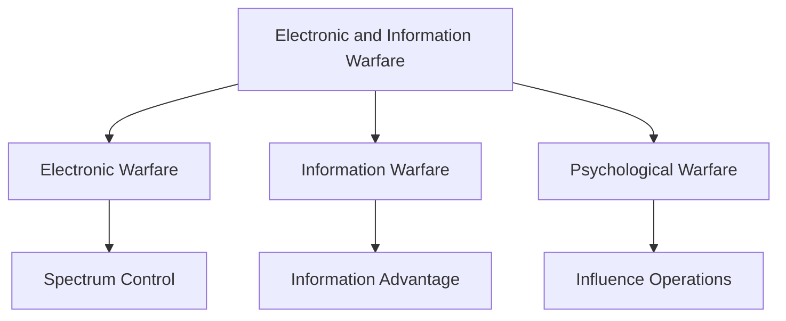

# Electronic and Information Warfare

## Why It Matters

Modern military operations depend heavily on information, communications, sensors, and control of the electromagnetic spectrum.

Electronic and Information Warfare focuses on gaining information superiority, disrupting adversary systems, protecting friendly networks, and influencing decision-making.

Understanding this domain is essential for analysing modern warfare, military technology, strategic communication, and national security.

---

## Learning Objectives

After completing this section, you should understand:

- Electronic Warfare fundamentals
- Information Warfare concepts
- Psychological Warfare techniques
- Information superiority
- Influence operations
- Modern multi-domain warfare

---

## Repository Structure

```text
electronic-and-information-warfare
├── README.md
├── electronic-warfare.md
├── information-warfare.md
└── psychological-warfare.md
```

---

## Learning Path


---

## Domain Overview

### Electronic Warfare

Operations conducted in the electromagnetic spectrum to detect, disrupt, deceive, or protect military systems.

### Information Warfare

Use of information as a strategic tool to gain decision advantage and influence outcomes.

### Psychological Warfare

Influence activities designed to affect perceptions, morale, attitudes, and behaviour.

---

## Electronic and Information Warfare Ecosystem



---

## Relationship with Other Domains

| Domain | Relationship |
| -------- | -------- |
| Cyber Warfare | Cyber and information operations often work together |
| Intelligence | Provides information and targeting support |
| Armed Forces | Uses EW and IW capabilities during operations |
| Space Security | Relies on communication and satellite systems |
| National Security | Supports strategic decision-making and resilience |

---

## Key Concepts

- Information Superiority
- Electromagnetic Spectrum
- Strategic Communication
- Influence Operations
- Perception Management
- Decision Advantage
- Multi-Domain Warfare

---

## Quick Revision

- Electronic Warfare focuses on the electromagnetic spectrum.
- Information Warfare focuses on information advantage.
- Psychological Warfare focuses on influencing behaviour and perceptions.
- All three domains support military and national objectives.
- Information superiority is a critical requirement in modern warfare.

---

## Key Concepts

### Easy

1. What is Electronic Warfare?
2. What is Information Warfare?
3. What is Psychological Warfare?
4. Why is information superiority important?

### Intermediate

1. How does Electronic Warfare support military operations?
2. What is the relationship between Information Warfare and Psychological Warfare?
3. How do influence operations affect national security?
4. Why is the electromagnetic spectrum strategically important?

### Advanced

1. Analyse the role of Electronic and Information Warfare in modern conflicts.
2. Evaluate the importance of information superiority in military doctrine.
3. Explain how Electronic Warfare, Information Warfare, and Cyber Warfare interact.