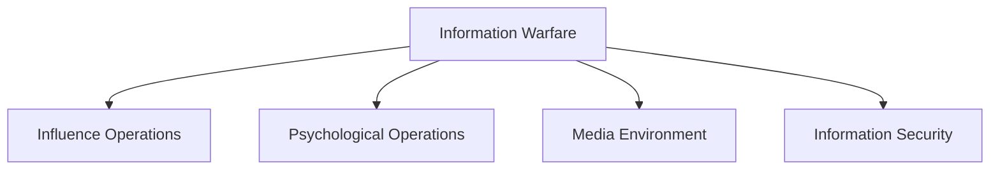

# Information Warfare

## Why It Matters

Information has become a strategic resource in modern conflicts.

Governments, militaries, intelligence agencies and non-state actors increasingly compete to influence perceptions, shape narratives and affect decision-making.

Information Warfare focuses on gaining an advantage in the information environment while protecting one's own information systems and public confidence.

---

## Quick Facts

| Item | Details |
|----------|----------|
| Domain | Intelligence and National Security |
| Operational Area | Information Environment |
| Purpose | Influence, Protect and Control Information |
| Importance | Strategic Decision-Making and Public Perception |
| Users | Governments, Military and Intelligence Agencies |
| Strategic Value | Information Advantage |

---

## What is Information Warfare?

Information Warfare refers to the use of information, communication and influence activities to achieve strategic, political, military or national-security objectives.

It involves protecting friendly information while influencing or disrupting an adversary's ability to make informed decisions.

---

## Evolution of Conflict

---

## Major Components

### Information Operations

Includes:

- Strategic communication
- Narrative management
- Public information activities
- Influence campaigns

### Psychological Operations

Supports:

- Behavioural influence
- Perception management
- Morale-related objectives
- Decision influence

### Counter-Disinformation

Focuses on:

- Identifying false information
- Fact verification
- Narrative defence
- Information resilience

---

## Information Warfare Ecosystem

---

## Role in National Security

Information warfare supports:

- Strategic communication
- Crisis management
- Public confidence
- National resilience
- Decision-making support

---

## Information Warfare and Intelligence

Intelligence organisations help:

- Monitor information environments
- Detect influence operations
- Assess narratives and trends
- Support strategic awareness
- Identify disinformation campaigns

---

## Strategic Importance

Information warfare helps:

- Protect national interests
- Strengthen resilience against influence operations
- Improve strategic communication
- Support national-security objectives
- Enhance information awareness

---

## Challenges

- Rapid information spread
- Social-media amplification
- Disinformation campaigns
- Information overload
- Difficulty in attribution

---

## Future Roadmap

- Better information monitoring
- Improved fact-verification systems
- Enhanced public resilience
- Greater integration with intelligence operations
- Advanced analytics and AI-assisted monitoring

---

## Quick Revision

- Information warfare focuses on the information environment.
- Influence and perception are key elements.
- Disinformation is a major challenge.
- Information warfare supports national-security objectives.
- Intelligence agencies monitor information threats.
- Strategic communication is an important defence tool.

---

## Key Concepts

### What is Information Warfare?

The use of information and influence activities to achieve strategic objectives.

### Why is Information Warfare important?

Information can shape decisions, perceptions and national-security outcomes.

### What is disinformation?

False or misleading information spread deliberately to influence people.

### How does intelligence support information warfare?

By monitoring narratives, identifying threats and supporting decision-making.

### Why is information resilience important?

It helps societies resist manipulation and misinformation.