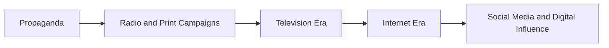
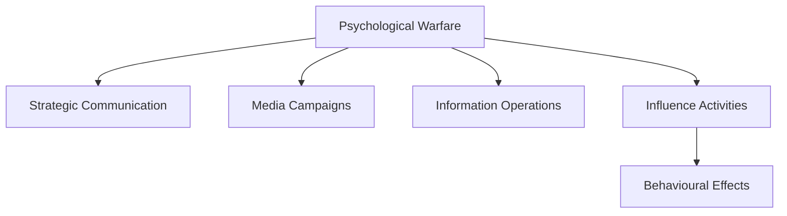

# Psychological Warfare

## Why It Matters

Psychological Warfare (PsyWar) involves the planned use of information, messaging, influence activities, and psychological techniques to affect the perceptions, emotions, attitudes, and behaviour of target audiences.

Modern conflicts are not fought only through military force. Governments, armed forces, and non-state actors also compete in the information domain to influence public opinion, military morale, and decision-making.

Understanding psychological warfare helps explain how information can become a strategic weapon.

---

## Quick Facts

| Item | Details |
| -------- | -------- |
| Domain | Information and Influence Operations |
| Objective | Influence perceptions and behaviour |
| Target Audience | Military personnel, civilians, governments, adversaries |
| Tools | Media, communication campaigns, messaging, information operations |
| Importance | Strategic advantage without direct military force |

---

## What is Psychological Warfare?

Psychological Warfare refers to activities designed to influence how people think, feel, and act in support of political, military, or national objectives.

The goal is often to:

- Reduce enemy morale
- Influence decision-making
- Build support for friendly objectives
- Counter adversary narratives
- Shape public perception

---

## Evolution of Psychological Warfare

---

## Major Components

### Strategic Messaging

Delivering information to influence public opinion and perceptions.

### Propaganda

Information used to influence attitudes and behaviour, often supporting political or military objectives.

### Perception Management

Efforts to shape how events, actions, and policies are understood by audiences.

### Influence Operations

Activities intended to affect decision-making processes and public behaviour.

---

## Psychological Warfare Ecosystem

---

## Role in Modern Warfare

Psychological Warfare supports military and national objectives by:

- Influencing adversary morale
- Supporting military operations
- Strengthening public confidence
- Countering misinformation campaigns
- Shaping international opinion

---

## Challenges

- Misinformation and disinformation
- Social media manipulation
- Deepfake technologies
- Rapid information spread
- Attribution difficulties
- Ethical concerns

---

## India and Psychological Warfare

Important areas include:

- Strategic communication
- Counter-disinformation efforts
- Information resilience
- Public awareness initiatives
- Support for national security objectives

---

## Future Roadmap

- AI-assisted influence analysis
- Advanced disinformation detection
- Improved strategic communication capabilities
- Stronger information resilience frameworks
- Better integration with cyber and information operations

---

## Quick Revision

- Psychological Warfare aims to influence perceptions and behaviour.
- Information can be used as a strategic tool.
- Strategic communication and influence operations are key components.
- Modern PsyWar increasingly uses digital platforms and social media.
- Psychological Warfare supports broader information operations.

---

## Interview Questions

### Easy

1. What is Psychological Warfare?
2. What are the objectives of Psychological Warfare?
3. What is strategic communication?
4. How does Psychological Warfare differ from conventional warfare?

### Intermediate

1. How do influence operations support military objectives?
2. What role does social media play in Psychological Warfare?
3. What challenges arise from digital influence campaigns?
4. How can misinformation affect national security?

### Advanced

1. Analyse the role of Psychological Warfare in modern conflicts.
2. Evaluate the impact of digital platforms on influence operations.
3. Explain the relationship between Psychological Warfare and Information Warfare.
