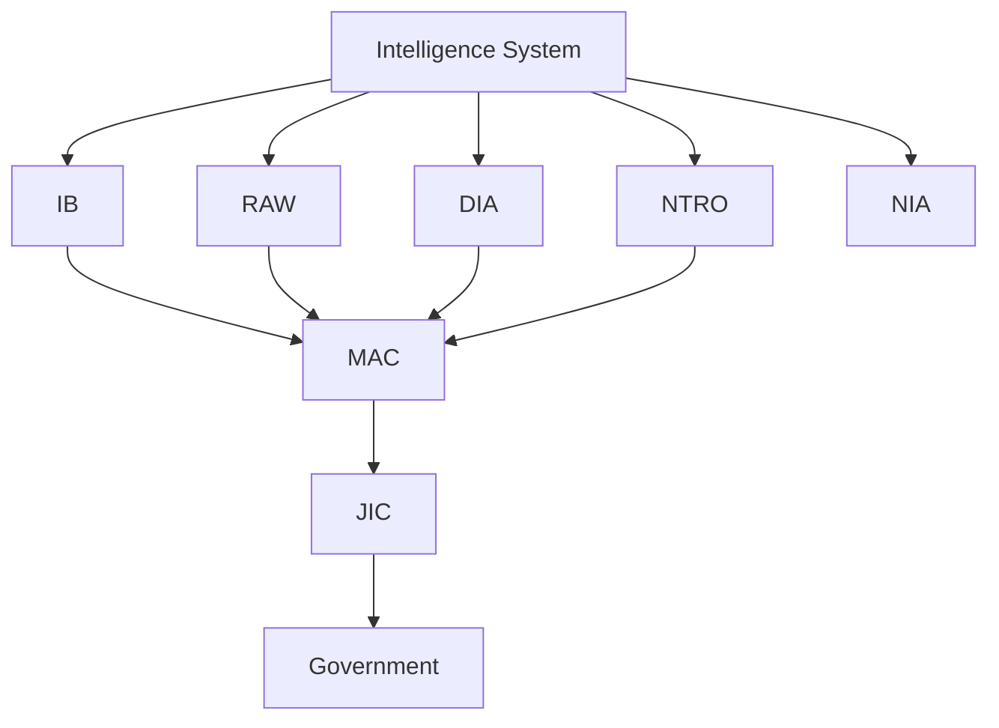
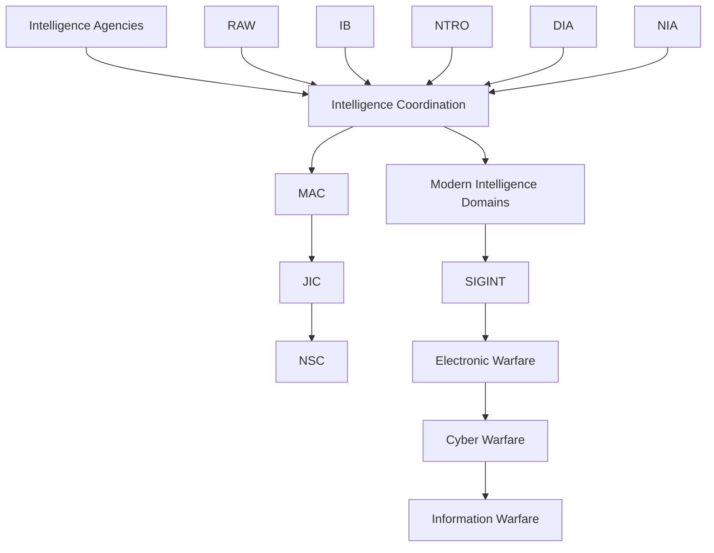
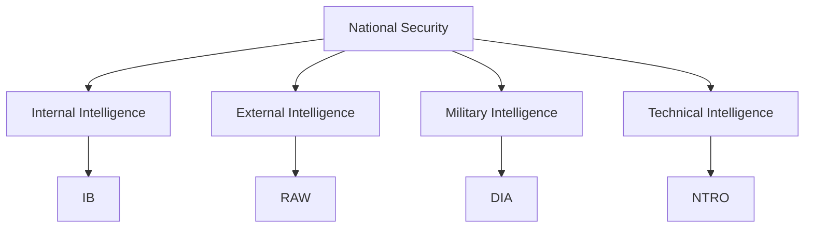
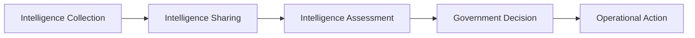
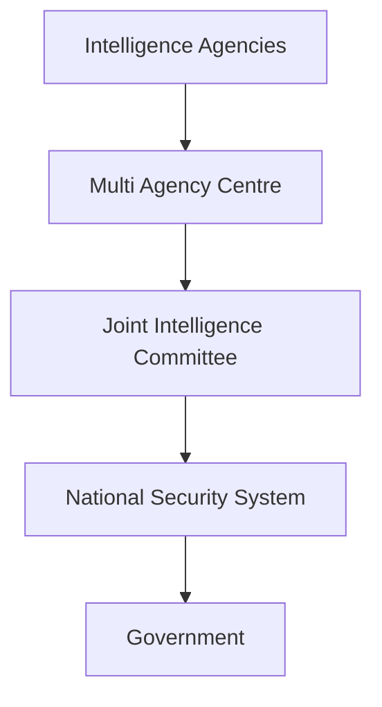

# Intelligence and Security Agencies

## Why It Matters

Intelligence is one of the most important components of national security. Governments require timely and accurate information to identify threats, prevent attacks, support military operations and make strategic decisions.

India's intelligence architecture consists of multiple organizations responsible for internal intelligence, external intelligence, military intelligence, technical intelligence, intelligence coordination and national-security investigations.

Together, these institutions help protect India's sovereignty, territorial integrity and national interests.

---

## Quick Facts

| Item | Details |
|----------|----------|
| Domain | National Security |
| Purpose | Intelligence Collection, Analysis and Coordination |
| Coverage | Internal, External, Military and Technical Intelligence |
| Key Objective | Threat Detection and National Security |
| Major Agencies | IB, RAW, DIA, NTRO, NIA |
| Strategic Importance | National Security Decision-Making |

---

## Intelligence Ecosystem



---

## Learning Roadmap



---

## Major Agencies Overview

| Agency | Primary Responsibility |
|----------|----------|
| Intelligence Bureau (IB) | Internal Intelligence |
| Research and Analysis Wing (RAW) | External Intelligence |
| Defence Intelligence Agency (DIA) | Military Intelligence |
| National Technical Research Organisation (NTRO) | Technical Intelligence |
| National Investigation Agency (NIA) | Counter-Terrorism Investigation |
| Multi Agency Centre (MAC) | Intelligence Sharing |
| Joint Intelligence Committee (JIC) | Intelligence Assessment |

---

## Repository Structure

```text
intelligence/
├── README.md
├── intelligence-agencies/
│   ├── raw.md
│   ├── ib.md
│   ├── ntro.md
│   ├── dia.md
│   └── nia.md
├── intelligence-coordination/
│   ├── intelligence-coordination.md
│   ├── mac.md
│   ├── jic.md
│   └── nsc.md
└── modern-intelligence-domains/
    ├── sigint.md
    ├── electronic-warfare.md
    ├── cyber-warfare.md
    └── information-warfare.md
```

---

## Internal and External Intelligence Structure



---

## Intelligence Coordination Architecture



---

## Agency Roles at a Glance

| Function | Lead Organization |
|----------|----------|
| Internal Intelligence | IB |
| External Intelligence | RAW |
| Military Intelligence | DIA |
| Technical Intelligence | NTRO |
| Intelligence Sharing | MAC |
| Intelligence Assessment | JIC |
| Terrorism Investigation | NIA |

---

## Intelligence Domains

### Intelligence Agencies

Responsible for:

- Intelligence collection
- Intelligence analysis
- Threat monitoring
- National-security support

### Intelligence Coordination

Responsible for:

- Intelligence sharing
- Intelligence assessment
- Strategic coordination
- National-security decision support

### Modern Intelligence Domains

Focus on:

- Signals Intelligence (SIGINT)
- Electronic Warfare (EW)
- Cyber Warfare
- Information Warfare

---

## National Security Decision Flow



---

## Why Intelligence Matters

Intelligence helps India:

- Detect threats early
- Prevent terrorist attacks
- Protect borders
- Support military operations
- Improve strategic planning
- Strengthen national security
- Support crisis management

---

## Challenges

- Terrorism and extremism
- Cyber threats
- Hybrid warfare
- Information overload
- Emerging technologies
- Rapid geopolitical change
- Multi-domain security threats

---

## Future Roadmap

- Greater intelligence integration
- AI-assisted intelligence analysis
- Improved cyber-intelligence capability
- Better inter-agency coordination
- Enhanced technical surveillance systems
- Faster intelligence-sharing mechanisms

---

## Quick Revision

- IB handles internal intelligence.
- RAW handles external intelligence.
- DIA handles military intelligence.
- NTRO handles technical intelligence.
- MAC enables intelligence sharing.
- JIC performs intelligence assessment.
- NIA investigates terrorism-related offences.
- SIGINT focuses on communications and electronic signals.
- Electronic Warfare operates in the electromagnetic spectrum.
- Cyber Warfare targets digital systems and infrastructure.
- Information Warfare focuses on influence and information environments.

---

## Key Concepts

### What is intelligence?

The collection, analysis and use of information related to security and threats.

### Which agency handles internal intelligence?

The Intelligence Bureau (IB).

### Which agency handles external intelligence?

The Research and Analysis Wing (RAW).

### What is MAC?

The Multi Agency Centre responsible for intelligence sharing.

### What is JIC?

The Joint Intelligence Committee responsible for intelligence assessment.

### What is NIA?

India's premier counter-terrorism investigation agency.