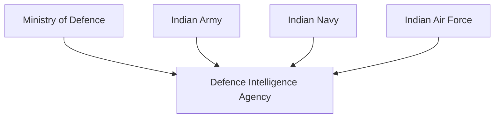

# Defence Intelligence Agency (DIA)

## Why It Matters

The Defence Intelligence Agency (DIA) is India's primary military intelligence organization responsible for coordinating intelligence activities across the Indian Army, Indian Navy and Indian Air Force.

It strengthens joint military intelligence, improves coordination between the armed forces and supports national security decision-making.

---

## Quick Facts

| Item | Details |
|----------|----------|
| Full Name | Defence Intelligence Agency |
| Abbreviation | DIA |
| Established | 2002 |
| Reports To | Ministry of Defence |
| Domain | Military Intelligence |
| Primary Role | Tri-Service Defence Intelligence Coordination |

---

## Background

The Defence Intelligence Agency was established after the Kargil War (1999).

The conflict highlighted the need for better intelligence sharing and coordination among the three armed services.

The Kargil Review Committee recommended improvements in India's defence intelligence structure, leading to the creation of the DIA.

---

## Intelligence Structure

---

## Primary Responsibilities

### Military Intelligence Coordination

- Coordinate intelligence among the three services
- Reduce intelligence gaps
- Improve information sharing
- Support joint operations

### Strategic Intelligence

- Monitor military developments
- Assess external threats
- Support military planning
- Provide intelligence assessments

### Operational Intelligence

- Support military operations
- Assist commanders with intelligence inputs
- Monitor border activities
- Track emerging threats

---

## Why DIA Was Created

Before DIA:

- Intelligence efforts were often service-specific
- Coordination challenges existed
- Intelligence sharing was slower
- Joint operational awareness was limited

After DIA:

- Improved tri-service coordination
- Better intelligence integration
- Enhanced operational planning
- Stronger joint military capability

---

## DIA and National Security

---

## Areas of Focus

The DIA focuses on:

- Border security developments
- Military modernization of neighbouring countries
- Terrorism-related threats
- Strategic military infrastructure
- Regional security developments
- Defence preparedness assessments

---

## Relationship with Other Agencies

| Agency | Primary Role |
|----------|----------|
| DIA | Military Intelligence |
| RAW | External Intelligence |
| Intelligence Bureau (IB) | Internal Intelligence |
| National Technical Research Organisation (NTRO) | Technical Intelligence |

---

## Role During Conflict

During military crises or conflicts, DIA helps:

- Coordinate intelligence assessments
- Support operational planning
- Identify threats and vulnerabilities
- Improve battlefield awareness
- Assist strategic decision-making

---

## Challenges

- Rapidly changing security environment
- Multi-domain warfare
- Cyber threats
- Intelligence integration challenges
- Technological modernization requirements

---

## Future Roadmap

- Greater intelligence integration
- Advanced surveillance technologies
- AI-assisted intelligence analysis
- Improved joint operational awareness
- Enhanced cyber intelligence capability
- Stronger multi-domain intelligence support

---

## Quick Revision

- DIA is India's primary military intelligence coordination agency.
- It was established in 2002 after Kargil War reforms.
- It supports the Army, Navy and Air Force.
- It improves intelligence sharing among the armed forces.
- It focuses on military and strategic intelligence.
- DIA strengthens India's defence preparedness.

---

## Key Concepts

### What is the Defence Intelligence Agency?

India's tri-service military intelligence coordination agency.

### Why was DIA created?

To improve intelligence coordination after lessons learned from the Kargil War.

### Which services work with DIA?

The Indian Army, Indian Navy and Indian Air Force.

### Is DIA the same as RAW?

No. DIA focuses on military intelligence, while RAW focuses on external intelligence.

### Why is DIA important?

It improves military intelligence sharing, planning and operational effectiveness.