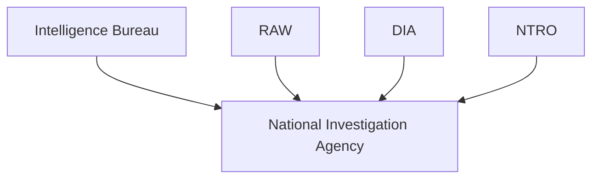
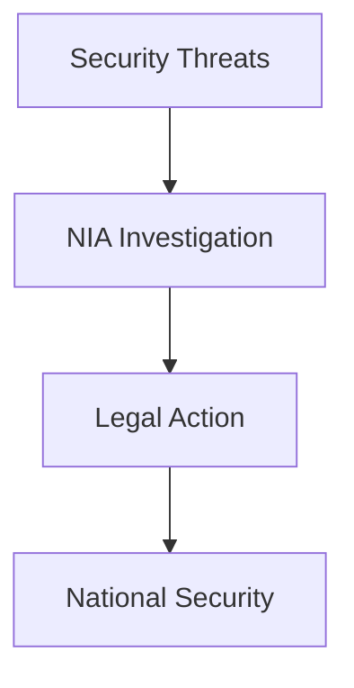

# National Investigation Agency (NIA)

## Why It Matters

The National Investigation Agency (NIA) is India's premier counter-terrorism investigation agency. It is responsible for investigating offences that affect national security, including terrorism, terrorist financing, organized terror networks and other serious security-related crimes.

NIA plays a critical role in protecting India's internal security by conducting professional investigations and coordinating with intelligence and law-enforcement agencies.

---

## Quick Facts

| Item | Details |
|----------|----------|
| Full Name | National Investigation Agency |
| Abbreviation | NIA |
| Established | 2008 |
| Parent Ministry | Ministry of Home Affairs |
| Domain | Counter-Terrorism Investigation |
| Primary Role | National Security Investigations |

---

## What Is the NIA?

The National Investigation Agency is a federal investigative agency responsible for investigating offences that have implications for national security.

Unlike intelligence agencies that collect and assess information, the NIA focuses on criminal investigation, evidence collection, prosecution support and dismantling terrorist networks.

---

## Why NIA Was Created

The NIA was established following the 2008 Mumbai Terror Attacks.

The attacks highlighted the need for a specialized national-level agency capable of investigating terrorism-related offences across state boundaries.

---

## National Security Framework

---

## Primary Responsibilities

### Counter-Terrorism Investigation

- Investigate terrorist incidents
- Identify terror networks
- Support counter-terror operations
- Assist prosecution of terrorism cases

### Terror Financing Investigation

- Investigate funding networks
- Monitor illegal financing activities
- Support disruption of terrorist funding

### National Security Cases

- Investigate major security-related offences
- Support national-security enforcement
- Coordinate with central and state agencies

---

## Major Areas of Investigation

The NIA investigates:

- Terrorism-related offences
- Terror financing
- Organized terror networks
- Cross-border terrorism cases
- National-security offences
- Certain offences under special legislation

---

## Investigation Process

---

## Relationship with Other Agencies

| Agency | Primary Responsibility |
|----------|----------|
| IB | Internal Intelligence |
| RAW | External Intelligence |
| DIA | Military Intelligence |
| NTRO | Technical Intelligence |
| NIA | Terrorism Investigation |
| MAC | Intelligence Sharing |
| JIC | Intelligence Assessment |

---

## NIA vs Intelligence Agencies

| Feature | NIA | Intelligence Agencies |
|----------|----------|----------|
| Primary Function | Investigation | Intelligence Collection and Analysis |
| Focus | Criminal Cases | Threat Information |
| Output | Evidence and Prosecution | Intelligence Assessments |
| Role | Law Enforcement | Intelligence Support |

---

## Role During Major Security Incidents

NIA helps:

- Investigate terrorist attacks
- Collect evidence
- Identify perpetrators
- Coordinate with security agencies
- Support prosecution efforts

---

## Strategic Importance

---

## Challenges

- Evolving terrorism methods
- Cross-border networks
- Cyber-enabled threats
- Complex investigations
- Rapidly changing security environment

---

## Future Roadmap

- Advanced investigation technologies
- Improved digital-forensics capability
- Better inter-agency coordination
- Stronger counter-terror capabilities
- Enhanced international cooperation

---

## Quick Revision

- NIA is India's premier counter-terrorism investigation agency.
- It was established in 2008 after the Mumbai attacks.
- It operates under the Ministry of Home Affairs.
- It investigates terrorism and national-security offences.
- NIA focuses on investigation, evidence and prosecution.
- It works closely with intelligence and security agencies.

---

## Key Concepts

### What is the NIA?

India's primary counter-terrorism investigation agency.

### Why was NIA created?

Following the 2008 Mumbai Terror Attacks.

### What is NIA's primary role?

Investigating terrorism-related and national-security offences.

### How is NIA different from intelligence agencies?

NIA investigates crimes, while intelligence agencies collect and analyze information.

### Why is NIA important?

It strengthens India's ability to investigate and prosecute terrorism-related offences.