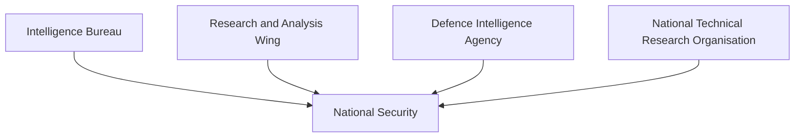
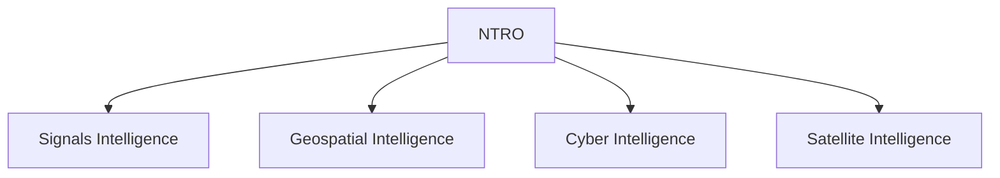

# National Technical Research Organisation (NTRO)

## Why It Matters

The National Technical Research Organisation (NTRO) is India's premier technical intelligence agency. It supports national security through satellite intelligence, cyber intelligence, signals intelligence, geospatial intelligence and advanced technical surveillance.

In the modern era, intelligence is increasingly driven by technology. NTRO helps India monitor threats, support military operations and strengthen national security using advanced technical capabilities.

---

## Quick Facts

| Item | Details |
|----------|----------|
| Full Name | National Technical Research Organisation |
| Abbreviation | NTRO |
| Established | 2004 |
| Reports To | National Security Adviser (NSA) |
| Domain | Technical Intelligence |
| Primary Role | Strategic Technical Intelligence Collection |

---

## What Is NTRO?

NTRO is India's dedicated technical intelligence organization responsible for collecting, processing and analyzing intelligence using advanced technological systems.

Unlike IB, RAW and DIA, which rely significantly on human intelligence and operational networks, NTRO focuses on technology-driven intelligence collection.

---

## Intelligence Ecosystem

---

## Why NTRO Was Created

The growing importance of:

- Satellite surveillance
- Cyber security
- Electronic intelligence
- Advanced communications monitoring
- Technical intelligence collection

created the need for a specialized technical intelligence agency.

NTRO was established to fill this capability gap.

---

## Primary Responsibilities

### Technical Intelligence Collection

- Gather technical intelligence
- Monitor strategic activities
- Support national-security assessments
- Provide intelligence support to government agencies

### Signals Intelligence (SIGINT)

- Monitor electronic communications
- Analyze signals intelligence
- Support strategic threat assessments

### Geospatial Intelligence (GEOINT)

- Satellite imagery analysis
- Mapping and terrain assessment
- Strategic infrastructure monitoring

### Cyber Intelligence

- Monitor cyber threats
- Support cyber-security assessments
- Identify hostile cyber activities

---

## Technical Intelligence Domains

---

## Satellite Intelligence

NTRO uses satellite-based capabilities for:

- Border monitoring
- Infrastructure assessment
- Strategic surveillance
- Disaster monitoring
- Maritime awareness

Satellite intelligence is a critical component of modern national security.

---

## Signals Intelligence (SIGINT)

Signals intelligence involves:

- Electronic signal monitoring
- Communication analysis
- Threat detection
- Intelligence assessment

SIGINT helps identify emerging security risks.

---

## Cyber Intelligence

NTRO contributes to:

- Cyber-threat monitoring
- Digital-security assessment
- Strategic cyber awareness
- National cyber resilience

---

## Relationship with Other Agencies

| Agency | Primary Responsibility |
|----------|----------|
| IB | Internal Intelligence |
| RAW | External Intelligence |
| DIA | Military Intelligence |
| NTRO | Technical Intelligence |
| NIA | Terrorism Investigation |

---

## Intelligence Support Role

---

## Strategic Importance

NTRO helps India:

- Monitor strategic threats
- Strengthen border security
- Improve maritime awareness
- Enhance cyber security
- Support military planning
- Improve intelligence assessments

---

## Challenges

- Rapid technological change
- Cyber warfare threats
- Large-scale data analysis requirements
- Space-security challenges
- Emerging electronic warfare threats

---

## Future Roadmap

- Advanced satellite capabilities
- AI-assisted intelligence analysis
- Stronger cyber-intelligence capability
- Improved geospatial intelligence systems
- Enhanced technical surveillance
- Better multi-agency intelligence integration

---

## Quick Revision

- NTRO is India's primary technical intelligence agency.
- It was established in 2004.
- It focuses on technology-based intelligence collection.
- Major domains include SIGINT, GEOINT and cyber intelligence.
- NTRO supports military and national-security decision-making.
- It strengthens India's technical intelligence capability.

---

## Key Concepts

### What is NTRO?

India's premier technical intelligence organization.

### What is the primary role of NTRO?

Technical intelligence collection and analysis.

### What is SIGINT?

Signals Intelligence derived from electronic communications and signals.

### What is GEOINT?

Geospatial Intelligence derived from maps, imagery and satellite data.

### Why is NTRO important?

It provides advanced technical intelligence that supports national security and strategic decision-making.