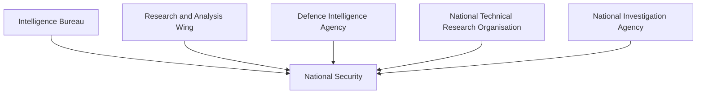
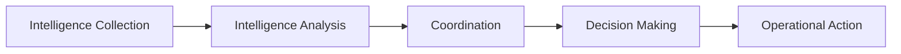

# Intelligence Coordination

## Why It Matters

No single intelligence agency can protect a country alone. Modern national security requires multiple agencies to collect, analyze and share information rapidly.

Intelligence coordination ensures that information gathered by different agencies is combined into a complete picture, helping policymakers and security forces make informed decisions.

For India, intelligence coordination is essential for counter-terrorism, border security, military preparedness and national security.

---

## Quick Facts

| Item | Details |
|----------|----------|
| Domain | National Security |
| Purpose | Intelligence Sharing and Integration |
| Scope | Internal, External, Military and Technical Intelligence |
| Key Objective | Unified Threat Assessment |
| Major Participants | IB, RAW, DIA, NTRO, NIA and Others |
| Strategic Importance | National Security Decision-Making |

---

## What Is Intelligence Coordination?

Intelligence coordination is the process of collecting, sharing, analyzing and integrating intelligence from multiple agencies to create a common operational picture.

---

## Intelligence Ecosystem

---

## Why Coordination Is Important

- Prevent intelligence gaps
- Improve threat detection
- Support counter-terror operations
- Enhance military preparedness
- Strengthen border security
- Improve crisis response

---

## Major Coordination Mechanisms

### Multi Agency Centre (MAC)

The Multi Agency Centre enables intelligence sharing among various security and intelligence organizations.

### Joint Intelligence Committee (JIC)

The Joint Intelligence Committee analyzes intelligence inputs and supports strategic assessments.

### National Security Council Secretariat (NSCS)

Provides policy support and coordination for national-security matters.

---

## Intelligence Flow

---

## Internal and External Intelligence

| Domain | Lead Agency |
|----------|----------|
| Internal Intelligence | Intelligence Bureau (IB) |
| External Intelligence | RAW |
| Military Intelligence | DIA |
| Technical Intelligence | NTRO |
| Terror Investigation | NIA |

---

## Intelligence During Crisis Situations

During major security events:

- Agencies share intelligence rapidly
- Threat assessments are updated continuously
- Security forces receive operational inputs
- Government receives strategic assessments
- Response actions are coordinated

---

## Challenges

- Large volumes of intelligence data
- Rapidly evolving threats
- Cyber security risks
- Multi-domain warfare
- Real-time coordination requirements

---

## Future Roadmap

- Better intelligence integration
- AI-assisted analysis
- Advanced data-sharing platforms
- Improved cyber-intelligence capability
- Faster inter-agency coordination
- Enhanced real-time situational awareness

---

## Quick Revision

- Intelligence coordination integrates information from multiple agencies.
- IB handles internal intelligence.
- RAW handles external intelligence.
- DIA handles military intelligence.
- NTRO handles technical intelligence.
- Coordination reduces intelligence gaps and improves national security.

---

## Key Concepts

### What is intelligence coordination?

The sharing and integration of intelligence among multiple agencies.

### Why is intelligence coordination important?

It helps create a complete understanding of threats.

### What is MAC?

The Multi Agency Centre for intelligence sharing.

### What is JIC?

The Joint Intelligence Committee that supports intelligence assessment.

### What is the goal of intelligence coordination?

To improve national security through better intelligence sharing and decision-making.