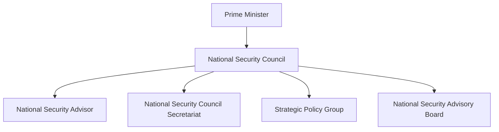

# National Security Council (NSC)

## Why It Matters

The National Security Council (NSC) is India's highest institutional mechanism for coordinating national-security policy.

It assists the Prime Minister and the Government of India in addressing security challenges related to defence, foreign policy, internal security, intelligence, cyber security, economic security and strategic affairs.

The NSC helps ensure that decisions are made using coordinated inputs from military, intelligence, diplomatic and security institutions.

---

## Quick Facts

| Item | Details |
|----------|----------|
| Full Name | National Security Council |
| Abbreviation | NSC |
| Established | 1998 |
| Chairperson | Prime Minister of India |
| Domain | National Security Policy |
| Primary Role | Strategic Security Coordination |

---

## What Is the National Security Council?

The National Security Council is the apex body responsible for advising and coordinating national-security matters.

It provides a structured framework through which security-related information, intelligence assessments and strategic recommendations reach the highest levels of government.

---

## National Security Architecture

---

## Why the NSC Was Created

Before the NSC:

- Security decisions were often handled through separate ministries
- Strategic coordination was limited
- Intelligence and policy integration was slower

After the NSC:

- Better strategic planning
- Improved inter-agency coordination
- Stronger intelligence integration
- More structured national-security decision-making

---

## Main Responsibilities

### Strategic Assessment

- Assess national-security threats
- Evaluate regional developments
- Review strategic risks
- Support long-term planning

### Policy Coordination

- Coordinate security policies
- Integrate intelligence inputs
- Support crisis management
- Facilitate inter-agency cooperation

### National Security Planning

- Defence planning
- Internal security planning
- Foreign policy coordination
- Emerging technology assessment

---

## Components of the NSC System

### National Security Advisor (NSA)

The NSA is the principal security adviser to the Prime Minister.

Responsibilities include:

- Strategic advice
- Security coordination
- Intelligence integration
- Crisis management support

### National Security Council Secretariat (NSCS)

The NSCS supports the functioning of the National Security Council.

Responsibilities include:

- Policy analysis
- Security coordination
- Strategic assessments
- Administrative support

### Strategic Policy Group (SPG)

The SPG supports:

- Strategic planning
- Security reviews
- Inter-ministerial coordination
- Long-term policy formulation

### National Security Advisory Board (NSAB)

The NSAB consists of experts from:

- Defence
- Foreign policy
- Intelligence
- Science and technology
- Strategic affairs

It provides external expert advice.

---

## Decision-Making Flow

---

## Areas of Focus

The NSC examines:

- Defence and military affairs
- Border security
- Counter-terrorism
- Cyber security
- Maritime security
- Space security
- Strategic technologies
- Foreign policy challenges

---

## Relationship with Other Agencies

| Institution | Primary Responsibility |
|----------|----------|
| NSC | National Security Coordination |
| IB | Internal Intelligence |
| RAW | External Intelligence |
| DIA | Military Intelligence |
| NTRO | Technical Intelligence |
| NIA | Terrorism Investigation |

---

## Role During National Crises

During major security events, the NSC helps:

- Review intelligence assessments
- Coordinate government response
- Support strategic decision-making
- Integrate military and civilian inputs
- Monitor evolving threats

---

## Challenges

- Rapid technological change
- Cyber threats
- Multi-domain warfare
- Regional security instability
- Information overload
- Complex strategic environment

---

## Future Roadmap

- Greater intelligence integration
- Advanced strategic analysis capability
- Enhanced cyber-security coordination
- Stronger technology-security assessments
- Improved multi-domain planning
- Faster crisis-response mechanisms

---

## Quick Revision

- NSC is India's highest national-security coordination body.
- It was established in 1998.
- The Prime Minister chairs the NSC.
- The NSA is the principal security adviser.
- The NSCS supports NSC operations.
- The NSC integrates intelligence, defence and foreign-policy inputs.

---

## Key Concepts

### What is the National Security Council?

India's apex institution for national-security coordination and strategic policy.

### Who chairs the NSC?

The Prime Minister of India.

### What is the role of the NSA?

To advise the Prime Minister on national-security matters.

### What is the NSCS?

The National Security Council Secretariat that supports NSC functions.

### Why is the NSC important?

It coordinates intelligence, defence and security decision-making at the highest level.