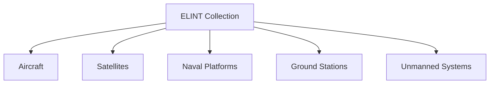

# Electronic Intelligence (ELINT)

## Why It Matters

Electronic Intelligence (ELINT) is the collection and analysis of non-communication electronic emissions generated by military systems.

Modern armed forces rely heavily on radars, missile guidance systems, air-defence networks, sensors, and electronic warfare platforms. Monitoring these emissions provides valuable intelligence about an adversary's capabilities, deployments, readiness, and intentions.

Understanding ELINT is essential for studying intelligence operations, electronic warfare, air defence, and modern military technology.

---

## Quick Facts

| Item | Details |
| -------- | -------- |
| Full Form | Electronic Intelligence |
| Intelligence Category | SIGINT Sub-discipline |
| Focus | Non-communication electronic emissions |
| Major Sources | Radars, sensors, missile systems |
| Users | Armed Forces and Intelligence Agencies |
| Importance | Battlefield awareness and threat assessment |

---

## What is ELINT?

ELINT focuses on collecting and analysing electronic signals that are not used for communication.

These signals help identify:

- Radar locations
- Air defence systems
- Missile guidance networks
- Surveillance platforms
- Electronic warfare systems

---

## ELINT Collection Process

---

## Major Sources of ELINT

### Radar Systems

Air-defence, surveillance, naval, and battlefield radars emit electronic signals that can be analysed.

### Missile Guidance Systems

Missile tracking and targeting systems generate electronic signatures.

### Electronic Warfare Systems

Jammers and electronic support measures provide valuable intelligence information.

### Air Defence Networks

Integrated air-defence systems reveal operational capabilities through their emissions.

---

## ELINT Platforms

---

## Military Applications

- Air defence monitoring
- Threat identification
- Target development
- Electronic order of battle creation
- Strategic intelligence collection
- Mission planning support

---

## ELINT vs COMINT

| Feature | ELINT | COMINT |
| -------- | -------- | -------- |
| Focus | Electronic emissions | Communication signals |
| Sources | Radars and sensors | Voice and data communications |
| Objective | Technical intelligence | Communication intelligence |
| Usage | Threat analysis | Information gathering |

---

## Challenges

- Advanced low-observable systems
- Frequency-hopping technologies
- Electronic deception measures
- Signal congestion
- Rapid technological evolution

---

## India and ELINT

ELINT supports:

- Air defence operations
- Border surveillance
- Maritime domain awareness
- Strategic intelligence collection
- Electronic warfare preparedness

Organizations such as intelligence agencies, defence organizations, and the armed forces use ELINT capabilities to strengthen national security.

---

## Future Roadmap

- AI-assisted signal analysis
- Advanced electronic surveillance systems
- Improved multi-domain intelligence integration
- Greater use of satellites and unmanned platforms
- Real-time intelligence processing

---

## Quick Revision

- ELINT collects non-communication electronic emissions.
- Major targets include radars and missile systems.
- ELINT is a sub-discipline of SIGINT.
- ELINT supports threat assessment and military planning.
- Electronic warfare and ELINT are closely related.

---

## Key Concepts

### Easy

1. What is ELINT?
2. What types of signals are collected under ELINT?
3. How is ELINT different from COMINT?
4. Why are radar emissions important?

### Intermediate

1. How does ELINT support military operations?
2. What are the major sources of ELINT?
3. Explain the ELINT collection process.
4. How does ELINT contribute to air defence?

### Advanced

1. Analyse the role of ELINT in modern warfare.
2. Evaluate the relationship between ELINT and Electronic Warfare.
3. Explain how ELINT supports intelligence superiority.