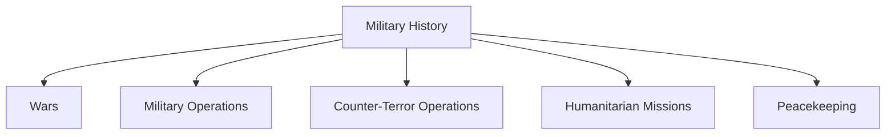

# Military History

## Why It Matters

Military history helps explain how India developed its defence capabilities, military doctrine, strategic thinking and national-security framework.

By studying wars, military operations, humanitarian missions and peacekeeping efforts, we can understand how the Indian Armed Forces evolved from independence to the present day.

---

## Quick Facts

| Item | Details |
|----------|----------|
| Domain | Military History |
| Coverage | Wars, Operations, Peacekeeping and Humanitarian Missions |
| Timeline | 1947–Present |
| Participants | Army, Navy, Air Force and Joint Forces |
| Importance | National Security and Strategic Learning |
| Strategic Value | Defence Doctrine Development |

---

## Repository Structure

```text
military-history
├── wars
│   ├── 1947-48-war.md
│   ├── 1962-war.md
│   ├── 1965-war.md
│   ├── 1971-war.md
│   └── 1999-kargil-war.md
│
├── military-operations
│   ├── operation-meghdoot.md
│   ├── operation-cactus.md
│   ├── operation-parakram.md
│   └── operation-sindoor.md
│
├── counter-terror-operations
│   ├── surgical-strikes-2016.md
│   └── balakot-air-strike.md
│
├── humanitarian-evacuation-missions
│   ├── operation-maitri.md
│   ├── operation-rahat.md
│   ├── operation-devi-shakti.md
│   └── operation-ganga.md
│
└── peacekeeping
    └── un-peacekeeping-missions.md
```

---

## Military History Timeline


---

## Learning Roadmap



---

## Military History Categories

### Wars

- 1947-48 Indo-Pak War
- 1962 Sino-Indian War
- 1965 Indo-Pak War
- 1971 Indo-Pak War
- Kargil War (1999)

### Military Operations

- Operation Meghdoot
- Operation Cactus
- Operation Parakram
- Operation Sindoor

### Counter-Terror Operations

- Surgical Strikes (2016)
- Balakot Air Strike (2019)

### Humanitarian and Evacuation Missions

- Operation Maitri
- Operation Rahat
- Operation Devi Shakti
- Operation Ganga

### Peacekeeping

- UN Peacekeeping Missions

---

## Major Wars

### Post-Independence Wars

| Conflict | Significance |
|-----------|-------------|
| 1947-48 Indo-Pak War | First war after independence and accession of Jammu and Kashmir |
| 1962 Sino-Indian War | Exposed defence weaknesses and triggered military reforms |
| 1965 Indo-Pak War | Demonstrated India's military recovery after 1962 |
| 1971 Indo-Pak War | Led to the creation of Bangladesh |
| Kargil War (1999) | High-altitude conflict resulting in Indian victory |


---

## Humanitarian and Evacuation Missions

India has increasingly used military and diplomatic capabilities for humanitarian assistance and evacuation operations.

Key examples include:

- Operation Rahat
- Operation Maitri
- Operation Devi Shakti
- Operation Ganga

These missions demonstrate India's ability to protect citizens and assist friendly nations during crises.

---

## UN Peacekeeping Contributions

India is one of the largest contributors to United Nations peacekeeping operations.

Indian personnel have participated in missions across Africa, Asia and other regions, supporting international peace and stability.

---

## Evolution of Military Doctrine


India's military doctrine has evolved through operational experience, technological modernization and changing security challenges.

---

## Key Themes

- National Security
- Strategic Deterrence
- Military Preparedness
- Joint Operations
- Counter-Terrorism
- Humanitarian Assistance
- International Peacekeeping
- Crisis Response

---

## Quick Revision

- 1947-48: First Indo-Pak War over Jammu and Kashmir.
- 1961: Goa Liberation.
- 1962: Sino-Indian War with China.
- 1965: Second Indo-Pak War.
- 1971: Bangladesh Liberation War and creation of Bangladesh.
- 1984: Operation Meghdoot secured key Siachen positions.
- 1988: Operation Cactus in Maldives.
- 1999: Kargil War and Operation Vijay.
- 2001-02: Operation Parakram military mobilization.
- 2016: Surgical Strikes across the LoC.
- 2019: Balakot Air Strike.
- 2025: Operation Sindoor.

---

## Key Concepts

### Why study military history?

Military history provides lessons about strategy, leadership, logistics, intelligence and national security.

### Why are wars and military operations studied separately?

Wars are large-scale armed conflicts between states, while military operations are focused missions conducted to achieve specific strategic or tactical objectives. Studying them separately helps understand different levels of military planning and execution.

### Why is the 1971 war important?

It resulted in the creation of Bangladesh and remains one of India's most significant military victories.

### Why are the 1962 and 1965 wars important?

The 1962 war exposed critical defence weaknesses, while the 1965 war demonstrated India's military recovery and operational improvements. These conflicts shaped future defence reforms and military planning.

### Why is Operation Meghdoot important?

It secured key positions in the Siachen region and established India's presence on the Saltoro Ridge.

### Why are Surgical Strikes, Balakot and Sindoor important?

They represent the evolution of India's modern counter-terrorism and precision-response doctrine.

### Why are humanitarian missions important?

They demonstrate India's ability to provide assistance, evacuation support and disaster relief during crises.