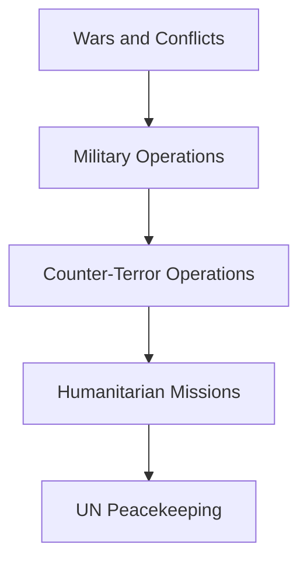

# Military History

## Why It Matters

Military history helps explain how India developed its defence capabilities, military doctrine, strategic thinking and national-security framework.

By studying wars, military operations, humanitarian missions and peacekeeping efforts, we can understand how the Indian Armed Forces evolved from independence to the present day.

---

## Quick Facts

| Item | Details |
|----------|----------|
| Domain | Military History |
| Coverage | Wars, Operations, Peacekeeping and Humanitarian Missions |
| Timeline | 1947–Present |
| Participants | Army, Navy, Air Force and Joint Forces |
| Importance | National Security and Strategic Learning |
| Strategic Value | Defence Doctrine Development |

---

## Military History Timeline

---

## Learning Roadmap

---

## Major Military Operations

### Historical Operations

- Operation Meghdoot
- Operation Cactus
- Operation Parakram

### Modern Counter-Terror Operations

- Surgical Strikes (2016)
- Balakot Air Strike (2019)
- Operation Sindoor (2025)

---

## Humanitarian and Evacuation Missions

India has increasingly used military and diplomatic capabilities for humanitarian assistance and evacuation operations.

Key examples include:

- Operation Rahat
- Operation Maitri
- Operation Devi Shakti
- Operation Ganga

These missions demonstrate India's ability to protect citizens and assist friendly nations during crises.

---

## UN Peacekeeping Contributions

India is one of the largest contributors to United Nations peacekeeping operations.

Indian personnel have participated in missions across Africa, Asia and other regions, supporting international peace and stability.

---

## Evolution of Military Doctrine

India's military doctrine has evolved through operational experience, technological modernization and changing security challenges.

---

## Key Themes

- National Security
- Strategic Deterrence
- Military Preparedness
- Joint Operations
- Counter-Terrorism
- Humanitarian Assistance
- International Peacekeeping
- Crisis Response

---

## Quick Revision

- 1947–48: First Indo-Pak War.
- 1961: Goa Liberation.
- 1962: Sino-Indian War.
- 1965: Indo-Pak War.
- 1971: Bangladesh Liberation War.
- 1984: Operation Meghdoot.
- 1988: Operation Cactus.
- 1999: Kargil War.
- 2001–02: Operation Parakram.
- 2016: Surgical Strikes.
- 2019: Balakot Air Strike.
- 2025: Operation Sindoor.

---

## Key Concepts

### Why study military history?

Military history provides lessons about strategy, leadership, logistics, intelligence and national security.

### Why is the 1971 war important?

It resulted in the creation of Bangladesh and remains one of India's most significant military victories.

### Why is Operation Meghdoot important?

It secured key positions in the Siachen region and established India's presence on the Saltoro Ridge.

### Why are Surgical Strikes, Balakot and Sindoor important?

They represent the evolution of India's modern counter-terrorism and precision-response doctrine.

### Why are humanitarian missions important?

They demonstrate India's ability to provide assistance, evacuation support and disaster relief during crises.